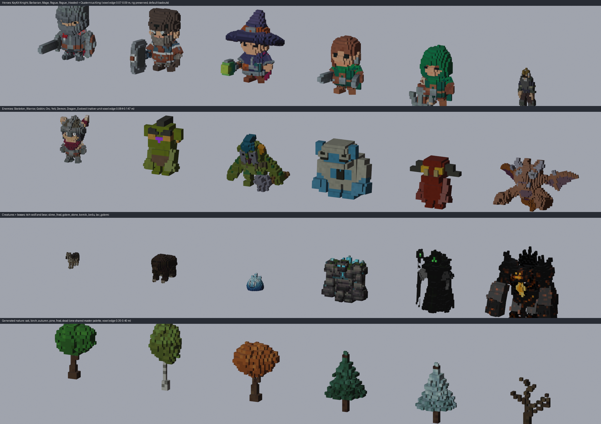

# EFSUN ONLINE: Voxel-PSX art direction, asset audit and conversion pipeline

Status: art-direction spec with a **working, validated prototype** (2026-10-13). Written by the art director; implemented by Haiku coders (work packages in section 4).
Request that triggered it (Turkish, paraphrased): *"some trees look different, make everything PSX and consistent, make models and textures yourself if needed; I do not like the character models, make them PSX square / voxel style; everything should look better."*

Everything marked **measured** comes from the prototype in `docs/voxel/` run on the real files in `public/assets/models/` (Windows 11, Python 3.11 + numpy 2.4 + Pillow 12, Blender 5.2.2 LTS, three.js r186 through the dev server). Nothing in `src/` or `tools/` was edited to produce this document.



*Rows: five KayKit heroes + Quaternius King / six enemies / creatures and bosses / generated trees. All rows are real output of `docs/voxel/voxelize_glb.py` and `docs/voxel/gen_nature.py`, rendered with Blender workbench (no PSX post pass). The framing of the sheet crops a few heads; it is a review aid, not final art.*

---

## 0. TL;DR (decisions)

1. **Style = "Voxel-PSX"**: every *model* (heroes, NPCs, enemies, bosses, weapons, props, trees, buildings) is built from axis-aligned cubes, flat-lit, with a tiny nearest-filtered **palette texture** (colours snapped to RGB555), then crushed by the existing PSX post pass (320x180..640x360 virtual pixels, 5-bit colour, Bayer dither, vertex snap). Terrain and the modular dungeon shell stay smooth (section 1.7).
2. **Characters are not redrawn, they are voxelised from the existing rigs.** The converter reads the original GLB, evaluates the skinning in the rest pose, voxelises in world space, and writes the voxel faces back **in the original skinning space, with rigid single-bone weights**. Skins, joints, node names, node hierarchy, node transforms and **all animation clips are copied untouched** (76 / 95 / 14 / 8 clips preserved, measured). Accessory toggles (`1H_Sword`, `Round_Shield`, `Knight_Helmet`, `Skeleton_*_Cloak`, ...) keep working because node names are identical.
3. **The Blender `Remesh(BLOCKS)` + Data Transfer route requested in the brief was tried and rejected** (section 3.0): KayKit body parts are open meshes (350..1086 boundary edges per part) and the modifier produced ragged, partly missing shells, drops UVs and weights, uses a separate grid per object, and a bare Blender import/export round trip already changes node order, TRS and clip durations (up to 1 frame). The replacement is a **GLB-to-GLB Python/numpy voxeliser** (no Blender in the loop; Blender 5.2 is used only for contact sheets). It converts the whole skinned library (57 files) in well under a minute and ~600 static files in about a minute.
4. **Voxel edge by class** (in-game metres): heroes and humanoids 0.09 (24-26 voxels tall), small swarm creatures 0.06, big elites 0.14, bosses 0.14-0.18, weapons 0.06, props about 1/14 of their longest side (0.06-0.40), trees 0.32-0.40, buildings 0.25-0.5. Floor: **never below 0.06 m** (that is 2.1 virtual px at the default camera).
5. **One canonical nature set, generated by script**: 24 trees + 5 bushes + rocks + tufts + flowers + mushrooms + cacti + logs (`gen_nature.py`, 48 GLBs, 144..2932 tris, one shared master palette image so seasons are a texture swap). It replaces ten incompatible tree sources (retro cards, KayKit hex, KayKit Halloween, Kenney x4 kits, Blender-gen, nocturnal pine). This is the direct fix for "some trees look different".
6. **Triangle budgets (visible, measured)**: hero 3.8k..7.5k, medium creature median 4.0k, small median 3.2k, large median 6.2k (max 9.4k Dragon_Evolved), trees 0.4k..2.9k, props median 1.2k..1.5k (p90 2.4k), buildings median 2.7k (castle 11k).
7. **The game switches assets through one URL remap** resolved inside `Assets.load/instantiate` (section 4.2). Voxel files mirror the source path under `public/assets/models/voxel/`, keep the **same basename** (code keys on `Orc.glb`, `lid`, `Glow`, `glass`, ...), and a setting / `?voxel=0` flips back to the originals for A/B.
8. **Order of work**: prototype Knight (3 variants) + `tree_oak_l1` + `tree_pine_l1` and **stop for the user's review** (WP1), then heroes/skeletons/weapons, then monsters/bosses, then nature, props, buildings, polish.

### Prototype parameters (the ones the brief asked for)

| What | Value |
|---|---|
| Knight, game voxel edge | **0.09 m** (`--cell 0.09`, native units = game units because the player model runs at scale 1): 26 voxels for the 2.31 m body, 27 with the helmet crest |
| Equivalent Blender Remesh BLOCKS (only for reference, rejected) | `mode='BLOCKS'`, `octree_depth=4`, `scale = maxdim / (0.09 * 2**4)`: Body 0.636, Head 0.755, Arm 0.486, Leg 0.365 (measured law: `cell = maxdim / (scale * 2**depth)`; depth 4 is the smallest that keeps `scale <= 0.99` for the largest part, the Head at 1.087 m) |
| Weights | `--weights rigid` (one dominant bone per voxel, cubes never shear); `blend` (top 4 bones) only for slimes, ooze, ghost, wraith |
| Toggleable parts | `--overlay '(Helmet\|Hat\|Hood)$'` (own solid so "hide helmet" shows a full head) |
| Worn vs held accessories | `--global-acc '^(head\|chest\|spine\|hips\|neck)'` joins the world grid; hand items get their own local grid with `cell / worldScale` |
| Palette | 24 colours (max-min seeded k-means, snapped to RGB555) x 4 shade rows (0.88 / 1.00 / 1.08 / 1.00 linear-light), PNG 32x4, NEAREST |
| Per-voxel variation | deterministic hash: 12.5 % dark row, 12.5 % light row, 75 % base row |
| Conservative SAT, grid | box scale 1.0, bias 1e-3 cell, x/z voxel centres on 0 (symmetric), y boundary on 0 (feet on the floor) |
| Knight result | 4175 shell voxels, 5278 faces (10.6k tris counting the 5 hidden accessories), **6460 visible tris** (original: about 5.3k), 3.8 MB (animations are 3.4 MB of it; `glbopt.py` takes it to 2.3 MB) |
| A/B variants to show the user (measured visible tris) | A `head=1.0` **6460**; B `--scale-bone '^head$=0.85'` (less chibi) **5534**; C `--cell 0.075` (finer) **9350**; A without `--overlay` 5020 |
| Trees for the review | `tree_oak_l1` (cell 0.40, 6.8 m, 1.7k tris), `tree_pine_l1` (cell 0.35, 7.7 m, 2.4k tris) |

### What was validated (so the coders do not have to guess)

* 57 skinned GLBs (5 KayKit heroes, 4 skeletons, 19 Quaternius monsters, 2 Quaternius NPCs, 12 + 6 Blender-generated creatures and bosses, 11 itch creatures, 2 bestiary) converted without failure; node / joint / clip / material-name contracts pass `docs/voxel/validate_voxel_glb.py` on every one tried.
* In **real three.js r186** (through the project's dev server): voxel and original AABBs of the *skinned* meshes agree within about 1.5 voxels over `Running_A`, `2H_Melee_Attack_Spin`, `Death_B`, `Idle` (Knight), `Punch`, `Run`, `Death` (Orc), `Fast_Flying`, `Headbutt` (Dragon_Evolved). `psx-demo.html?model=...&anim=...` plays the voxel Knight with the PSX post pass.
* Conservative greedy meshing (merging coplanar same-colour quads, with T-junction-safe perimeter fans) saves only **1..28 %** here: rejected (also it would reintroduce cracks under vertex snapping). Per-voxel quads with their own four vertices are crack-free by construction.
* Static props, hex-pack buildings, Kenney / itch kits, weapons, massifs: 600+ files converted, median 0.4k..2.7k tris (Appendix B).

---

## 1. Style guide "Voxel-PSX"

### 1.1 The look in one paragraph

Chunky cubes you can count, flat-shaded so each cube shows three tones (top lighter, sides mid, underside dark), colours taken from the original art but snapped to a small palette, a touch of per-cube value noise so big surfaces are not dead flat, hard edges with no bevel, no outline, no baked shadows on animated models. The PSX post pass then does what it already does: renders at a virtual resolution, jitters vertices to that grid, quantises to 15-bit colour with a 4x4 Bayer dither. Voxels are the *shape language*, the post pass is the *era language*; neither is allowed to fight the other.

### 1.2 Grid and shape rules (apply to every voxel asset)

* **Axis-aligned in the rest pose.** Characters are voxelised in the rest-pose world frame of the skin (glTF `world = sum(w * W_joint * IBM) * p`; the mesh node transform cancels, verified on the Quaternius cm / Z-up rigs). Static props are voxelised in the file's world frame. Held items use their own node-local frame so a blade stays aligned with its own axis.
* **Grid origin.** x and z: voxel *centres* on 0 (a model that is symmetric about its centre plane stays symmetric, odd widths give a nose column). y: voxel *boundary* on 0, so soles are on the floor. A 1e-3-cell positive bias makes faces lying exactly on a boundary belong to the voxel above, so nothing sinks one layer below y = 0 (measured: without it the Knight stood 0.09 m under the floor).
* **Conservative coverage.** A voxel is solid if any triangle touches it (triangle-box SAT, box scale 1.0), then the interior is filled by a 6-connected flood fill from outside. This is hole-free even on the open KayKit meshes. Cost: shapes inflate about 0.3-0.5 voxel; `--shrink 0.8` slims by ~9 % but leaks on thin parts, `< 0.75` is unsafe.
* **Faces.** Only faces between solid and exterior are emitted, each quad with its **own 4 vertices** (counter-clockwise from outside). No shared vertices means vertex snapping can never open cracks. No NORMAL attribute is written: three.js then renders with `flatShading` automatically, which is exactly the three-tone voxel look and is correct under skinning.
* **Rigid skinning.** Every voxel follows exactly one bone (the one with the largest barycentric weight of its nearest source triangle). Cubes translate and rotate with their bone and never shear; seams show as small steps at joints, which is the accepted voxel-animation look. `blend` mode (top 4 bones, `p = inv(sum w*M) q`) is reserved for blobs and cloth-like bodies.
* **Eyes.** Eye / glow parts win any voxel they touch and the voxels directly in front of them (+Z, up to 2) are cleared, so glowing eyes always show (without this the skeleton eyes were 1 face). Eye materials keep their original name (`Glow`, `Eye_White`, `Eye_Black`) and stay **flat, palette-less primitives** so `Enemy.styleMaterials` still skips tint / applies `eyeEmissive`.
* **Toggleable parts** (helmets, hats, hoods, cloaks) are voxelised against **their own solid** inside the same grid (`--overlay`). The body underneath is complete, so "Kaskı gizle", helm items and `hide: ['Skeleton_Minion_Cloak']` show a full head / body. Overlay faces that look into the body are dropped; body faces inside overlay cells are inset 2 % to avoid z-fighting. Measured cost: +29 % on the Knight's visible tris (6.46k with `--overlay` vs 5.02k without).
* **No bevel, no outline, no AO baked into skinned meshes, no per-vertex colour.** Optional (unvalidated, statics only): 3-level corner AO in vertex colour (1.0 / 0.85 / 0.72).
* **Proportion lever (optional, A/B with the user).** `--scale-bone '^head$=0.85'` scales everything owned by a bone around that bone's origin *before* voxelising. Because the output is mapped back through the inverse skin matrix, animation is unaffected. Head 0.8-0.85 makes the KayKit chibi read as a small voxel person; 1.0 keeps the original silhouette.

### 1.3 Voxel size by asset class

`game cell` = voxel edge in metres as the player sees it. The converter takes the edge in the **file's own units**: `native_cell = game_cell / in_game_scale` (enemy defs scale the same GLB differently: Orc 0.9..1.65, rhino 0.42..0.95; pick the median, other uses simply get proportionally bigger or smaller cubes).

| Class | Typical size | Game cell | Voxels along height / longest side | Visible tris budget | Measured |
|---|---|---:|---|---:|---|
| Hero, humanoid NPC, humanoid enemy | 2.0-2.8 m | **0.09** | 24-28 | hero <= 7.6k, other <= 6k | Knight 6.5k, Barbarian 5.7k, Mage 7.5k, Rogue 3.8k, Rogue_Hooded 4.2k, skeletons 3.4k-6.0k, King / Worker 1.8k |
| Small creatures, swarm trash | < 1.6 m | **0.06-0.075** | 14-20 | <= 3.6k | median 3.2k (rat 2.3k, wolf 2.4k, slime 3.4k, wasp 1.3k) |
| Medium creatures | 1.6-3.0 m | 0.09-0.11 | 18-27 | <= 6k | median 4.0k (bear 5.7k, rhino 6.1k, spider 6.2k) |
| Large elites | 3-5 m | **0.14** | 22-34 | <= 8.5k | median 6.2k |
| Bosses, dragons | > 5 m | 0.14-0.18 (max 0.22) | 28-39 | <= 9.5k | 5.0k..9.4k |
| Weapons, shields, tools | 0.3-2.4 m | **0.06** (daggers, wands 0.04) | ~30 along the blade | <= 1.5k (shields <= 3k) | gen sword_2h_demon 1.1k at 0.05 |
| Props (barrels, chests, furniture, banners) | 0.5-4 m | `longest / 14`, clamp 0.06-0.40 | ~14 | median 1.2-1.5k, p90 2.4k, <= 3.5k | Appendix B |
| Trees (generated) | 5.5-9 m | 0.32-0.40 | 17-26 | <= 3k | 0.44k (dead) .. 2.93k (pine_l2) |
| Bushes / rocks / tufts (generated) | 0.3-6 m | 0.09-0.45 | 8-14 | bush 0.5k, rock <= 1.2k, tuft 0.25k | `gen_nature.py` manifest |
| Buildings, walls, massifs | 6-40 m | 0.25-0.5 (hex pack native 1/6 of that) | 14-20 | median 2.7k, <= 6k, castle 11k | Appendix B |

**Why 0.06 is the floor, 0.09 is the hero:** at the default camera (distance 9 m, FOV 60 degrees) a metre is `virtualRows / (2 * d * tan 30)` virtual pixels:

| Camera distance | 1080p, pixelScale 3 (640x360) | 720p, pixelScale 3 (427x240) |
|---|---:|---:|
| 3 m (menu / close zoom) | 104 px/m: hero voxel 9.4 px | 69 px/m: 6.2 px |
| **9 m (default)** | 34.6 px/m: hero voxel **3.1 px**, 0.06 voxel 2.1 px | 23.1 px/m: 2.1 px / 1.4 px |
| 18 m (max zoom out) | 17.3 px/m: 1.6 px | 11.5 px/m: 1.0 px |
| 30 m (tree at the horizon) | 10.4 px/m: 0.40 tree voxel **4.2 px** | 6.9 px/m: 2.8 px |

Rule: at the default zoom a voxel must be >= 2 virtual px (so it is *seen* as a cube), hence 0.06 m minimum for anything that is looked at from 9 m or more. Big things get chunkier cubes automatically, which doubles as free LOD.

### 1.4 Colour

* **Source colour of a voxel** = colour of the *nearest source triangle* to the voxel centre: `texture(uv at the closest point) x baseColorFactor x COLOR_0 (if present)`, computed in linear light and converted back. Flat-colour materials (Quaternius) use the factor. `alphaMode MASK` voxels whose alpha is under the cutoff are dropped (alpha-card foliage becomes voxel leaves). Painted textures (itch creatures, Blender gen) use `--blur 1` (3x3 box filter on the source texture) so the pixel-art dither is not sampled as noise; swatch textures (KayKit, Quaternius) use `--blur 0` so swatch borders do not bleed.
* **Palette per model** ("MAIN"): all non-special voxels are quantised to **24** colours with max-min seeding (outliers such as eyes, gems, a red cape get their own entry before frequent colours are averaged), 14 weighted Lloyd iterations, each entry **snapped to RGB555**. The image is `pow2(N) x 4` (32x4 for 24 colours), 8-bit RGBA PNG, sampler NEAREST / NEAREST, clamp. A face's UV is the centre of one texel, all four vertices identical, so the texture derivative is zero, mip level is always 0, and `psxify`'s mipmap / downscale / 5-bit pass changes nothing.
* **Shade rows.** Rows 0..3 of the palette image are the same colours multiplied (in linear light) by `0.88, 1.00, 1.08, 1.00`. A deterministic hash of the voxel index picks row 0 (12.5 %), row 2 (12.5 %), else row 1. Result: broad surfaces get a subtle speckle that survives the 4x4 Bayer pass; `--no-variation` makes everything row 1 (use for big flat architecture).
* **Special groups keep their own material** (name, `doubleSided`, `alphaMode`, `emissiveFactor`, extensions such as `KHR_materials_emissive_strength` are copied from the source material):
  * flat eye / glow / tongue / teeth materials with no texture: copied through untouched, UV-less primitive;
  * **textured emissive** materials (every Blender-gen creature, boss and prop): own 16-colour palette image **plus an emissive palette image with the same layout** (average emissive colour per palette entry), so runes, lava cracks, crystals still glow and bloom;
  * `BLEND` materials (wraith robe, itch ooze): own palette with the material's mean alpha baked into the PNG alpha channel, `alphaMode BLEND` kept.
* **Master palette for generated statics** (`gen_nature.py`): 21 colour ramps x 8 shades = 168 colours in one 8x21 PNG (bark, birch, leaf, leaf_olive, leaf_pine, leaf_spruce, leaf_autumn, leaf_gold, leaf_frost, leaf_dead, rock, rock_red, sand, moss, flowers, grass, cactus, cap_red, cap_tan). Every nature GLB uses it, so (a) all vegetation shares one material and one texture (instancing / merging friendly), (b) a season or biome swap is a texture swap with the same layout (e.g. `voxel_master_winter.png`), (c) adding a ramp is appending a row.
* **Class colour variants and tints keep working.** `CharacterModel.recolorTexture` recolours *any* image per pixel by HSV rules (skin / leather hues 8-40 degrees protected, steel < 0.16 saturation tinted, trim hue 41-66 shifted); a 32x4 palette is simply a very small image. `Enemy.styleMaterials` multiplies `material.color` (palette material) and skips eye / tongue / teeth materials; they remain separate. Acceptance test in WP2: all 6 variants of all 5 classes in the character-select screen, no pure black / white palette.

### 1.5 Lighting and the PSX post pass

* Materials: `MeshStandardMaterial`, metalness 0, roughness 1 (already written by the converter), flat shading by missing normals. Do not add normal maps, env maps or vertex colours to voxel assets.
* Three tones per cube come from the existing hemisphere + directional light. Keep the darkest face (underside / back) at **>= 45 %** of the lit top face luminance; if a scene's ambient is too low the voxel faces collapse into a black silhouette (the bosses are already dark purple / black: `kemik_lordu` palette is `(33,24,57)`; check them in the dungeon light, not in the Blender sheet).
* Shadows: voxel models cast blocky shadows with the existing shadow setup. No change.
* Bloom: emissive groups (eyes, runes, crystals, lava) are what should pass the dungeon threshold (0.92); bright whites (bone, frost ramp tops, snow) can touch it exactly as the current assets do, so check them in WP9.
* PSX settings: **unchanged defaults** (`psxPixelScale 3`, `psxColorDepth 5`, dither on, jitter on). Voxel quads have 4 private vertices, so the jitter wobbles faces as units but opens no cracks. At pixelScale 4 hero voxels fall to 2.3 px at 9 m: acceptable, but do not go below 0.08 for heroes if that preset is promoted.
* Textures: `psxify('character')` (<= 128 px, 5 bit, no mips) and `psxify('world')` (mips on, <= 512) are both harmless for 32x4 / 8x21 palettes because every UV is a texel centre.
* No outline pass, no extra post effect. Sprites and particles: prefer square sprites with nearest sampling for new VFX (round soft sprites break the cube language); damage numbers and HUD stay HTML.

### 1.6 Per-voxel colour noise, dither and edge treatment, summarised

| Item | Rule |
|---|---|
| Colour noise | 3 value rows (0.88 / 1.00 / 1.08), 12.5 / 75 / 12.5 %, hash of the voxel index (stable between runs and peers) |
| Dither | none baked; the Bayer pass supplies it |
| Edges | hard; no bevel, no outline, no AO on skinned models |
| Top-face highlight (nature generator only) | the topmost leaf voxel of a column is one shade lighter |
| Underside | not darkened by the converter; the light rig does it |

### 1.7 What stays smooth and what becomes voxel

| Becomes voxel | Stays smooth (PSX textured, vertex snapped) |
|---|---|
| player classes, NPCs, skeletons, monsters, bosses | **terrain** and ground splat (PSX tiny textures, 2-4 m quads) |
| held / worn items, shields, quivers | **dungeon shell**: floors, walls, stairs, pillars, arches (`dungeon/floor_*`, `wall_*`, `stairs_*`, `pillar*`, `barrier*`) |
| dungeon props (barrels, crates, chests, tables, candles, banners, torches, shelves) | skyboxes, sky domes, fog |
| furniture, halloween props, gen props (anvil, forge, well, tent, stall, statues, crystals, altar ...) | VFX sprites, HUD, damage numbers |
| **all trees, bushes, rocks, tufts, flowers, mushrooms, cacti, logs** (canonical generated set) | alpha-card effects: `flame`, `fire_fx`, portal surface, liquid |
| town buildings, kit walls / roofs, massifs, clouds, windmills, towers | |
| code-built proc entities (`ai/procModels.ts`, 8 builders) | |

Rationale for the smooth side: voxelising flat architecture adds triangles and no read (measured: a KayKit 4x4 wall is 2.99k tris at 0.25 m and 0.57k at 0.5 m; the original is a single low-poly mesh) and tile seams are the first thing the eye checks. The shell is harmonised instead: re-quantise its single atlas to the master palette and keep NEAREST + 5 bit (WP9, optional). A coarse voxel shell (0.5 m, 0.57k tris per 4x4 wall, measured) is an optional WP10 *after* the user has seen WP1-WP4 in the dungeon.

---

## 2. Audit: every asset family in use and its consistency problem

Counts are files under `public/assets/models/`. "Used by code" comes from a scan of `src/` (helpers `gp() hw() fu() kg() ks() kf() kc() kn() tw() ip()`, `MON() CHAR() SKEL() GEN() GENB() ITCH() GRAVE()` and literals). Decision verbs: **voxelise** (rig-preserving where skinned), **replace** (one consistent source), **generate** (new, scripted), **keep**.

### 2.1 Families

| # | Family (files) | Look / problem | Used by code | Decision |
|---|---|---|---|---|
| 1 | KayKit Adventurers `characters/` (5; 76 clips, 41-bone shared rig) | smooth chibi low-poly, 1024 swatch atlas; the "character models I do not like" | players, NPCs, 20+ human enemy defs | **voxelise**, rig-preserving, cell 0.09, `--overlay` helmets / hats, optional head 0.85 |
| 2 | KayKit Skeletons `enemies/` (4; 95 clips) | same rig, glowing `Glow` eyes, separate Helmet / Hat / Hood / Cloak / Jaw parts | skeleton packs, summoned dead | **voxelise**, `--overlay '(Helmet\|Hat\|Hood\|Cloak)$'`, eye carving |
| 3 | Quaternius monsters `monsters/` (19; flat colours, cm / Z-up rigs, 14 clips) | smooth, 1-8 flat colours, FBX2glTF PBR muddy | ~35 enemy defs including 5-6 bosses | **voxelise**; cell by in-game scale; Eye_* materials stay flat |
| 4 | Quaternius NPCs `npcs/` King, Worker (11k / 5k tris, realistic proportions) | style mismatch with chibi, today "special roles only" | NPC.ts | **voxelise** (cell 0.07 native = 0.09 game, 1.8k tris) so they match; keep for special roles |
| 5 | itch Fantasy Creatures `itch/creatures/` (11) + Bestiary imp, puglin (2) | smooth, painted 256 px textures, realistic | open-world fauna (wolf, warg, bear, rhino, deer, spider, wasp, ooze, centipede), goblin-pig | **voxelise**, `--blur 1`, ooze with `blend` weights and BLEND palette |
| 6 | Blender-generated creatures `gen/creatures/` (12) and bosses `gen/bosses/` (6) | low-poly with 64-128 px pixel-art atlases, vertex AO, emissive textures; closest to the target but still smooth shapes | dungeon trash, 6 bosses | **voxelise**, `--blur 1`, emissive palette groups, `blend` for slimes / wraith |
| 7 | Kenney Graveyard characters `kenney/graveyard-kit/character-*.glb` (keeper, vampire used, scale x3) | smooth | 2 enemy defs | **voxelise**, game cell 0.1 (native 0.033), ~5k tris |
| 8 | Weapons: KayKit `weapons/*.gltf` (49 incl. `skeleton/`), gen `gen/weapons/` (37), itch `fantasy-weapons-bits/` (31) | three smooth styles, `.gltf` + `.bin` for KayKit | item visuals, skeleton loadouts, NPC props | **voxelise** all at 0.06, keep grip origin and axis (local grid), output `.glb` (remap handles `.gltf`) |
| 9 | **Trees (10 sources)**: itch retro tree pack (36 trees + 8 bushes, **alpha cards** 52 tris, 8 m), itch retro nature pack (32 trees + 57 bushes + 48 grass, x4 seasons, crossed cards), Blender gen `gen/props/tree_*` (6 + bushes), KayKit Halloween `tree_dead_*`, `tree_pine_orange/yellow_*` (10 files with the dead ones), KayKit hex nature (`tree_single_*`, `trees_A/B_*` clusters, `hills_*_trees`), Kenney nature-kit (61 tree files), Kenney survival (8), Kenney fantasy-town (5), Kenney graveyard `pine*`, `trunk*`, nocturnal `pine_tree` | five modelling styles, two scales (cards 8 m, hex x6 tabletop, Kenney x4), alpha cards read as flat quads with dark backing in the lineup, colour palettes disagree | open-world regions r1-r6, border tree walls, town yards, hex gate groves, dungeon outdoor shells | **generate one canonical set (section 2.2) and remap every tree-like URL to it**; never voxelise the card trees |
| 10 | Rocks, bushes, tufts, flowers, mushrooms, cacti, logs: gen `rock_*`, `bush_*`, `grass_tuft`, `flowers`; Kenney nature (60 rocks, 56 cliffs, 6 bushes, 8 plants, 9 flowers, 6 grass, 6 mushrooms, 7 stumps, 5 logs); hex `rock_single_A-E`; retro grass / bushes | same problem as trees | scenery scatter | **generate** (canonical set) for rocks / bushes / tufts / flowers / mushrooms / cacti / logs / stumps; **voxelise** Kenney `cliff_*` at 0.5 and `crops_*` at 0.15 (farm specials) |
| 11 | KayKit hex Medieval pack `town/` (181; x6 tabletop, one 1024 atlas; buildings x4 factions, props, `tiles/`, `nature/` incl. hills, mountains, clouds) | tabletop miniature look, scale x6 | hub town buildings (`scale: 6`), wall + gate with door leaves, props, massifs | buildings / props / massifs / clouds: **voxelise** (game cell 0.4-0.5 for buildings, 0.9-1.2 for massifs); `tiles/` stay (ground); gate door nodes `wall_straight_gate_door_left/right` kept |
| 12 | Kenney fantasy-town (167, x4), castle (76, x4), survival (80, x3), graveyard props (91, x3) | smooth, external `Textures/colormap.png` | stalls, windmill, walls, tents, gravestones, crypts | **voxelise** referenced pieces (script follows `colormap` URIs); batch the packs |
| 13 | itch PSX Going Medieval `psx-medieval/` (193), PSX Dungeon `psx-dungeon/` (43), Nocturnal Watch `nocturnal-watch/` (55), PSX walls and fences (79) | already PSX-textured, but modular blocks / roofs at 4-5 m | villages, market, tavern | **voxelise** props and market goods (median 0.4k tris); blocks / roofs at game cell 0.3 only where visible; walls and fences at 0.25 |
| 14 | KayKit Dungeon `dungeon/` (203), Halloween `halloween/` (63), Furniture `furniture/` (53) | one atlas per pack, smooth | dungeon builder, graveyard, interiors | **props: voxelise** (dungeon ~90, halloween ~55, furniture 53); **shell: keep** (`floor_*`, `wall_*`, `stairs_*`, `pillar*`, `barrier*`, `rubble*`) |
| 15 | Blender-generated props `gen/props/` (59: chests with `Open` clip, forge, anvil, well, portal, obelisk, waypoint, banners, brazier, campfire, tent, statues, crystals, gravestones) | pixel-textured low-poly, named animated sub-nodes, emissive materials | everywhere (about 370 references) | **voxelise** static, keep animated nodes (`lid`, `rune_ring`, `shards`, `obelisk_crystal`, `slot_1..5`, `waypoint_crystal`, `teleport_ring`, `cloth`, `bucket`, `door`, `wheel_*`, `liquid`, `portal_surface`) as separate local-grid nodes; keep cards (`flame`) through |
| 16 | Code-built proc entities `ai/procModels.ts` (8 builders: phylactery, soul_orb, bone_cage, ice_tomb, ice_pillar, explosive_orb, metin_stone, rift) and small primitives in VFX / Sky | Lambert spheres / cylinders / octahedra | mechanic entities | **replace** the 8 builders with voxel box clusters (WP8); leave sky / VFX primitives |
| 17 | Terrain, skies, ground textures (`textures/itch/*`, `sky/itch/*`) | PSX tiny textures, panoramas | everywhere | **keep** |
| 18 | `itch/ual/UAL_clips.glb` | animation library, not rendered | none found | **keep** (do not convert) |

### 2.2 The canonical nature set (the single tree / rock / bush family)

Generated by `docs/voxel/gen_nature.py` into `public/assets/models/voxel/nature/<id>.glb`, origin at the trunk / base centre on y = 0, +Z front, one material `voxel_master` (shared palette), sampler NEAREST. Sizes and triangle counts below are **measured** from the prototype run (seeded, reproducible); native heights were chosen to match the sources they replace so call-site scales (`tree(url, ..., 0.95..3.0)` in `WorldScenery`, `1.5..2.3` in `OutdoorBuilder`) keep producing the same on-screen sizes.

| Id | Cell | Size W x H x D (m) | Tris | Replaces (size-compatible, within +-25 % of height) |
|---|---:|---|---:|---|
| `tree_oak_m1` / `m2` | 0.35 | 3.9 x 5.6 x 4.2 / 4.2 x 6.0 x 4.2 | 1264 / 1444 | `gen/props/tree_oak_a`, `tree_oak_b`, Kenney `tree_oak`, `tree_default`, `tree_fat` |
| `tree_oak_l1` / `l2` / `l3` | 0.40 | 4.8 x 6.8 x 4.8 / 5.2 x 7.6 x 5.6 / 6.0 x 8.4 x 6.4 | 1656 / 1956 / 2588 | retro tree pack broadleaf `tree02, 13, 15-25, 27`, nature pack `treeNN_spring / summer` broadleaf |
| `tree_olive_l1` | 0.40 | 5.2 x 7.2 x 5.6 | 1888 | retro olive broadleaf `tree18, 19, 26` |
| `tree_birch_m1` / `l1` | 0.35 / 0.40 | 3.9 x 7.0 x 3.5 / 4.4 x 8.8 x 4.0 | 1416 / 1440 | retro `tree35, 36`, nature pack pale-bark `tree02_*` |
| `tree_pine_m1` / `m2` | 0.32 | 3.8 x 5.8 x 3.8 / 3.2 x 5.1 x 3.2 | 1580 / 1248 | `gen/props/tree_pine_a`, `tree_pine_b`, Kenney `tree_pineDefault*`, `tree_cone*`, survival `tree`, `tree-tall` |
| `tree_pine_l1` / `l2` / `l3` | 0.35 | 4.9 x 7.7 x 4.9 / 5.6 x 8.4 x 5.6 / 5.6 x 7.0 x 5.6 | 2356 / 2932 / 2872 | retro conifers `tree04, 07, 09-11, 14`, nocturnal `pine_tree` |
| `tree_spruce_l1` / `l2` | 0.35 | 5.6 x 8.1 x 5.6 / 4.2 x 7.4 x 4.2 | 2720 / 1860 | retro dark firs `tree01, 03, 05, 08, 12` |
| `tree_autumn_m1` | 0.35 | 4.2 x 5.6 x 4.2 | 1336 | `gen/props/tree_autumn`, Kenney `*_fall` |
| `tree_autumn_l1` / `l2` (orange / gold) | 0.40 | 5.6 x 7.2 x 4.8 / 5.6 x 8.0 x 5.6 | 1816 / 2268 | retro `tree28-34`, nature pack `treeNN_fall`, Halloween `tree_pine_orange/yellow_*` |
| `tree_frost_l1` / `l2` | 0.35 | 4.9 x 7.7 x 4.9 / 5.6 x 7.0 x 5.6 | 2260 / 2528 | retro frosted `tree06`, nature pack `treeNN_winter` with leaves |
| `tree_dead_m1` / `l1` / `l2` | 0.35 / 0.40 | 3.2 x 4.9 x 2.8 / 4.4 x 7.6 x 3.2 / 4.4 x 8.0 x 5.2 | 444 / 612 / 684 | `gen/props/tree_dead`, Halloween `tree_dead_*`, graveyard `pine-crooked`, hex `*_cut`, nature pack bare winter |
| `tree_dead_frost_l1` | 0.40 | 3.6 x 7.6 x 3.6 | 592 | nature pack winter bare (`tree01_winter`, `tree03_winter`) |
| `bush_1`, `bush_2`, `bush_berry`, `bush_autumn`, `bush_frost` | 0.16 | 1.4 x 0.8 x 1.1 | 480-508 | retro `bush01-08`, nature pack `bush*` (season from suffix), gen `bush_a`, `bush_b`, Kenney bushes / plants |
| `cactus_tall`, `cactus_short` | 0.22 / 0.20 | 2.0 x 3.1 x 0.44 / 1.8 x 1.6 x 0.40 | 364 / 244 | Kenney `cactus_tall`, `cactus_short` |
| `rock_s1`, `rock_s2` | 0.10 | 0.8 x 0.5 x 0.7 / 1.0 x 0.6 x 0.7 | 412 / 544 | `gen/props/rock_small`, Kenney small rocks, survival `rock-*` |
| `rock_m1`, `rock_m2` | 0.18 | 1.4 x 0.9 x 1.3 / 1.6 x 0.9 x 1.6 | 420 / 548 | `gen/props/rock_medium`, hex `rock_single_A-E`, Kenney `rock_smallA-I` |
| `rock_l1`, `rock_l2` | 0.28 | 3.4 x 2.0 x 2.5 / 3.4 x 2.2 x 2.8 | 792 / 960 | `gen/props/rock_large`, Kenney `rock_largeA-F` |
| `rock_xl1` | 0.45 | 5.4 x 3.6 x 5.9 | 1204 | `gen/props/rock_cliff`, Kenney `cliff_block_rock` |
| `rock_tall_1..3` | 0.30 | 1.5 x 3.0-4.5 x 1.5 | 420-620 | Kenney `rock_tallA-F` (desert region r5) |
| `tuft` | 0.09 | 0.45 x 0.54 x 0.45 | 244 | `gen/props/grass_tuft`, retro / Kenney grass |
| `flowers_r`, `flowers_y`, `flowers_p` | 0.10 | 0.5 x 0.6 x 0.3-0.5 | 144-204 | `gen/props/flowers`, Kenney `flower_*` |
| `mushroom_red`, `mushroom_tan` | 0.10 | 1.1 x 0.6 x 0.8 | 500 | Kenney `mushroom_*` (3 caps each) |
| `log` | 0.12 | 1.7 x 0.24 x 0.36 | 304 | Kenney `log`, `log_large`, survival `tree-log*` |

Still to author in WP5 (same generator, new builders, same palette): `stump`, `reeds`, `lily`, `tree_swamp_l1` (drooping dark canopy), `grove_a/b_{s,m,l}` (3 / 5 / 8 trees on one footprint, replaces hex `trees_A_*` / `trees_B_*`, which would cost 9.3k tris if voxelised), `massif_1..4` (stepped hills / mountains 30-80 m at cell 0.9-1.2; or voxelise hex `hills_*` / `mountain_*`: 0.6-1.2k tris at 0.9-1.2 m, measured), `cliff_*`.

**Remap rule for tree-like URLs that are not listed** (so no source family can leak): classify by regex on the URL (`tree|pine|spruce|fir|oak|birch|trunk|palm`) -> species group from the name (`dead|cut|bare` -> dead, `fall|autumn|orange|yellow` -> autumn, `winter|frost|snow` -> frost, `pine|cone|spruce|fir` -> pine / spruce, `birch` -> birch, else oak) -> size class from the source's measured height (>= 7 m L, else M) -> `ids[hash(url) % ids.length]` within that group. The table is generated by `tools/voxel/build_replace.py` (WP5) and committed, so it is deterministic.

### 2.3 Name contract (what the converters must keep, verified by `validate_voxel_glb.py`)

Code addresses these by name; the converter keeps them and the validator fails the file if they change.

* **Nodes (all files):** every node name and the full hierarchy / TRS / skin joint list / clip names and durations (compared exactly).
* **KayKit characters:** `<Class>_Head|Body|ArmLeft|ArmRight|LegLeft|LegRight` (skinned), accessories `1H_Sword`, `1H_Sword_Offhand`, `2H_Sword`, `Round_Shield`, `Badge_Shield`, `Rectangle_Shield`, `Spike_Shield`, `Knight_Helmet`, `Knight_Cape`, `2H_Axe`, `1H_Axe`, `1H_Axe_Offhand`, `Barbarian_Round_Shield`, `Barbarian_Hat`, `Mug`, `2H_Staff`, `1H_Wand`, `Spellbook`, `Spellbook_open`, `Mage_Hat`, `Knife`, `Knife_Offhand`, `1H_Crossbow`, `2H_Crossbow`, `Throwable`, `Rogue_Cape`; bones `handslot.r`, `handslot.l`, `head`, `chest`, `hips`, `root` (the loader strips dots, unchanged).
* **Skeletons:** `Skeleton_*_Eyes`, `_Jaw`, `_Cloak`, `_Helmet`, `_Hat`, `_Hood`, `_Cape`, `_Skull`; material `Glow`.
* **Quaternius / gen creatures:** materials matching `eye|glow|tongue|teeth` (`Eye_White`, `Eye_Black`, `Tongue`, `Teeth`, `*_glow`), emissive / blend materials keep their names.
* **Gen props:** node names `lid`, `rune_ring`, `shards`, `obelisk_crystal`, `slot_1..5`, `waypoint_crystal`, `teleport_ring`, `portal_surface`, `cloth`, `bucket`, `door`, `liquid`, `wheel_*`, `flame`, `light_0`, `fire_fx`, `keystone_socket`, `enter_trigger`, `interact`, `vendor_spot`, `loot_fx`; materials `glass`, `runes`, `crystal` (TownBuilder tames their emissive strength by name; the converter copies `KHR_materials_emissive_strength`).
* **Hex pack:** `wall_straight_gate_door_left`, `wall_straight_gate_door_right` (TownBuilder swings them); KayKit dungeon `wall_doorway` door node, `chest` / `chest_lid`.
* **File basenames** (`Orc.glb`, `Goblin.glb`, `Demon_Lord.glb`, ... key `BARK_PITCH`; `.gltf` -> `.glb` is the only allowed change and the remap handles it).
* **Animation clip names and durations** (impact times in the docs are in seconds).

### 2.4 Explicitly not converted

Terrain meshes and ground textures, dungeon shell pieces (phase 1-9), skies, VFX sprite sheets, HUD / icons (`public/assets/icons`), `UAL_clips.glb`, alpha-card effect nodes (`flame`, `fire_fx`, grass cards inside props), `light_0` / `fire_fx` empties, audio.

---

## 3. Pipeline spec

### 3.0 Decision and evidence: GLB-direct voxeliser instead of Blender Remesh

The brief proposed: duplicate each skinned mesh, `Remesh` modifier `mode='BLOCKS'`, Data Transfer of vertex-group weights and UVs from the original, Armature modifier, export GLB with `export_animation_mode='ACTIONS'`. This was **executed in headless Blender 5.2.2** on `Knight.glb` and measured:

| Finding | Measured |
|---|---|
| Cell size law | `cell = maxdim / (scale * 2**octree_depth)`. Body (maxdim 0.916): depth 4 / scale 0.5 -> 0.1146; depth 4 / 0.9 -> 0.0637; depth 5 / 0.9 -> 0.0318; depth 7 / 0.99 -> 0.0072. `scale` max is 0.99. For a target cell: smallest depth with `maxdim / (cell * 2**depth) <= 0.99`, then `scale = maxdim / (cell * 2**depth)`. |
| Input meshes are open | boundary edges: ArmLeft 350, ArmRight 350, Body **1086**, Head 456, LegLeft 360, LegRight 360 (every part is non-manifold) |
| Result quality | ragged, partly missing shells; the torso and head came out as irregular slabs with holes (see section 3.7 for how to reproduce) |
| One grid per object | each body part gets its own grid origin and, unless `scale` is tuned per part, its own cell size; neighbouring parts do not tile |
| Data lost by the modifier | UVs (0 layers after), vertex-group weights (names stay on the object, data gone). Data Transfer then needs the destination UV layer created first (`mesh.uv_layers.new`) or nothing transfers (observed `uv []`); pre-creating vertex groups on a duplicate gives **82 groups** (41 x 2) because `Object.copy()` already copies the names |
| UV interpolation on block faces | `POLYINTERP_NEAREST` interpolates *between* corners that may sit in different palette swatches: colours smear across a block (analysis; flat per-face UV collapse would be needed) |
| Round trip alone (import then `export_scene.gltf`, `export_animation_mode='ACTIONS'`, `export_force_sampling=True`, no edits) | all 57 node names and 41 joints survive, but node order, node TRS and the joint order are rewritten and clip durations move by up to one frame (`1H_Melee_Attack_Chop` 1.067 s -> 1.042 s, `1H_Melee_Attack_Stab` 1.6 -> 1.583). Impact times in `docs/assets/characters.md` are tuned to the original durations. |
| Blender import quirks that bite previews | a stray `Icosphere` object (bone shape) appears; the 76 actions import as separate actions and a second import of the same file names them `.001`, so `bpy.data.actions.get('Idle')` returns the *first* rig's action, which makes the second rig sit in rest pose unless you assign `rig.animation_data.action` explicitly per rig |

The replacement keeps the original file as the source of truth:

* **No Blender import/export.** The converter parses the GLB (and `.gltf` + side files, embedding images), computes the rest pose from the node tree + skin, voxelises with numpy, and writes a new GLB where **only mesh primitives, materials, textures, images, accessors, buffer views** are rebuilt. Everything else in the JSON (nodes, skins, animations, scenes, extras, samplers) is copied verbatim and animation accessors are re-packed byte-for-byte.
* Output positions are expressed in the original skinning space, so the unchanged inverse bind matrices and clips drive the voxel meshes exactly: for a voxel vertex `q` (rest-pose world) owned by one bone, `p_out = inv(W_joint * IBM) * q`; for blended voxels `p_out = inv(sum_j w_j * W_j * IBM_j) * q`.

### 3.1 Reference tooling (delivered, runnable)

| File | Role |
|---|---|
| `docs/voxel/voxelize_glb.py` | the converter (about 560 lines, system Python + numpy + Pillow, run with `python -I`) |
| `docs/voxel/gen_nature.py` | procedural nature set with master palette (`python -I gen_nature.py OUT [id ...]`, writes `manifest.json`) |
| `docs/voxel/validate_voxel_glb.py` | drop-in contract check (`python -I validate_voxel_glb.py ORIG VOX [--max-tris N] [--max-kb N]`, exit code 0 = pass) |

WP0 copies them to `tools/voxel/` (keep the file names: `gen_nature.py` and the validator import `voxelize_glb`). Disk note: the machine this was written on was **at 100 % disk** (C: 442 GB used, a few hundred MB free); a full run writes about 120-150 MB, so free at least 1 GB first and delete scratch outputs between runs.

### 3.2 (a) Rigged characters, creatures, bosses (skinned meshes)

Exact steps of `convert()` (flags in brackets):

1. **Parse** the GLB (`read_any`: `.glb`, or `.gltf` with `.bin` and image files, or a GLB whose images are external `uri`s such as Kenney `Textures/colormap.png`; all embedded into one buffer).
2. **Rest pose**: `W[i]` = global node matrix from the node TRS / matrix; for each skin `Mj[k] = W[joints[k]] @ IBM[k]`. **World rest position of a skinned vertex** = `(sum_k w_k * Mj[J_k]) @ [p, 1]`. Do not multiply by the mesh node's matrix (three.js and the glTF spec cancel it; doing so over-scaled Quaternius models by 10^4 in the first attempt).
3. **Proportion lever** (`--scale-bone RE=f`): vertices whose dominant joint matches `RE` are scaled by `f` around that joint's rest origin (`W[joint][:3,3]`); applied to worn accessories hanging from that bone as well.
4. **Spaces.** *World space*: all skinned parts plus rigid accessories whose parent bone matches `--global-acc` (default `^(head|chest|spine|hips|neck)`), gathered as world-space triangles and given `fixed_joint` = that bone. Toggleable parts matching `--overlay` become **separate sub-spaces on the same grid** (grid corner and dims computed once from the union bbox). *Local spaces*: every other rigid node (held items) is voxelised in its own local frame with `cell / |W[node][:3,0]|` so the cube size in the world stays `cell`.
5. **Voxelise** (`voxelize`): `V += 1e-3 * cell` (half-open boxes), candidate voxel ranges from each triangle's AABB (abort above 40 M candidate pairs: raise `--cell`), conservative separating-axis test with box half-size `cell / 2 * shrink` in chunks of 400 k pairs.
6. **Per shell voxel**: choose the **nearest source triangle** to the voxel centre (`bary_closest`, barycentric clamped to the triangle); triangles of flat / emissive materials get their distance multiplied by 0.05 so eyes and glow parts win.
7. **Attributes** from that triangle: colour (texture at barycentric UV, nearest texel, `--blur` pre-filter; x `baseColorFactor`; x `COLOR_0`), emissive colour (emissive texture), alpha (MASK cutoff drops the voxel; BLEND keeps alpha), material group, owner part (node), bone weights accumulated over the three vertices x barycentric weights: dominant joint (`rigid`) or top 4 renormalised (`blend`); `fixed_joint` overrides for worn accessories.
8. **Solid** = complement of the 6-connected exterior flood fill from the padded corner of the shell mask; overlays use their own solid; **eye sockets**: for voxels whose material or node name matches `eye`, clear up to 2 non-semantic solid voxels in front (+Z).
9. **Faces**: for each of the 6 directions emit quads where `solid & ~solid(shifted)` and the voxel has a record. Counter-clockwise vertex order from outside; overlay faces that look into the base solid are dropped; base faces in overlay cells move 2 % of a cell inward. Statics drop the `-Y` faces of the lowest voxel layer (`--no-cull-bottom` to keep).
10. **Skin write-back** per quad: skinned parts `p_out = inv(sum w*Mj) @ q` with `JOINTS_0` (uint16) / `WEIGHTS_0` (float, `[1,0,0,0]` for rigid); worn accessories `p_out = inv(W[node]) @ q`, no skin; local spaces `p_out = q`.
11. **Palette / materials** (section 1.4), **rebuild GLB**: new float32 `POSITION`, float32 `TEXCOORD_0` (not for flat groups), indices uint16 (uint32 above 65535 vertices), no `NORMAL`, no `COLOR_0`; materials named after the main source material (`knight_texture`) or the source emissive / blend material; samplers NEAREST; unused accessors, buffer views, textures, images dropped; `extensionsRequired` removed; emptied nodes keep one degenerate triangle so the node name survives.
12. **Validate** (section 3.6) and write a per-file report (`--report out.json`: voxels, faces, tris, colours per group, tris per node, seconds, bytes).

### 3.3 (b) Static props, trees, buildings (no rig)

Same engine with `--static`:

* Every non-animated mesh node joins **one world grid** (adjoining parts tile, hidden internal faces cull). Output keeps the node structure: each node's voxels are written in **its own local space** (`inv(W[node]) @ q`), so pivots, door hinges, `Pieces` baking and `Decor` lookups behave as before.
* Nodes that are animation targets, or whose name matches `door|gate|lid|hinge|wheel|flame|fire|light|crystal|ring|portal|cloth|flag|orb|spin|slot|bucket|liquid|shards|rune|cap$`, keep their own **local grid** (cell divided by node scale), so a lid still rotates about its hinge and the `Open` clip still works.
* `--keep RE` copies matching nodes through untouched (alpha cards: `flame|fire_fx|grass|flowers|vine|leaf`).
* Cell selection: `game_cell = clamp(longest_side_in_game_metres / 14, 0.06, 0.40)`, buildings / kit walls `clamp(L / 14, 0.25, 0.5)`; `native_cell = game_cell / pack_scale` with pack scale hex x6, Kenney fantasy / castle / nature x4, Kenney graveyard / survival x3, everything else x1.
* Not handled by the prototype (none found in the shipped library): one mesh shared by several nodes. Split such a file or pass the nodes through with `--keep`.

### 3.4 (c) Texture / palette baking options

| Option | Default | Notes |
|---|---|---|
| `--colors N` | 24 (MAIN), 16 (emissive / blend groups) | 12 is enough for flat Quaternius models (they used 1-8); never above 32 (image width) |
| shade rows | `0.88, 1.00, 1.08, 1.00` | `--no-variation` for architecture |
| RGB555 snap | always | pre-quantised, so the PSX 5-bit pass is a no-op |
| `--blur` | 0 swatch / 1 painted | 0 for KayKit, Quaternius; 1 for `gen/*`, `itch/*` |
| image format | PNG RGBA 8-bit, `pow2(N) x 4` | `optimize=True`; 32x4 is about 200 bytes |
| emissive | separate image, same layout | average emissive colour per palette entry, RGB555 |
| BLEND | alpha in the PNG | mean material alpha; `alphaMode BLEND`, `doubleSided` copied |
| master palette (nature) | 21 ramps x 8 | season swap = replace the PNG; `gen_nature.RAMPS` defines the ramps (HSV generated, so no third-party palette licence applies) |
| per-class recolour | unchanged game code | works on the tiny image |

### 3.5 (d) Triangle budgets and the levers when a model is over budget

Budgets in section 1.3. Levers in order of preference (all measured):

1. **Raise `--cell`**: tris scale with `1 / cell^2`; the batch driver (`batch` in WP0) does `cell *= sqrt(tris / budget)` for up to 3 passes, capped at the class maximum (x1.25 is -36 % tris).
2. Static models: bottom-face cull is on by default (-5 % barrel, -12 % building, -17 % crate).
3. `--shrink 0.9` (about -5 % solid voxels; Knight 2080 -> 1984), only if the leak test passes (solid count must stay well above shell count; at 0.7 the Knight leaked: solid == shell).
4. Hide-able parts are the cost of correctness (`--overlay` +29 % on the Knight); if a class never toggles its helmet (enemies), drop `--overlay` for that file.
5. Split the model (separate hat / hair node) so a smaller cell can be used for the head only: **not** recommended (mixed voxel sizes break the look).
6. Last resort: manual review and a larger class cell for that asset.

**Rejected lever:** conservative greedy meshing (rectangles of equal colour / bone) with perimeter fans to avoid T-junctions: saves 1 % (Knight with variation), 8 % (Knight without), 3-7 % (barrels, walls), at best 28 % (a plain table), and costs the per-voxel colour noise.

Scene-level sanity: 40 medium enemies x 4k = 160k tris; hero party 5 x 6k = 30k; instanced forest chunks are culled by the existing layer limits (`tree far + 20`). No GPU concern at these counts; CPU skinning cost per bone is unchanged because the rig is unchanged.

### 3.6 Validation (acceptance criteria for every converted file)

1. `python -I tools/voxel/validate_voxel_glb.py ORIG VOX [--max-tris BUDGET]` exits 0: same node names, order, hierarchy, TRS; same skin joint names; same clip names and durations; no NaN; indices in range; `JOINTS_0 / WEIGHTS_0` present on skinned nodes, weights sum 1; UVs in 0..1; every image <= 128 px; **semantic material names kept** (`eye|glow|tongue|teeth`, emissive, BLEND); optional tri / KB budget.
2. **Pose AABB in three.js** (Appendix D, run in the browser console of the dev server): for 3-4 clips x t = 0 and 0.5, the skinned-mesh AABB of voxel vs original must agree within 1.5 voxels per axis (head lever excepted).
3. Visual: `docs/assets/previews/voxel-<wp>.png` contact sheet (section 3.7), one row per class, reviewed against the style guide: no floating voxels larger than a thin-part exception, eyes visible, no hole in torsos, helmet hide shows a head.
4. In-engine: character select, town, one dungeon, one open-world region; PSX presets 2 / 3 / 4; `renderer.info.render.triangles` and draw calls recorded in the WP report.
5. `npx tsc --noEmit` passes after integration code (WP1).

### 3.7 Blender 5.2 usage (previews and, for reference, the rejected route)

**Previews (supported use of Blender).** Headless, workbench engine, orthographic camera far away (a near camera culls objects with positive lateral offsets), one rig per import, action assigned *per rig object*:

```python
import bpy, math
bpy.ops.wm.read_factory_settings(use_empty=True)
before = set(bpy.data.objects); actions_before = set(bpy.data.actions); bpy.ops.import_scene.gltf(filepath=PATH)   # one import per file
new = [o for o in bpy.data.objects if o not in before]
for o in new:
    if o.name.startswith('Icosphere'): bpy.data.objects.remove(o)               # bone-shape artefact
rig = next(o for o in new if o.type == 'ARMATURE')
act = next(a for a in bpy.data.actions if a not in actions_before and a.name.split('.')[0] == 'Idle')   # the action created by THIS import (snapshot bpy.data.actions before it)
rig.animation_data.action = act; bpy.context.scene.frame_set(1)
sc = bpy.context.scene; sc.render.engine = 'BLENDER_WORKBENCH'
sc.display.shading.light = 'STUDIO'; sc.display.shading.color_type = 'TEXTURE'
cam = bpy.data.objects.new('cam', bpy.data.cameras.new('cam')); sc.collection.objects.link(cam); cam.data.type = 'ORTHO'
cam.location = (90*math.sin(math.radians(25)), -90*math.cos(math.radians(25)), focus + 25); cam.data.clip_end = 1000
# aim at (0, 0, focus), ortho_scale = number_of_models * spacing, one model per spacing along x
```

Set `sc.render.filepath` to an **absolute** path (relative paths silently write nowhere in background mode). Hide default-hidden accessories with `docs/voxel`-style node stripping (`strip_nodes`: remove names from the parents' `children`) when you want the default loadout in `psx-demo.html`.

**Plan B recipe, reproduced for completeness (do not use for KayKit or other open meshes):**

```python
src = bpy.data.objects['Knight_Body']; dup = src.copy(); dup.data = src.data.copy(); bpy.context.collection.objects.link(dup); dup.modifiers.clear()
depth = 4
while src.dimensions.max() / (CELL * 2**depth) > 0.99: depth += 1
scale = src.dimensions.max() / (CELL * 2**depth)
m = dup.modifiers.new('rm', 'REMESH'); m.mode = 'BLOCKS'; m.octree_depth = depth; m.scale = scale
m.use_remove_disconnected = False; m.use_smooth_shade = False
dup.data.uv_layers.new(name='UVMap')                                           # without a destination layer nothing transfers
dt = dup.modifiers.new('dt', 'DATA_TRANSFER'); dt.object = src; dt.use_object_transform = True
dt.use_vert_data = True; dt.data_types_verts = {'VGROUP_WEIGHTS'}; dt.vert_mapping = 'POLYINTERP_NEAREST'
dt.use_loop_data = True; dt.data_types_loops = {'UV'}; dt.loop_mapping = 'POLYINTERP_NEAREST'
# vertex groups already exist on the duplicate (do not re-create); apply modifiers in order with bpy.ops.object.modifier_apply under temp_override
# export: bpy.ops.export_scene.gltf(filepath=..., export_format='GLB', export_animations=True, export_animation_mode='ACTIONS',
#         export_skins=True, export_yup=True, export_apply=False, export_force_sampling=True, export_optimize_animation_size=True)
```

All property names above exist in 5.2.2 (`export_animation_mode` enum: `ACTIONS, ACTIVE_ACTIONS, BROADCAST, NLA_TRACKS, SCENE`). The results are the ones in the 3.0 table.

### 3.8 CLI cookbook (exact commands, all run from `tools/voxel/`)

```bash
# heroes (native = game units, scale 1); toggleable helm/hat/hood own solid
python -I voxelize_glb.py ../../public/assets/models/characters/Knight.glb OUT/characters/Knight.glb --cell 0.09 --overlay "(Helmet|Hat|Hood)$"
# A/B: less chibi
python -I voxelize_glb.py .../Knight.glb OUT/proto/Knight_B.glb --cell 0.09 --overlay "(Helmet|Hat|Hood)$" --scale-bone "^head$=0.85"
# finer variant C
python -I voxelize_glb.py .../Knight.glb OUT/proto/Knight_C.glb --cell 0.075 --overlay "(Helmet|Hat|Hood)$"
# skeletons (95 clips), cloak is hide-able
python -I voxelize_glb.py .../enemies/Skeleton_Warrior.glb OUT/enemies/Skeleton_Warrior.glb --cell 0.0841 --overlay "(Helmet|Hat|Hood|Cloak)$"
# Quaternius monster: native cell = game cell / scale (Orc 0.14 / 1.05)
python -I voxelize_glb.py .../monsters/Orc.glb OUT/monsters/Orc.glb --cell 0.1333
# painted itch creature, blend weights for the jelly
python -I voxelize_glb.py .../itch/creatures/ooze.glb OUT/itch/creatures/ooze.glb --cell 0.1475 --blur 1 --weights blend
# Blender-gen boss (emissive palette groups automatic)
python -I voxelize_glb.py .../gen/bosses/kemik_lordu.glb OUT/gen/bosses/kemik_lordu.glb --cell 0.1421 --blur 1
# gen prop with animated lid and flame cards kept
python -I voxelize_glb.py .../gen/props/chest_wood.glb OUT/gen/props/chest_wood.glb --cell 0.08 --static --keep "flame|fire_fx|grass|flowers|vine|leaf"
# hex building (x6 tabletop): game cell 0.45 -> native 0.075
python -I voxelize_glb.py .../town/buildings/red/building_home_A_red.glb OUT/town/buildings/red/building_home_A_red.glb --cell 0.075 --static
# KayKit weapon (.gltf + .bin + .png are embedded automatically; output is .glb)
python -I voxelize_glb.py .../weapons/sword_1handed.gltf OUT/weapons/sword_1handed.glb --cell 0.06 --static
# nature set
python -I gen_nature.py ../../public/assets/models/voxel/nature
```

### 3.9 Known limitations (so nobody is surprised)

* Thin features below one voxel are lost or become a one-voxel column (crown spikes, staves, whiskers, bow strings). Raise detail only by lowering the *class* cell, not per part.
* Rigid per-voxel bones step at joints and tails (centipede, dragon tail, spider legs); use `blend` only where a soft body is wanted.
* Conservative coverage inflates shapes by 0.3-0.5 voxel (limbs look chunkier than the source).
* Voxel meshes carry 4 vertices per quad (no sharing): Knight about 21k vertices; fine for GPU, do not merge across models.
* The prototype does not fix texture-space tricks in the source (affine UV scrolling on `portal_surface`, `liquid`): those nodes are voxelised as geometry, so UV animation must be re-pointed (WP6) or the nodes passed through with `--keep`.
* Meshes instanced by several nodes, morph targets and sparse accessors are not handled (none found in the shipped library).
* No LODs: the cube size already scales with asset size; add `*_lod1` with +40 % cell later if the forest cost shows up in profiling.

---

## 4. Conversion plan (ordered work packages for Haiku coders)

### 4.1 Output layout

```
public/assets/models/voxel/                 mirrors public/assets/models/ (same relative path, same basename, .gltf -> .glb)
  characters/  enemies/  monsters/  npcs/  weapons/  weapons/skeleton/
  gen/creatures/  gen/bosses/  gen/props/  gen/weapons/
  itch/creatures/  itch/bestiary/  itch/fantasy-weapons-bits/  itch/psx-*  itch/nocturnal-watch/
  dungeon/ (props only)  halloween/  furniture/  town/ (buildings, decoration)  kenney/<kit>/
  nature/                                   generated canonical set (section 2.2) + manifest.json + voxel_master*.png
tools/voxel/
  voxelize_glb.py  gen_nature.py  validate_voxel_glb.py        (from docs/voxel/)
  manifest.json        one record per source file: class, native cell, flags, budget (generated by build_manifest.py)
  build_manifest.py    scans public/assets/models + src/data/enemies.ts scales, applies the class rules of section 1.3
  run_all.py           reads manifest, converts, validates, auto-budget loop, writes report
  build_replace.py     generates tools/voxel/replace.json (tree / rock / bush remap) from the rules of section 2.2
  build_remap.mjs      emits src/core/voxelIndex.ts (the list of existing voxel URLs) and src/core/voxelReplace.ts (replace.json)
docs/assets/voxel-report.md (+ .json)       per-file measured table, regenerated by run_all.py
docs/assets/previews/voxel-<wp>.png         contact sheets
```

Source files stay in place until WP9 sign-off; afterwards retired families move out of `public/` (the bundle shrinks from about 120 MB of models to the voxel set).

### 4.2 How the game switches assets (one URL remap, code does not change per asset)

All model URLs in `src/` are built from string constants and passed to `G.assets.load / loadMany / instantiate / spawn / clips / get / has`. One resolver at the entry of those methods covers every caller.

```ts
// src/core/voxelRemap.ts  (new; the two lists are generated by tools/voxel/build_remap.mjs)
import { VOXEL_INDEX } from './voxelIndex';      // Set<string> of /assets/models/voxel/... that exist
import { VOXEL_REPLACE } from './voxelReplace';  // Record<sourceUrl, voxelUrl>  (trees, rocks, bushes, ...)
export const VOXEL_ROOT = '/assets/models/voxel/';
export function resolveModelUrl(url: string, on = voxelOn()): string {
  if (!on || !/\.(glb|gltf)$/i.test(url)) return url;
  const rep = VOXEL_REPLACE[url]; if (rep) return rep;
  const v = VOXEL_ROOT + url.replace('/assets/models/', '').replace(/\.gltf$/i, '.glb');
  return VOXEL_INDEX.has(v) ? v : url;            // anything not converted falls back to the original
}
```

Integration rules (the complete list of touch points found in the audit; owner = core module):

| File | Change |
|---|---|
| `src/core/Assets.ts` | key `models / pending / failed` by the **resolved** URL; `ModelAsset` gains `srcUrl` (resolved) and `voxel: boolean`; `instantiate(url)` resolves again and sets `userData.assetUrl = url` (requested, unchanged) plus `userData.voxelUrl`; `clips(url)`, `get(url)`, `has(url)` resolve first; `.gltf` -> `.glb` handled by the resolver |
| `src/core/Settings.ts` | `voxelModels: boolean` default **true**; URL `?voxel=0` overrides for A/B; changing it needs a reload (asset cache) |
| `src/world/Pieces.ts` | `loadOne`: `const pack = asset.voxel ? null : packOf(url)`. **Critical**: otherwise a voxel piece requested as `/assets/models/halloween/tree_dead_large.glb` would be re-materialised with the Halloween pack atlas and break. Voxel statics share one material per palette image (add a `'voxel'` entry to `PackId` and call `packMaterial('voxel', struct, mat)`); `STRUCT_RE` stays keyed on the requested url (buildings keep affine off) |
| `src/entities/CharacterModel.ts`, `NPC.ts`, `Enemy.ts` | none: they receive the same node names; `attachFor(url)` and `BARK_PITCH` read the requested url / basename which are unchanged |
| `src/game/graphics.ts` | none (`psxify('character'/'world')` is harmless for palette textures) |
| `src/scenes/LoadingScene.ts` | none (labels test the requested url) |
| `src/ai/procModels.ts` | WP8 only |
| Net | none: visuals only; hit shapes use `def.radius`, nameplates use `Enemy.measureHeight` (changes by <= 1 voxel) |

### 4.3 Work packages

Each WP ends with: `run_all.py` for its manifest slice, all files `PASS`, report + contact sheet committed, `npx tsc --noEmit` clean.

**WP0 Setup (1 coder).** Copy `docs/voxel/*.py` to `tools/voxel/`. Write `build_manifest.py` (class rules of section 1.3, in-game scale per file from `src/data/enemies.ts`: median of the defs that use the file; players scale 1; weapons 1) and `run_all.py` (convert, `validate_voxel_glb.py`, auto-budget loop with `cell *= sqrt(tris/budget)` up to 3 passes, per-file JSON, markdown report). Also `build_remap.mjs`. Acceptance: `python -I run_all.py --only characters/Knight.glb` prints `PASS` and reproduces the prototype numbers (4175 voxels, 6460 visible tris at `--cell 0.09 --overlay ...`).

**WP1 Prototype and review gate (1 coder).** Convert Knight A / B / C, `tree_oak_l1`, `tree_pine_l1`. Implement `voxelRemap.ts`, the `Assets` / `Settings` / `Pieces` changes of 4.2 and a debug page or URL (`?voxel=1&prototype=1`) that shows the three Knights in the menu scene. Capture screenshots (menu character select with PSX pass at presets 2 / 3 / 4, town square, one dungeon room) into `docs/assets/previews/voxel-proto-*.png`. **Stop here.** The user decides: head 1.0 / 0.85, cell 0.09 / 0.075, and whether the dungeon shell should follow later (WP10). Do not start WP2 before the answer.

**WP2 Heroes, skeletons, held items (1-2 coders).** 5 KayKit adventurers, 4 skeletons, King / Worker, the 3 `character-*` Kenney enemies, all weapons and shields (KayKit `.gltf` 49 incl. `skeleton/`, gen 37, itch 31) at 0.06. Acceptance: validator PASS; menu shows 6 colour variants x 5 classes (no black / white palette); helm hide / helm item swap shows a head; skeleton cloak hide works; crossbow / staff / shield attach transforms unchanged (check `ATTACH` table by eye in town); `AnimController` finds every clip.

**WP3 Monsters and creatures (1-2 coders).** 19 Quaternius monsters, 12 gen creatures, 11 itch creatures, 2 bestiary. Use the Appendix A cells (re-derive from the median in-game scale if enemy defs changed). Acceptance: validator PASS; glow eyes visible in a dark dungeon; slimes / ooze / ghost / wraith use `--weights blend` and squash plausibly (play `Death`, `Walk`); `Enemy.styleMaterials` tint and `eyeEmissive` look right (spot-check 5 defs with `tint`); every bark-keyed basename unchanged.

**WP4 Bosses (1 coder).** 6 gen bosses, `Mushroom_King`, `Blue_Demon`, `Demon_Lord`, `Dragon_Evolved`, `Giant`, `Yeti` as bosses. Acceptance: each boss plays every clip used by `ai/bosses/*` (`Attack`, `Attack2`, `Cast`, `Enrage`, `Fly`, `Death`) in the dungeon; `fx_*` attach bones unchanged (they are bones, untouched); budget <= 9.5k; no hole in the silhouette from the camera angles used by the boss arenas.

**WP5 Nature (1-2 coders).** Extend `gen_nature.py` with the missing builders of section 2.2 (`stump`, `reeds`, `lily`, `tree_swamp_l1`, `grove_*`, `cliff_*`, `massif_*`), generate all ids, write `build_replace.py` (rules of 2.2, sizes within +-25 % of the source's measured height from `Pieces`), generate `voxelReplace.ts`. Voxelise only Kenney `crops_*` (0.15) and hex `hills_*` / `mountain_*` / `cloud_*` (game cell 0.9-1.2). Acceptance: in each of regions r1-r6 and in the town yards no source tree family is loaded (log `asset.srcUrl` vs `asset.url`; zero non-voxel tree URLs); forest wall density unchanged (same call-site scales); tree tris <= 3k; draw calls not higher than before; `voxel_master` season swap demo (`voxel_master_winter.png`) works on r4.

**WP6 Props (2 coders, bulk).** `gen/props` (59), `halloween` (63), `furniture` (53), `dungeon` props (~90: everything not `floor_*`, `wall_*`, `stairs_*`, `pillar*`, `barrier*`, `rubble*`), hex `decoration/props` (26), referenced Kenney survival / graveyard / fantasy / castle pieces, itch psx props, market goods, nocturnal props. Static mode, cell = `longest / 14` clamp 0.06-0.40, `--keep "flame|fire_fx|grass|flowers|vine|leaf"`. Acceptance: validator PASS (node and material names, including the table in 2.3); chest `Open` clip, `lid`, `rune_ring`, `shards`, `slot_N`, `portal_surface`, waypoint crystal / ring, forge / brazier flames and `light_0` still work in the town and the Mythic+ hub; `tameLampGlass` / `tameObelisk` still find `glass`, `runes`, `crystal`; UV-animated nodes (`portal_surface` swirl, `liquid`) re-pointed or kept via `--keep` (decide per node, record in the report).

**WP7 Buildings and large kit pieces (1-2 coders).** Hex buildings (faction colours, game cell 0.4-0.5 = native 0.067-0.083), `building_*`, `wall_*`, `fence_*`, gate with door leaves, itch psx-medieval blocks / roofs (cell 0.3), Kenney town / castle (cell 0.3-0.4), nocturnal tower / church / tavern, windmill, towers. Budget <= 6k each (castle 11k is accepted once). `--no-variation` for walls and roofs. Acceptance: collision radii from `Pieces` still sensible (sizes within +-5 %); gate doors swing; town screenshot compared with the original.

**WP8 Proc entities, VFX consistency (1 coder).** Replace the 8 `ai/procModels.ts` builders with voxel box clusters (InstancedMesh of cubes or tiny voxel GLBs through the same pipeline, preserving `height`, `update`, `dispose` contracts); switch new / changed VFX sprites to square nearest sprites; no change to HUD.

**WP9 QA, polish, retirement (1-2 coders + review).** PSX settings sweep (pixelScale 2 / 3 / 4, dither, jitter), light-rig check so the darkest voxel face stays >= 45 % of the lit face in every dungeon theme, performance capture (triangles, draw calls, frame time) before / after, memory (about +120 MB on disk), optional `glbopt.py` pass on animated GLBs (measured 3.9 MB -> 2.3 MB for the Knight, clips preserved) re-validated, fix list from the user's review. After sign-off: move retired families out of `public/assets/models` (keep an `assets-src/` copy outside the served tree) and delete the fallback branch of `resolveModelUrl`.

**WP10 (optional, only after review of WP1-WP4 in a dungeon).** Dungeon shell: either palette-harmonise the single atlas (keep smooth) or voxelise floors / walls / stairs at 0.5 m (measured 0.57k tris per 4 x 4 wall at 0.5 m, 2.99k at 0.25 m) with `--no-variation` and per-room chunk merging, and optionally quantise terrain height to 0.25 m steps.

### 4.4 Review gates and rollback

* Gate 1 after WP1 (style decision, section 4.3). Gate 2 after WP2 + WP3 (full cast visible in town / dungeon). Gate 3 after WP5 (nature in all six regions). Final after WP9.
* Rollback at any time: `voxelModels = false` or `?voxel=0` loads the originals (they stay in `public/` until WP9). Individual files can be excluded by deleting them from `voxelIndex.ts` (the resolver falls back per file), so a bad conversion never blocks a release.

### 4.5 Risks and open questions

| Risk | Mitigation |
|---|---|
| Thin parts disappear (staves, crowns, wings) | accepted voxel look; check the 12 hero-facing assets in WP2 / WP4 and lower the class cell only if the user asks |
| Hero voxel size too coarse / too fine | WP1 shows 0.075 / 0.09 and head 1.0 / 0.85; decision is one number in `build_manifest.py` |
| Double storage (+120 MB) | retirement in WP9, `glbopt.py`, voxel palette PNGs are tiny |
| `Pieces` pack-material trap (voxel piece re-skinned with the old atlas) | section 4.2 `asset.voxel` rule is part of WP1 acceptance |
| Size drift of replaced trees changes forest density | +-25 % rule enforced in `build_replace.py` against `Pieces` sizes |
| Dark bosses read black in poor light | WP9 light-rig check; palette is RGB555-snapped but not brightened |
| Per-voxel colour noise must be identical on every peer / build | pure integer hash of the voxel index (no RNG, no Python `hash`), so a rebuild reproduces the same file |

Open questions for the user (answer at Gate 1): (1) head proportion 1.0 or 0.85, (2) hero cell 0.09 or finer 0.075 (+45 % tris), (3) should the dungeon walls and floors also become voxel after the cast and nature (WP10), (4) blocky terrain steps, yes / no.

---

## Appendix A: measured manifest for all skinned models

`native --cell` is the value to pass to `voxelize_glb.py` (`game cell / in-game scale`; heroes use scale 1). `voxels tall` is native height / cell (misleading for long, low creatures such as the centipede). Visible tris exclude the default-hidden accessories of the five KayKit heroes. KB are the unoptimised GLB sizes (animation data dominates). Run: auto-budget loop with 12 % tolerance (budgets hero 7.6k, small 3.2k, medium 6k, large 8.5k, at most 3 passes), weights `rigid` except slime / ooze / ghost / wraith.

| source (`public/assets/models/`) | native H m | in-game scale | class | game cell m | **native `--cell`** | voxels tall | flags | visible tris | KB |
|---|---:|---:|---|---:|---:|---:|---|---:|---:|
| `characters/Barbarian.glb` | 2.19 | 1.00 | hero | 0.090 | 0.0900 | 24 | overlay | 5718 | 3710 |
| `characters/Knight.glb` | 2.31 | 1.00 | hero | 0.090 | 0.0900 | 26 | overlay | 6460 | 3835 |
| `characters/Mage.glb` | 2.20 | 1.00 | hero | 0.090 | 0.0900 | 24 | overlay | 7546 | 3756 |
| `characters/Rogue.glb` | 2.19 | 1.00 | hero | 0.090 | 0.0900 | 24 | overlay | 3796 | 3600 |
| `characters/Rogue_Hooded.glb` | 2.25 | 1.00 | hero | 0.090 | 0.0900 | 25 | overlay | 4160 | 3614 |
| `enemies/Skeleton_Mage.glb` | 2.17 | 1.00 | medium | 0.090 | 0.0900 | 24 | overlay | 5648 | 4798 |
| `enemies/Skeleton_Minion.glb` | 2.17 | 1.00 | medium | 0.090 | 0.0900 | 24 | overlay | 3418 | 4720 |
| `enemies/Skeleton_Rogue.glb` | 2.17 | 1.00 | medium | 0.090 | 0.0900 | 24 | overlay | 4758 | 4744 |
| `enemies/Skeleton_Warrior.glb` | 2.17 | 1.07 | medium | 0.090 | 0.0841 | 26 | overlay | 5998 | 4849 |
| `gen/bosses/buzul_devi.glb` | 6.12 | 1.00 | large | 0.158 | 0.1578 | 39 | blur1, glow/blend palette | 7568 | 775 |
| `gen/bosses/golge_rahibesi.glb` | 4.66 | 1.00 | large | 0.140 | 0.1400 | 33 | blur1, glow/blend palette | 4976 | 597 |
| `gen/bosses/kemik_lordu.glb` | 5.14 | 1.00 | large | 0.142 | 0.1421 | 36 | blur1, glow/blend palette | 8100 | 810 |
| `gen/bosses/kizil_ejder.glb` | 5.10 | 1.00 | large | 0.180 | 0.1797 | 28 | blur1, glow/blend palette | 8768 | 943 |
| `gen/bosses/lav_golemi.glb` | 6.27 | 0.85 | large | 0.145 | 0.1709 | 37 | blur1, glow/blend palette | 8792 | 890 |
| `gen/bosses/mantar_kral.glb` | 5.30 | 1.00 | large | 0.156 | 0.1556 | 34 | blur1, glow/blend palette | 8532 | 866 |
| `gen/creatures/bat_cave.glb` | 0.96 | 1.00 | small | 0.060 | 0.0600 | 16 | blur1, glow/blend palette | 2612 | 281 |
| `gen/creatures/elemental_fire.glb` | 2.52 | 1.40 | large | 0.140 | 0.1000 | 25 | blur1, glow/blend palette | 4108 | 455 |
| `gen/creatures/elemental_ice.glb` | 2.50 | 1.05 | medium | 0.095 | 0.0904 | 28 | blur1, glow/blend palette | 4684 | 506 |
| `gen/creatures/golem_stone.glb` | 3.50 | 1.00 | large | 0.140 | 0.1400 | 25 | blur1, glow/blend palette | 5140 | 554 |
| `gen/creatures/imp_fire.glb` | 1.60 | 1.00 | medium | 0.090 | 0.0900 | 18 | blur1, glow/blend palette | 1860 | 272 |
| `gen/creatures/mushroom_brute.glb` | 2.08 | 1.00 | medium | 0.090 | 0.0900 | 23 | blur1, glow/blend palette | 4816 | 507 |
| `gen/creatures/slime_frost.glb` | 1.32 | 1.33 | medium | 0.090 | 0.0677 | 20 | blend, blur1 | 3552 | 346 |
| `gen/creatures/slime_green.glb` | 1.00 | 1.07 | small | 0.072 | 0.0671 | 15 | blend, blur1 | 3360 | 329 |
| `gen/creatures/slime_lava.glb` | 1.00 | 1.33 | small | 0.089 | 0.0670 | 15 | blend, blur1, glow/blend palette | 3360 | 329 |
| `gen/creatures/spider_giant.glb` | 1.10 | 1.00 | medium | 0.090 | 0.0900 | 12 | blur1, glow/blend palette | 5232 | 570 |
| `gen/creatures/wolf_dire.glb` | 1.40 | 1.00 | small | 0.075 | 0.0755 | 19 | blur1, glow/blend palette | 3160 | 376 |
| `gen/creatures/wraith.glb` | 2.33 | 1.00 | medium | 0.090 | 0.0900 | 26 | blend, blur1, glow/blend palette | 3936 | 430 |
| `itch/bestiary/imp.glb` | 2.94 | 1.20 | large | 0.140 | 0.1167 | 25 | blur1 | 2132 | 1284 |
| `itch/bestiary/puglin.glb` | 1.63 | 1.40 | medium | 0.090 | 0.0643 | 25 | blur1 | 4696 | 1521 |
| `itch/creatures/bear.glb` | 2.06 | 0.90 | medium | 0.090 | 0.1000 | 21 | blur1 | 5708 | 834 |
| `itch/creatures/centipede.glb` | 0.30 | 1.00 | medium | 0.090 | 0.0900 | 3 | blur1 | 2300 | 1587 |
| `itch/creatures/deer.glb` | 3.15 | 0.80 | medium | 0.093 | 0.1159 | 27 | blur1 | 2464 | 493 |
| `itch/creatures/ooze.glb` | 1.50 | 0.55 | small | 0.081 | 0.1475 | 10 | blend, blur1, glow/blend palette | 3328 | 793 |
| `itch/creatures/rhino.glb` | 2.55 | 0.95 | medium | 0.111 | 0.1167 | 22 | blur1 | 6088 | 832 |
| `itch/creatures/spider.glb` | 1.23 | 0.80 | small | 0.105 | 0.1306 | 9 | blur1 | 3580 | 790 |
| `itch/creatures/warg.glb` | 1.79 | 0.95 | medium | 0.090 | 0.0947 | 19 | blur1 | 3828 | 664 |
| `itch/creatures/wasp.glb` | 1.09 | 0.55 | small | 0.060 | 0.1091 | 10 | blur1 | 1348 | 405 |
| `itch/creatures/wolf.glb` | 1.41 | 0.80 | small | 0.060 | 0.0750 | 19 | blur1 | 2412 | 520 |
| `monsters/Bat.glb` | 4.70 | 0.47 | medium | 0.090 | 0.1915 | 24 | - | 3384 | 372 |
| `monsters/Blue_Demon.glb` | 2.65 | 1.50 | large | 0.140 | 0.0933 | 28 | - | 6224 | 763 |
| `monsters/Demon.glb` | 2.69 | 1.20 | large | 0.140 | 0.1167 | 23 | - | 3168 | 327 |
| `monsters/Demon_Lord.glb` | 2.94 | 1.50 | large | 0.140 | 0.0933 | 32 | - | 7436 | 863 |
| `monsters/Dragon_Evolved.glb` | 2.83 | 1.50 | large | 0.140 | 0.0933 | 30 | - | 9390 | 987 |
| `monsters/Ghost.glb` | 3.13 | 0.79 | medium | 0.092 | 0.1159 | 27 | blend | 4048 | 454 |
| `monsters/Giant.glb` | 3.88 | 1.07 | large | 0.140 | 0.1308 | 30 | - | 5008 | 497 |
| `monsters/Goblin.glb` | 2.95 | 0.61 | medium | 0.090 | 0.1475 | 20 | - | 2036 | 223 |
| `monsters/Imp.glb` | 2.41 | 0.67 | medium | 0.090 | 0.1343 | 18 | - | 4232 | 497 |
| `monsters/Mushnub.glb` | 3.35 | 0.36 | small | 0.060 | 0.1667 | 20 | - | 3252 | 317 |
| `monsters/Mushroom_King.glb` | 3.45 | 1.36 | large | 0.140 | 0.1029 | 34 | - | 7504 | 876 |
| `monsters/Orc.glb` | 3.06 | 1.05 | large | 0.140 | 0.1333 | 23 | - | 3564 | 513 |
| `monsters/Rat.glb` | 2.24 | 0.31 | small | 0.060 | 0.1935 | 12 | - | 2252 | 333 |
| `monsters/Skull.glb` | 1.51 | 0.71 | small | 0.060 | 0.0845 | 18 | - | 3136 | 316 |
| `monsters/Spider.glb` | 2.00 | 0.63 | medium | 0.090 | 0.1429 | 14 | - | 6204 | 723 |
| `monsters/Yeti.glb` | 3.11 | 1.00 | large | 0.140 | 0.1400 | 22 | - | 3988 | 403 |
| `monsters/Zombie.glb` | 2.74 | 0.93 | medium | 0.093 | 0.1002 | 27 | - | 3140 | 324 |
| `npcs/King.glb` | 1.88 | 1.33 | medium | 0.092 | 0.0693 | 27 | - | 1788 | 801 |
| `npcs/Worker.glb` | 1.83 | 1.33 | medium | 0.091 | 0.0683 | 27 | - | 1804 | 801 |

Totals: 57 files, 67.6 MB before `glbopt.py` (about 45 MB after), average 4.55k visible tris, max 9.39k (`Dragon_Evolved`). Per class medians: hero 5.7k, medium 4.0k, small 3.2k, large 6.2k.

## Appendix B: static packs (measured, before bottom-face culling which removes another 5-17 %)

Rule used: props `clamp(longest / 14, 0.06, 0.40)`, buildings / kit shells `clamp(longest / 14, 0.25, 0.5)`, weapons `clamp(longest / 28, 0.03, 0.06)`; every sample converted without failure; times are for the whole sample.

| Pack (sample size) | Median tris | p90 | Max (worst file) | KB median | Notes |
|---|---:|---:|---:|---:|---|
| `gen/props` (59, all) | 1228 | 2391 | 2700 (`crate_a`) | 60 | animated nodes kept |
| `halloween` (63, all) | 952 | 1868 | 3304 (`crypt`) | 44 | |
| `furniture` (27 of 53) | 1160 | 2175 | 3204 (`lamp_table`) | 54 | |
| `dungeon` props (40) | 1454 | 2409 | 3412 (`box_small`) | 69 | shell stays smooth |
| `dungeon` shell sample (8) | 2468 | 2735 | 2836 | 112 | for WP10 only, cell >= 0.25 |
| hex buildings (39) | 2732 | 5217 | 11088 (`building_castle_red`) | 124 | x6 tabletop, cell 0.25-0.5 game |
| hex props (26) | 1404 | 3084 | 3228 | 68 | |
| Kenney fantasy town (34) | 1206 | 2024 | 2700 | 56 | external colormap handled |
| Kenney castle (19) | 1728 | 2376 | 2680 | 79 | |
| Kenney graveyard (23) | 1088 | 1714 | 1976 | 50 | |
| Kenney survival (20) | 822 | 1958 | 2688 | 39 | |
| Kenney nature (33) | 1020 | 1711 | 2700 (`cliff_block_rock`) | 47 | trees / rocks are replaced by the generator, cliffs and crops are voxelised |
| itch psx-medieval (33) | 424 | 2062 | 2688 | 29 | |
| itch psx-dungeon (15) | 1308 | 1834 | 1932 | 60 | |
| itch nocturnal-watch (19) | 636 | 1370 | 2156 | 30 | |
| itch psx walls / fences (16) | 296 | 636 | 764 | 15 | |
| gen weapons (37, all) | 700 | 1735 | 3640 (`shield_round_wood`) | 33 | converted at 0.03-0.06; shields at the fixed 0.06 cost about a third (tris scale 1/cell^2, estimate) |
| KayKit weapons (27) | 2212 | 4508 | 4932 (`shield_spikes`) | 101 | same remark: the fixed 0.06 cell cuts shields to about a third (estimate) |
| itch weapons bits (31) | 1392 | 3292 | 4920 (`shield_c`) | 64 | |
| hex massifs / trees (6) | 650-1160 (hills, mountains at 0.9-1.2 m) | | 9296 (`trees_A_large` at 0.4: use groves) | 31-54 | `cloud_big` 2436 at 1.0 |

Whole-library run time (measured): skinned 57 files well under a minute, static sample of about 520 files in about 50 s, nature set (48 files) a few seconds.

## Appendix C: nature generator parameters (`gen_nature.py`)

`SET[id] = (builder, kwargs, cell)`. Builders: `oak(H, leaf, trunk)`, `pine(H, leaf, tiers, wide)`, `birch(H, leaf)`, `dead(H, ramp_)`, `bush(leaf, berries)`, `rock(S, ramp_, mossy)`, `rock_tall(H, ramp_)`, `tuft`, `flowers(ramp_)`, `mushroom(cap)`, `cactus(H)`, `log(L)`. `H` is the height in voxels, native height = `H * cell`. Randomness: `numpy.random.default_rng(1000 + 7919 * position_of_id_in_SET + sum(ord(c) for c in id))`, so the set is reproducible and a single-id run equals the same id in a full run. Crown rule: union of 1 + 4 ellipsoids, 35 % ragged outer layer, shade by height + noise, topmost voxel of each column one shade lighter; conifer rule: 6-8 stacked 2-voxel discs with radius `Rmax * (1 - t)^0.85 + 0.9`, 30 % ragged rim; dead rule: tapered trunk + 6 random-walk branches with sub-branches. To add a species: write a builder returning a `Canvas`, add a ramp row if a new colour family is needed, add an entry to `SET`; the exporter handles flood fill, face culling and the shared palette.

## Appendix D: pose AABB check (browser console on `http://localhost:5173/psx-demo.html`)

```js
const THREE = await import('/node_modules/.vite/deps/three.js?v=<hash from performance.getEntriesByType("resource")>');
const { GLTFLoader } = await import('/node_modules/.vite/deps/three_examples_jsm_loaders_GLTFLoader__js.js?v=<hash>');
const L = new GLTFLoader(), load = (u) => new Promise((r, j) => L.load(u, r, undefined, j));
function bbox(g, clip, t) {
  const root = g.scene, mx = new THREE.AnimationMixer(root), c = THREE.AnimationClip.findByName(g.animations, clip) || g.animations.find(a => a.name.endsWith('|' + clip));
  const a = mx.clipAction(c); a.play(); mx.setTime(t * c.duration); root.updateMatrixWorld(true);
  const box = new THREE.Box3(); root.traverse(o => { if (o.isSkinnedMesh) { o.skeleton.update(); box.union(new THREE.Box3().setFromObject(o, true)); } });
  a.stop(); mx.uncacheRoot(root); return [box.min.toArray().map(x => +x.toFixed(2)), box.max.toArray().map(x => +x.toFixed(2))];
}
// serve the voxel GLB from any CORS-enabled static server (or from public/assets/models/voxel/ once copied)
```

Measured result (Knight with head lever 0.8 at cell 0.09, Orc at 0.10, Dragon_Evolved at 0.085): per-axis differences <= 0.12 m for the Orc, <= 0.09 m for the Dragon, <= 0.13 m (1.4 voxels) for the Knight except the height axis where the 0.8 head lever shrinks it (2.07 m vs 2.32 m); clip counts 76 / 14 / 8 equal in both files.

## Appendix E: files delivered by this task

* `docs/ART_VOXEL_PSX.md` (this document)
* `docs/voxel/voxelize_glb.py`, `docs/voxel/gen_nature.py`, `docs/voxel/validate_voxel_glb.py` (runnable reference tooling, validated as described)
* `docs/assets/previews/voxel-psx-prototype.png` (prototype contact sheet)

Out of scope here (other agents): enlarging maps, new planets / zones, dungeon / raid finder, difficulty selection, onboarding guidance ("where do I go"), chat speech bubbles over heads. The voxel work does not block them: it only changes meshes behind the existing URLs.
