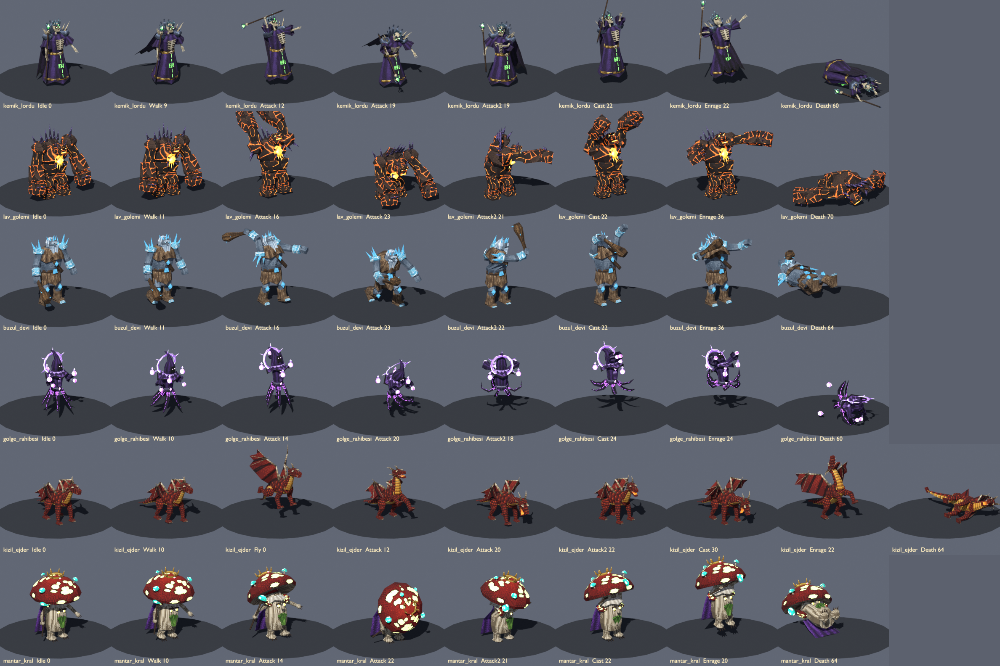

# Generated bosses (Blender, procedural, PSX style)

Six big rigged + animated end-of-dungeon bosses for the Mythic+ style dungeons of EFSUN ONLINE - Kadim Zindanlar.
Everything is generated by script in headless Blender 5.2 (nothing hand-modelled), so every boss can be rebuilt or tweaked from code.

- Models: `public/assets/models/gen/bosses/<id>.glb` (URL `/assets/models/gen/bosses/<id>.glb`)
- Generators: `tools/blender/bosses/`
  - `bosslib.py`: shared helpers (numpy pixel-art painters + atlas, low-poly primitive builder with per-part UVs and skin weights, world-axis rig, keyed actions, glTF export)
  - `boss_<id>.py`: one file per boss (textures, bones, geometry, actions)
  - `gen_bosses.py`: entry point, writes `boss_report.json` (tris, bones, bytes, emissive tiles)
  - `render_preview.py`: contact sheet built from the re-imported GLBs
- Preview: `docs/assets/previews/bosses.png`. One row per boss, with columns Idle / Walk / Attack windup / Attack impact / Attack2 / Cast / Enrage / Death end. The dragon also has a Fly column.



Rebuild (headless, about 3 s for all six):

```
"C:/Program Files/Blender Foundation/Blender 5.2/blender.exe" --background --factory-startup --python tools/blender/bosses/gen_bosses.py -- public/assets/models/gen/bosses [boss_id ...]
"C:/Program Files/Blender Foundation/Blender 5.2/blender.exe" --background --factory-startup --python tools/blender/bosses/render_preview.py -- public/assets/models/gen/bosses docs/assets/previews/bosses.png
node tools/glb-inspect.mjs public/assets/models/gen/bosses --short
```

## Conventions (all bosses)

| Topic | Value |
|---|---|
| Units / axes | 1 unit = 1 m, glTF +Y up, the boss faces **+Z** (Blender -Y), same as KayKit. Origin = ground contact at bottom centre. Character's left = +X. |
| Rig | One skinned mesh (`<id>`), armature node / skin `Rig`, root bone `root`. Rigid per-part skinning (PSX style). Blended weights only on the lich robe, the tentacles, the dragon neck/body/tail and the wing membranes. Every bone has an identity rest rotation (bones point up), so bone-local axes = model axes. |
| Clip names | `Idle`, `Walk`, `Run`, `Attack` (melee slam), `Attack2` (sweep / cleave), `Cast` (big spell windup with raised arms + release), `Enrage` (roar / phase-transition, same name on every boss), `Hit`, `Death`. The dragon also has `Fly` (hover loop). |
| Clip behaviour | `Idle`, `Walk`, `Run`, `Fly` loop seamlessly. `Attack`, `Attack2`, `Cast`, `Enrage`, `Hit` start and end on the Idle pose. `Death` ends lying on the ground: play it with `LoopOnce` + `clampWhenFinished = true`. Locomotion is **in place**. Attacks/Hit/Death have small root offsets (lunge, knock-back, fall), so do not apply root motion. |
| Cross-fading | Every bone that moves in any clip is keyed in every clip, and bones that never move are never keyed. Switching clips always restores a clean pose. |
| Animation format | Sparse quaternion / translation keys exported as glTF **CUBICSPLINE** (smooth ease, tiny files). Tested with three.js r186 `GLTFLoader` + `AnimationMixer`: every clip samples to normalised quaternions. If a tool needs LINEAR samplers, set `export_force_sampling=True` in `bosslib.export_glb` and rebuild. |
| Bind pose | The bind pose is not the idle pose (arms straighter, dragon wings fully spread). Start `Idle` right after spawning. |
| Hovering | `kemik_lordu` floats 0.16 above the ground in all clips and `golge_rahibesi` 0.32 (plus a bob). This is root translation, so keep the entity at floor height. |
| Texture | One 128x128 base atlas + one 128x128 emission atlas per boss (32 px tiles, some 64 px), embedded PNG. 4-6 colour ramps per tile, Bayer dither, painted highlights / dark edges / top-to-bottom AO gradient per part. Sampler mag NEAREST, min NEAREST_MIPMAP_NEAREST. For the crispest PSX look you may set `map.generateMipmaps = false; map.minFilter = THREE.NearestFilter` (same for `emissiveMap`). |
| Material | One material per boss (one draw call): base colour texture, roughness 0.9, metallic 0, **doubleSided** (capes, membranes, open robes), `emissiveTexture` + `emissiveFactor` 1 + `KHR_materials_emissive_strength` 1.4-2.2 so the bloom pass picks up the glowing parts. No vertex colours. |
| Budget | 592-1280 tris, 19-33 bones, 166-261 KB per GLB (all under 300 KB). |
| Floor contact | Checked by skinning every vertex in three.js across all clips. Death end poses lie on the floor. The only remaining dips are claw or toe tips mid-stride and the priestess tentacle tips when dead, at most 0.15 m. Re-check with the same method if you change poses. |
| Bone names | Plain `snake_case` with `_L` / `_R` (no dots), so three.js keeps them unchanged: `scene.getObjectByName('fx_mouth')`. |

## Asset table

Size = bind-pose AABB W x H x D in metres (glTF X x Y x Z) from `node tools/glb-inspect.mjs public/assets/models/gen/bosses --short`.

| id | URL | TR name | Size WxHxD | Tris | KB | Animations (seconds) | Intended use | Emissive parts | Attach points / notes |
|---|---|---|---|---|---|---|---|---|---|
| kemik_lordu | `/assets/models/gen/bosses/kemik_lordu.glb` | Kemik Lordu | 2.77 x 5.14 x 2.08 | 920 | 182 | Idle 2.0, Walk 1.2, Run 0.8, Attack 1.4, Attack2 1.4, Cast 2.2, Enrage 2.13, Hit 0.53, Death 2.0 | Undead crypt final boss. Tall skeletal lich king: spiked crown, high collar, bone-spiked pauldrons, tattered purple robe + cape, skull staff. Floats. | Eyes, crown gem, staff gem, rune tabard on the robe front (green) | `fx_staff` = staff gem (spell VFX origin, bobs in Idle/Cast). `hand_R` holds the staff, `hand_L` is the claw. `head` / `jaw` for the roar. Attack = overhead staff slam (impact 0.63 s). Attack2 = left-claw cleave (0.63 s). Cast = arms + staff raised 0.6-1.3 s, release thrust 1.57 s. Enrage roar 0.67-1.73 s. Death falls face-down. |
| lav_golemi | `/assets/models/gen/bosses/lav_golemi.glb` | Lav Golemi | 5.30 x 6.27 x 2.81 | 592 | 166 | Idle 2.4, Walk 1.47, Run 1.0, Attack 1.6, Attack2 1.47, Cast 2.27, Enrage 2.2, Hit 0.6, Death 2.33 | Fire / lava dungeon final boss. Hulking basalt gorilla-golem with huge fists, obsidian back and shoulder spikes, horned head sunk between the shoulders. | Lava cracks (only part of the crack network glows), molten chest core + drips, eyes, mouth slit (orange) | `fx_core` = chest core (weak-point / beam VFX). `hand_L` / `hand_R` = fists (ground-impact VFX). `head`, `jaw`. Attack = double-fist overhead smash (impact 0.77 s). Attack2 = right backhand sweep (0.70 s). Cast = arms raised 0.67-1.47 s, ground slam / eruption 1.67 s. Enrage = chest beats 0.27-0.87 s, then roar 1.2-1.8 s. Death = kneel, then topple forward. |
| buzul_devi | `/assets/models/gen/bosses/buzul_devi.glb` | Buzul Devi | 4.05 x 6.12 x 3.01 | 980 | 200 | Idle 2.13, Walk 1.47, Run 1.0, Attack 1.6, Attack2 1.53, Cast 2.4, Enrage 2.27, Hit 0.6, Death 2.13 | Frost cavern final boss. Grey-blue frost giant: white beard and hair, fur kilt / mantle / boots, ice crown, ice pauldron clusters, ice bracers and knee guards, huge gnarled club with ice shards. | Ice crystals (crown, pauldron spikes, knee guards, medallion, belt buckle, club shards) in pale cyan, plus the eyes | `fx_club` = club head (impact / frost VFX). The club is part of the mesh, skinned to `hand_R`. `hand_L`, `head`, `jaw`. Attack = overhead club slam (impact 0.77 s). Attack2 = horizontal club sweep (0.73 s). Cast = arms raised 0.67-1.33 s, then left-foot stomp 1.73 s (frost nova). Enrage = chest beat, then roar 1.27 s. Death falls on his back. |
| golge_rahibesi | `/assets/models/gen/bosses/golge_rahibesi.glb` | Gölge Rahibesi | 2.49 x 4.66 x 2.28 (min y 0.14) | 964 | 260 | Idle 2.0, Walk 1.33, Run 0.93, Attack 1.4, Attack2 1.47, Cast 2.27, Enrage 2.07, Hit 0.53, Death 2.0 | Shadow temple final boss. Floating priestess: pointed hood with a black void face, flared spiky mantle, six tentacle-like cloth strips instead of legs, clawed hands, crescent halo. | Purple orbs in both palms, 3 orbiting orbs, crescent halo + spikes, eyes, chest and sash jewels, rune stripes on the tentacles | `fx_orb_L` / `fx_orb_R` = palm orbs (projectile origins). `orbit` = pivot of the 3 orbiting orbs (it spins 120 degrees per loop; in Death the orbs drop to the floor). `tent<k>_1..3` = tentacle chains. Attack = rise and double orb-slam (impact 0.67 s). Attack2 = full 360-degree tentacle spin 0.27-1.07 s. Cast = arms up 0.53-1.33 s, push release 1.6 s. Enrage scream 0.8-1.6 s. Death sinks to the floor. |
| kizil_ejder | `/assets/models/gen/bosses/kizil_ejder.glb` | Kızıl Ejder | 9.20 x 5.10 x 9.28 | 986 | 261 | Idle 2.0, Walk 1.33, Run 0.8, Fly 1.33, Attack 1.33, Attack2 1.47, Cast 2.07, Enrage 2.2, Hit 0.53, Death 2.13 | Dragon lair final boss (biggest boss). Small red dragon: 4 legs, bat wings (folded in Idle, spread in Enrage / Fly), swept horns, back spikes, spade tail, gold belly plates. 9.2 W is the spread-wing bind pose; folded it is about 5 wide. | Eyes (yellow-orange), throat / mouth interior (orange glow, visible when the jaw opens) | `fx_mouth` = snout tip, **fire-breath origin** (forward = +Z of the model). `jaw`, `head`, `tail4` (tail tip), `wing3_L/R` (wing tips). Attack = rear up + right-claw slam + bite (impact 0.67 s). Attack2 = tail whip to the left (0.73 s). Cast = inhale 0.53-0.73 s, then breath 0.93-1.67 s, jaw open, sweeping left to right. Enrage = rear up with wings spread, roar 0.73-1.8 s. Fly = hover 1.5 above the ground with wing flaps. Death rolls onto its side. |
| mantar_kral | `/assets/models/gen/bosses/mantar_kral.glb` | Mantar Kral | 3.84 x 5.30 x 3.84 | 1280 | 239 | Idle 2.0, Walk 1.33, Run 0.87, Attack 1.47, Attack2 1.47, Cast 2.2, Enrage 2.33, Hit 0.6, Death 2.13 | Optional fungal grotto boss. Giant fly-agaric king: huge red cap with cream spots, tiny gold crown, grumpy face on the stalk with a moss beard, white ruff, purple velvet cape, mushroom pauldrons, root feet, glowing mushroom scepter. | Cap spots (soft yellow-green glow), 4 small cyan mushrooms on the cap, scepter mushroom (cyan), crown gem (red), eyes (yellow) | `fx_scepter` = glowing scepter top (spell origin). `fx_cap` = top of the cap (spore-cloud VFX). `cap` bone wobbles in every clip. Attack = cap headbutt slam (impact 0.73 s). Attack2 = scepter sweep (0.70 s). Cast = arms raised 0.67-1.53 s, spore burst 1.53 s. Enrage = jump 0.67 s, landing shockwave 0.9 s, then roar. Death falls on his back with the cap flopping forward. |

### Bones per boss

- **kemik_lordu** (19): root hips skirt spine chest cape1 cape2 neck head jaw shoulder_L/R upperarm_L/R forearm_L/R hand_L/R fx_staff
- **lav_golemi** (19): root hips spine chest fx_core head jaw upperarm_L/R forearm_L/R hand_L/R thigh_L/R shin_L/R foot_L/R
- **buzul_devi** (20): root hips spine chest neck head jaw upperarm_L/R forearm_L/R hand_L/R fx_club thigh_L/R shin_L/R foot_L/R
- **golge_rahibesi** (33): root hips spine chest neck head orbit upperarm_L/R forearm_L/R hand_L/R fx_orb_L/R tent0_1..tent5_3
- **kizil_ejder** (31): root hips chest neck1 neck2 neck3 head jaw fx_mouth tail1..tail4 upperleg_F_L/R lowerleg_F_L/R foot_F_L/R upperleg_B_L/R lowerleg_B_L/R foot_B_L/R wing1_L/R wing2_L/R wing3_L/R
- **mantar_kral** (20): root hips spine chest cap fx_cap jaw upperarm_L/R forearm_L/R hand_L/R fx_scepter thigh_L/R shin_L/R foot_L/R

`fx_*` bones carry no deforming geometry of their own (except the lich gem, the priestess palm orbs and the mushroom scepter cap, which ride them). They are attach points for VFX and projectiles.

### Suggested gameplay footprint (collision radius, metres)

kemik_lordu 1.1 · lav_golemi 1.8 · buzul_devi 1.6 · golge_rahibesi 1.0 · kizil_ejder 2.6 (or a capsule along Z, length about 6) · mantar_kral 1.9

## three.js usage

```ts
const gltf = await loader.loadAsync('/assets/models/gen/bosses/kizil_ejder.glb');
const boss = gltf.scene;                       // already faces +Z, feet at y = 0
const mixer = new THREE.AnimationMixer(boss);
const clip = (n: string) => THREE.AnimationClip.findByName(gltf.animations, n);
mixer.clipAction(clip('Idle')).play();
const death = mixer.clipAction(clip('Death'));
death.setLoop(THREE.LoopOnce, 1); death.clampWhenFinished = true;
const mouth = boss.getObjectByName('fx_mouth'); // fire-breath origin (world pos via getWorldPosition)
```

Scale the whole scene with `boss.scale.setScalar(k)` if a dungeon needs a bigger or smaller boss. Animations are scale-independent.
