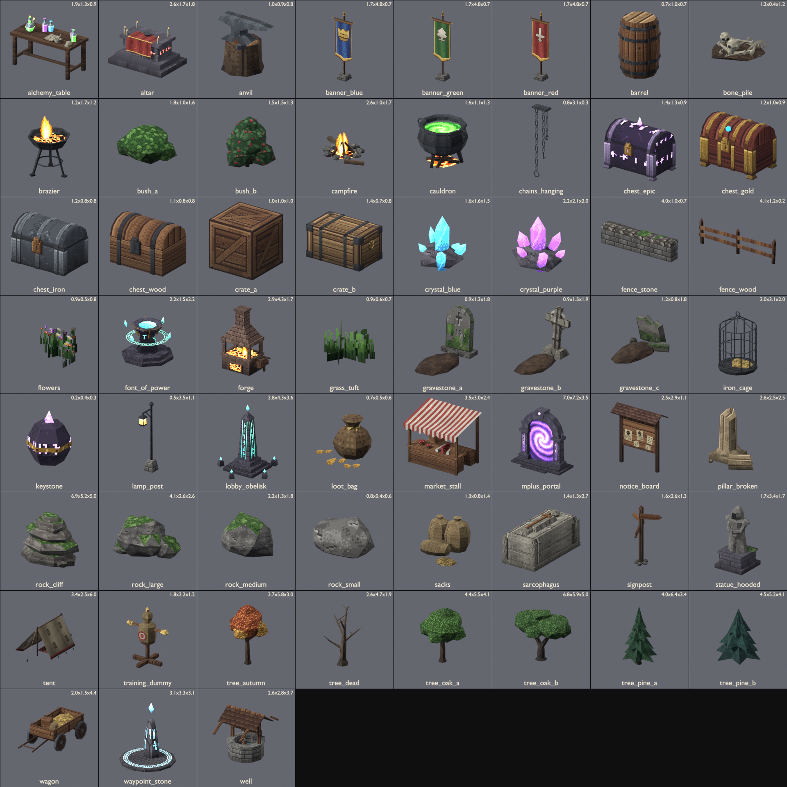

# Üretilmiş PSX Proplar (props)

EFSUN ONLINE – Kadim Zindanlar için Blender 5.2 ile **arka planda (headless)** prosedürel olarak üretilmiş 59 çevre/oynanış objesi.
Toplam 14316 üçgen, 1730 KB (tüm dokular GLB içine gömülü).



## Sözleşme

- **Ölçek:** 1 Blender birimi = 1 oyun birimi (metre). Karakter ~2.5, zindan karosu 4×4, duvar 4, kapı ~2.5×3.5.
- **Eksenler:** glTF +Y yukarı. Modeller **+Z yönüne bakar** (Blender'da -Y). Sandık kilidi, tabela yüzü, portal ön yüzü vb. +Z'dedir.
- **Orijin:** taban merkezi (zemin teması, y=0). İstisnalar: `chains_hanging` (orijin üstte, tavana as), `lamp_post` (orijin direk dibinde, fener kolu +Z'ye uzanır).
- **Boyut sütunu:** W × H × D = glTF X × Y × Z (metre), AABB.
- **Malzeme:** Principled BSDF → glTF metallic-roughness (roughness 0.9, metallic 0). 16×16 – 64×64 piksel dokular, **NEAREST** filtre
  (sampler mag 9728 / min 9984). Her asset ~8–20 renklik sınırlı palet, ordered (Bayer) dither, elle boyanmış kenar/ışık detayları.
- **Vertex renkleri:** tüm meshlerde `COLOR_0` (zemine yakın AO + aşağı bakan yüz karartması + PSX tarzı ±%5 yüz titremesi).
  three.js GLTFLoader bunu otomatik `vertexColors` ile base color'a çarpar.
- **Emissive:** `emissiveTexture` + `KHR_materials_emissive_strength` (1.5–3.0) → bloom eşiğini geçer. Emissive yalnız rün/kristal/ateş/cam piksellerindedir.
- **Alfa kartlar:** çimen, çiçek, alevler `alphaMode: MASK` + `doubleSided` (kumaşlar da çift yüzlü). Diğer tüm malzemeler tek yüzlü (backface culling).
- **Animasyon:** sandıklarda `Open` klibi (0.625 s, `lid` node'u yerel X ekseninde 0 → -105°, hafif sekme). Diğer hareketli parçalar ayrı node olarak verildi (oyun kodu döndürür/salınım verir).

## Oyun içi kullanım ipuçları (three.js)

- **Sandık:** `gltf.animations` içindeki `Open` klibini `AnimationMixer` ile `LoopOnce` + `clampWhenFinished` oynat; ya da `scene.getObjectByName('lid').rotation.x = -1.83`.
  Ganimet efekti için `loot_fx` boş node'unu kullan.
- **Portal:** `portal_surface` UV'leri girdap merkezi (0.5, 0.5) olacak şekilde ayarlı: `map.center.set(0.5, 0.5); map.rotation += dt` (aynı dokuyu `emissiveMap` için de döndür).
  Anahtar taşı yokken `emissiveIntensity` düşür / mesh'i gizle. `enter_trigger` giriş noktası.
- **Güç Kaynağı:** `rune_ring` (orijini halka merkezinde) Y ekseninde döndür, `shards` aşağı-yukarı salla; anahtar taşı `keystone_socket` noktasına konur (`keystone.glb` orijini alt merkez).
- **Toplanma dikilitaşı:** `slot_1`..`slot_5` her parti üyesi için ayrı mesh; materyal paylaşıldığı için yakmadan önce `material.clone()` yap.
- **Işık / efekt noktaları:** `light_0` boş node'larına PointLight (fener sıcak sarı, kristaller mavi/mor, portal mor), `fire_fx` noktalarına parçacık ekle.
  `flame` mesh'leri (çapraz alev kartları) ölçek/opacity titreşimi ile canlandırılabilir.
- **Rüzgar:** sancaklarda `cloth`, pazar tezgahında `roof_cloth` ayrı mesh: vertex shader dalgası veya basit rotasyon salınımı.
- **Diğer hareketli parçalar:** `wagon` tekerlekleri (`wheel_*`, yerel X ekseni), `well` kovası (`bucket`), `iron_cage` kapısı (`door`, dikey eksen),
  `sarcophagus` kapağı (`lid`, kaydır), kazan sıvısı (`liquid`, UV kaydır).
- **Instancing:** `grass_tuft`, `flowers`, kayalar ve ağaçlar InstancedMesh için uygundur (tek mesh, 1–3 malzeme).

## Özel oynanış objeleri (Mythic+)

| id | URL | Türkçe ad | Boyut W×H×D (m) | Tris | Animasyon | Kullanım | Emissive parçalar | Bağlantı / node bilgisi | KB |
|---|---|---|---|---|---|---|---|---|---|
| `font_of_power` | `/assets/models/gen/props/font_of_power.glb` | Güç Kaynağı | 2.23 × 1.49 × 2.23 | 352 | - | Mythic+ anahtar taşı kaidesi; anahtar taşı buraya yerleştirilince zindan başlar | 'rune_ring' (dönen rün halkası), kaide rünleri, kase parıltısı, yüzen kristaller ('shards') (mat: column, glow, ring) | 'keystone_socket' boş node (anahtar taşının oturduğu nokta, y≈1.42); 'rune_ring' ve 'shards' ayrı mesh (döndür/salla); 'light_0' — mesh: `font_of_power`, `rune_ring`, `shards`; boş: `keystone_socket`, `light_0` | 41.5 |
| `keystone` | `/assets/models/gen/props/keystone.glb` | Kadim Anahtar Taşı | 0.24 × 0.36 × 0.28 | 68 | - | Mythic+ anahtar taşı eşyası (envanter/yerde/Güç Kaynağı üstünde) | rün oyukları ve uç kristalleri (mor) (mat: stone, tip) | orijin alt merkez; Güç Kaynağı 'keystone_socket' noktasına oturur | 12.6 |
| `lobby_obelisk` | `/assets/models/gen/props/lobby_obelisk.glb` | Toplanma Dikilitaşı | 3.79 × 4.35 × 3.60 | 168 | - | Grup/lobi buluşma noktası; 5 yuva her katılan oyuncu için yanar | gövde rün sütunları, tepe kristali ('obelisk_crystal'), 5 yuva taşı ('slot_1'..'slot_5') (mat: runes, crystal) | 'slot_1'..'slot_5' ayrı mesh (parti üyesi katıldıkça emissive yak); 'obelisk_crystal' ayrı (döndür); 'light_0' — mesh: `lobby_obelisk`, `obelisk_crystal`, `slot_1`, `slot_2`, `slot_3`, `slot_4`, `slot_5`; boş: `light_0` | 34.4 |
| `mplus_portal` | `/assets/models/gen/props/mplus_portal.glb` | Kadim Zindan Geçidi (Mythic+) | 7.00 × 7.21 × 3.55 | 271 | - | Mythic+ zindan giriş kapısı; anahtar taşı aktifken portal yüzeyi parlar | 'portal_surface' (mor girdap), sütun rün şeritleri, kilit taşı mücevheri (mat: runes, gem, portal) | 'portal_surface' ayrı mesh: girdap UV merkezli (texture.center=0.5,0.5 ile döndür); 'enter_trigger' (giriş noktası), 'light_0' (portal merkezi) — mesh: `mplus_portal`, `portal_surface`; boş: `enter_trigger`, `light_0` | 38.2 |
| `waypoint_stone` | `/assets/models/gen/props/waypoint_stone.glb` | Işınlanma Taşı | 3.10 × 3.35 × 3.10 | 170 | - | Waypoint / hızlı seyahat noktası; etkileşimle harita açılır | taş üstü rünler, zemin rün halkası ('teleport_ring'), yüzen kristal ('waypoint_crystal') (mat: ring, crystal, menhir) | 'waypoint_crystal' ayrı mesh (süzülme+dönme), 'teleport_ring' ayrı mesh (dönme), 'arrive_point' boş node, 'light_0' — mesh: `teleport_ring`, `waypoint_crystal`, `waypoint_stone`; boş: `arrive_point`, `light_0` | 23.4 |

## Kasaba / kamp

| id | URL | Türkçe ad | Boyut W×H×D (m) | Tris | Animasyon | Kullanım | Emissive parçalar | Bağlantı / node bilgisi | KB |
|---|---|---|---|---|---|---|---|---|---|
| `alchemy_table` | `/assets/models/gen/props/alchemy_table.glb` | Simya Masası | 1.90 × 1.33 × 0.90 | 588 | - | İksir satıcısı / simya craft istasyonu | iksir sıvıları (yeşil/mor/mavi), mum alevi (mat: pot_g, pot_p, pot_b, flame) | 'interact' boş node (masanın önü) — boş: `interact`; alfa MASK: flame | 66.0 |
| `anvil` | `/assets/models/gen/props/anvil.glb` | Örs | 0.96 × 0.89 × 0.76 | 134 | - | Demirci, eşya yükseltme NPC noktası | - | - | 17.1 |
| `banner_blue` | `/assets/models/gen/props/banner_blue.glb` | Mavi Sancak | 1.74 × 4.75 × 0.70 | 138 | - | Kraliyet/kasaba sancağı, mavi takım işareti (taç arması) | - | 'cloth' ayrı mesh — mesh: `banner_blue`, `cloth` | 19.3 |
| `banner_green` | `/assets/models/gen/props/banner_green.glb` | Yeşil Sancak | 1.74 × 4.75 × 0.70 | 138 | - | Orman/elf bölgesi sancağı, yeşil takım işareti (ağaç arması) | - | 'cloth' ayrı mesh — mesh: `banner_green`, `cloth` | 19.3 |
| `banner_red` | `/assets/models/gen/props/banner_red.glb` | Kızıl Sancak | 1.74 × 4.75 × 0.70 | 138 | - | Kasaba/lonca sancağı, PvP kızıl takım işareti (kılıç arması) | - | 'cloth' ayrı mesh (rüzgar dalgası için) — mesh: `banner_red`, `cloth` | 19.3 |
| `barrel` | `/assets/models/gen/props/barrel.glb` | Fıçı | 0.73 × 1.05 × 0.70 | 176 | - | Kasaba/meyhane/zindan dolgu objesi | - | - | 19.7 |
| `brazier` | `/assets/models/gen/props/brazier.glb` | Mangal | 1.16 × 1.73 × 1.16 | 318 | - | Zindan/kasaba ateş kaynağı, boss odası aydınlatması | kömürler + 'flame' kartları (mat: coals, flame) | 'flame' ayrı mesh (titreşim/ölçek animasyonu); 'light_0', 'fire_fx' boş node — mesh: `brazier`, `flame`; boş: `fire_fx`, `light_0`; alfa MASK: flame | 37.7 |
| `campfire` | `/assets/models/gen/props/campfire.glb` | Kamp Ateşi | 2.65 × 1.00 × 1.70 | 313 | - | Açık dünya kampı, dinlenme noktası (taş çember + odunlar) | köz + 'flame' kartları (mat: embers, flame) | 'flame' ayrı mesh; 'light_0', 'fire_fx' boş node — mesh: `campfire`, `flame`; boş: `fire_fx`, `light_0`; alfa MASK: flame | 43.4 |
| `cauldron` | `/assets/models/gen/props/cauldron.glb` | Kazan | 1.60 × 1.07 × 1.25 | 355 | - | Cadı/simyacı kazanı, kamp aşçısı; zindan tuzak süsü | yeşil kaynayan sıvı ('liquid'), alttaki köz (mat: embers, liquid) | 'liquid' ayrı mesh (UV kaydırma/kabarcık için); 'light_0' — mesh: `cauldron`, `liquid`; boş: `light_0` | 38.3 |
| `crate_a` | `/assets/models/gen/props/crate_a.glb` | Tahta Kasa | 1.00 × 1.00 × 1.00 | 12 | - | Kasaba/zindan dolgu objesi, üst üste dizilebilir (1x1x1 m) | - | - | 3.2 |
| `crate_b` | `/assets/models/gen/props/crate_b.glb` | Demir Köşeli Erzak Sandığı | 1.38 × 0.73 × 0.82 | 204 | - | Liman/depo/kervan yükü, uzun erzak kasası | - | - | 22.3 |
| `forge` | `/assets/models/gen/props/forge.glb` | Demirci Ocağı | 2.88 × 4.27 × 1.75 | 252 | - | Demirci NPC işyeri; craft/yükseltme istasyonu | ocak közleri, kül çukuru, 'flame' kartları (mat: flame, coals) | 'flame' ayrı mesh; 'light_0', 'fire_fx' boş node — mesh: `flame`, `forge`; boş: `fire_fx`, `light_0`; alfa MASK: flame | 34.1 |
| `lamp_post` | `/assets/models/gen/props/lamp_post.glb` | Sokak Feneri | 0.50 × 3.55 × 1.12 | 136 | - | Kasaba sokak aydınlatması (gece) | fener camları (sıcak sarı) (mat: glass) | 'light_0' boş node: fener merkezi, PointLight için — boş: `light_0` | 17.1 |
| `market_stall` | `/assets/models/gen/props/market_stall.glb` | Pazar Tezgahı | 3.50 × 2.98 × 2.45 | 362 | - | Kasaba pazarı satıcı tezgahı (NPC satıcı arkasında durur) | - | 'vendor_spot' boş node: satıcı NPC'nin durduğu yer (tezgah arkası); 'roof_cloth' ayrı mesh — mesh: `market_stall`, `roof_cloth`; boş: `vendor_spot` | 40.9 |
| `notice_board` | `/assets/models/gen/props/notice_board.glb` | İlan / Ödül Panosu | 2.50 × 2.91 × 1.07 | 118 | - | Görev ve ödül (bounty) panosu; etkileşim noktası | - | 'interact' boş node (panonun önü, -Y) — boş: `interact` | 18.8 |
| `sacks` | `/assets/models/gen/props/sacks.glb` | Çuval Yığını | 1.28 × 0.82 × 1.35 | 304 | - | Pazar, değirmen, kervan yükü (3 çuval) | - | - | 32.6 |
| `signpost` | `/assets/models/gen/props/signpost.glb` | Yön Tabelası | 1.60 × 2.60 × 1.32 | 172 | - | Kavşak yön levhası (kasaba / zindan / orman) | - | - | 25.3 |
| `tent` | `/assets/models/gen/props/tent.glb` | Çadır | 3.40 × 2.45 × 5.96 | 231 | - | Kamp alanı, kervan durağı, açık dünya kampı | - | 'entrance' boş node: çadır girişi (-Y) — mesh: `tent`, `tent_frame`; boş: `entrance` | 26.1 |
| `training_dummy` | `/assets/models/gen/props/training_dummy.glb` | Antrenman Kuklası | 1.84 × 2.16 × 1.20 | 256 | - | Kasaba eğitim alanı; hasar testi hedefi | - | hit animasyonu için gövde tek mesh; 'hit_point' boş node (göğüs) — boş: `hit_point` | 30.5 |
| `wagon` | `/assets/models/gen/props/wagon.glb` | Yük Arabası | 2.02 × 1.48 × 4.38 | 616 | - | Kervan, çiftlik, kasaba girişi süsü (yüklü) | - | tekerlek node'ları 'wheel_fl','wheel_fr','wheel_bl','wheel_br' (yerel X ekseninde döner) — mesh: `wagon`, `wheel_bl`, `wheel_br`, `wheel_fl`, `wheel_fr` | 68.0 |
| `well` | `/assets/models/gen/props/well.glb` | Kuyu | 2.57 × 2.78 × 3.69 | 440 | - | Kasaba meydanı merkezi, görev etkileşim noktası | - | 'bucket' ayrı node (ip ucu, yukarı/aşağı animasyon için); 'interact' boş node — mesh: `bucket`, `well`; boş: `interact` | 48.0 |

## Zindan

| id | URL | Türkçe ad | Boyut W×H×D (m) | Tris | Animasyon | Kullanım | Emissive parçalar | Bağlantı / node bilgisi | KB |
|---|---|---|---|---|---|---|---|---|---|
| `altar` | `/assets/models/gen/props/altar.glb` | Kurban Sunağı | 2.60 × 1.67 × 1.80 | 251 | - | Zindan ritüel odası, boss arenası merkezi, görev etkileşimi | kızıl rünler, mum alevleri, kan kasesi (mat: runes, flame, blood) | 'offering' boş node (sunak üstü), 'light_0' — boş: `light_0`, `offering`; alfa MASK: flame | 35.4 |
| `bone_pile` | `/assets/models/gen/props/bone_pile.glb` | Kemik Yığını | 1.25 × 0.38 × 1.16 | 516 | - | Zindan köşesi, canavar ini, mezar odası | - | - | 50.2 |
| `chains_hanging` | `/assets/models/gen/props/chains_hanging.glb` | Asılı Zincirler | 0.76 × 3.10 × 0.35 | 608 | - | Zindan tavanından sarkan zincirler (zindan duvar yüksekliği 4 m) | - | İSTİSNA: orijin ÜSTTE (tavan bağlantı noktası); geometri y=0..-3.3 aşağı uzanır, tavana (y=4) yerleştir | 54.6 |
| `chest_epic` | `/assets/models/gen/props/chest_epic.glb` | Destansı Sandık | 1.39 × 1.27 × 0.93 | 324 | Open | Efsanevi/destansı mor ödül sandığı (Mythic+ +10 ve üstü) | mor rünler (gövde+kapak), iç parıltı, kristal sivri uçlar (mat: body, inside, lidwood, gem) | 'lid' menteşe pivotlu, 'Open' animasyonu; 'loot_fx' — mesh: `chest_epic`, `lid`; boş: `loot_fx` | 41.8 |
| `chest_gold` | `/assets/models/gen/props/chest_gold.glb` | Altın Sandık | 1.24 × 0.96 × 0.85 | 416 | Open | Destansı öncesi ödül sandığı (sarı nadirlik), Mythic+ bitiş sandığı | kapak üstü mavi mücevher (mat: gem) | 'lid' menteşe pivotlu, 'Open' animasyonu; 'loot_fx' — mesh: `chest_gold`, `lid`; boş: `loot_fx` | 46.7 |
| `chest_iron` | `/assets/models/gen/props/chest_iron.glb` | Demir Sandık | 1.17 × 0.83 × 0.82 | 300 | Open | Nadir ganimet sandığı (mavi nadirlik) | - | 'lid' menteşe pivotlu, 'Open' animasyonu; 'loot_fx' — mesh: `chest_iron`, `lid`; boş: `loot_fx` | 35.2 |
| `chest_wood` | `/assets/models/gen/props/chest_wood.glb` | Ahşap Sandık | 1.10 × 0.81 × 0.79 | 204 | Open | Sıradan ganimet sandığı (gri/beyaz nadirlik) | - | 'lid' node menteşede (arka üst kenar); yerel X ekseninde -105° döndürünce açılır, 'Open' animasyonu; 'loot_fx' boş node — mesh: `chest_wood`, `lid`; boş: `loot_fx` | 27.2 |
| `crystal_blue` | `/assets/models/gen/props/crystal_blue.glb` | Mavi Kristal Kümesi | 1.63 × 1.65 × 1.48 | 152 | - | Zindan/mağara aydınlatması, maden süsü | kristaller (mavi) (mat: crystal) | 'light_0' boş node: mavi PointLight için — boş: `light_0` | 19.1 |
| `crystal_purple` | `/assets/models/gen/props/crystal_purple.glb` | Mor Kristal Kümesi | 2.20 × 2.15 × 2.01 | 174 | - | Büyülü zindan bölgeleri, boss odası süsü | kristaller (mor) (mat: crystal) | 'light_0' boş node: mor PointLight için — boş: `light_0` | 21.1 |
| `gravestone_a` | `/assets/models/gen/props/gravestone_a.glb` | Mezar Taşı (Kemerli) | 0.92 × 1.28 × 1.83 | 124 | - | Mezarlık, zindan girişi; toprak höyüklü | - | - | 19.0 |
| `gravestone_b` | `/assets/models/gen/props/gravestone_b.glb` | Mezar Taşı (Haç) | 0.94 × 1.50 × 1.94 | 176 | - | Mezarlık; halkalı taş haç | - | - | 23.4 |
| `gravestone_c` | `/assets/models/gen/props/gravestone_c.glb` | Kırık Mezar Taşı | 1.23 × 0.78 × 1.84 | 148 | - | Eski/terk edilmiş mezarlık, lanetli bölge | - | - | 20.1 |
| `iron_cage` | `/assets/models/gen/props/iron_cage.glb` | Demir Kafes | 2.00 × 3.13 × 2.00 | 568 | - | Esir kafesi, zindan hapishane odası, görev (kurtarma) objesi | - | 'door' ayrı mesh (menteşe kapı sol kenarında, dikey eksende döner); 'prisoner_spot' boş node — mesh: `door`, `iron_cage`; boş: `prisoner_spot` | 55.2 |
| `loot_bag` | `/assets/models/gen/props/loot_bag.glb` | Ganimet Kesesi | 0.66 × 0.47 × 0.64 | 273 | - | Düşen ganimet torbası (canavar öldürünce yere düşer) | altın paralar (hafif parıltı, yerde fark edilsin diye) (mat: coins) | 'loot_fx' boş node (ışın/parıltı efekti) — boş: `loot_fx` | 27.1 |
| `pillar_broken` | `/assets/models/gen/props/pillar_broken.glb` | Kırık Sütun | 2.59 × 2.51 × 2.51 | 232 | - | Antik harabe, zindan salonu, açık dünya kalıntıları | - | - | 28.7 |
| `sarcophagus` | `/assets/models/gen/props/sarcophagus.glb` | Lahit | 1.35 × 1.32 × 2.70 | 186 | - | Kraliyet mezarı, boss ortaya çıkış noktası, gizli hazine | - | 'lid' ayrı mesh (pivot kapak alt merkezi; kaydırma/dönme animasyonu için) — mesh: `lid`, `sarcophagus` | 23.2 |
| `statue_hooded` | `/assets/models/gen/props/statue_hooded.glb` | Kukuletalı Savaşçı Heykeli | 1.73 × 3.38 × 1.70 | 434 | - | Kasaba meydanı anıtı, zindan girişi muhafızı | - | - | 45.7 |

## Doğa (ağaçlar, çalılar, kayalar, çitler)

| id | URL | Türkçe ad | Boyut W×H×D (m) | Tris | Animasyon | Kullanım | Emissive parçalar | Bağlantı / node bilgisi | KB |
|---|---|---|---|---|---|---|---|---|---|
| `bush_a` | `/assets/models/gen/props/bush_a.glb` | Çalı | 1.79 × 1.00 × 1.55 | 140 | - | Yol kenarı / kasaba bahçesi yeşil çalı | - | - | 20.0 |
| `bush_b` | `/assets/models/gen/props/bush_b.glb` | Böğürtlen Çalısı | 1.50 × 1.49 × 1.30 | 170 | - | Orman kenarı meyveli çalı (kırmızı meyveler) | - | - | 25.0 |
| `fence_stone` | `/assets/models/gen/props/fence_stone.glb` | Taş Duvar | 4.01 × 0.98 × 0.74 | 120 | - | Alçak taş duvar; kasaba/mezarlık sınırı, 4 m segment | - | segment X ekseni boyunca -2..+2 | 15.7 |
| `fence_wood` | `/assets/models/gen/props/fence_wood.glb` | Ahşap Çit | 4.10 × 1.22 × 0.22 | 69 | - | Kasaba/çiftlik sınırı; 4 m segment X ekseninde, uç uca dizilir | - | segment X ekseni boyunca -2..+2; direkler uçlarda | 10.2 |
| `flowers` | `/assets/models/gen/props/flowers.glb` | Kır Çiçekleri | 0.86 × 0.50 × 0.75 | 10 | - | Çayır, kasaba bahçeleri, mezarlık süsü | - | alfa-kesik (MASK) çift yüzlü kartlar — alfa MASK: flowers | 3.1 |
| `grass_tuft` | `/assets/models/gen/props/grass_tuft.glb` | Çimen Öbeği | 0.85 × 0.55 × 0.72 | 8 | - | Açık dünya zemin süsü (instancing ile çok sayıda) | - | alfa-kesik (MASK) çift yüzlü kartlar — alfa MASK: grass | 2.8 |
| `rock_cliff` | `/assets/models/gen/props/rock_cliff.glb` | Kayalık Uçurum Parçası | 6.92 × 5.24 × 5.00 | 250 | - | Bölge sınırı, dağ yamacı, zindan mağara duvarı | - | - | 26.3 |
| `rock_large` | `/assets/models/gen/props/rock_large.glb` | Büyük Kaya | 4.05 × 2.56 × 2.60 | 240 | - | Açık dünya engeli / yer işareti | - | - | 33.7 |
| `rock_medium` | `/assets/models/gen/props/rock_medium.glb` | Kaya | 2.25 × 1.35 × 1.81 | 80 | - | Açık dünya engeli, zindan kenarı | - | - | 13.9 |
| `rock_small` | `/assets/models/gen/props/rock_small.glb` | Küçük Taş | 0.79 × 0.44 × 0.60 | 80 | - | Zemin dolgusu, yol kenarı | - | - | 12.3 |
| `tree_autumn` | `/assets/models/gen/props/tree_autumn.glb` | Sonbahar Ağacı | 3.68 × 5.75 × 3.05 | 239 | - | Açık dünya renk çeşitliliği (turuncu/sarı yapraklı) | - | - | 33.2 |
| `tree_dead` | `/assets/models/gen/props/tree_dead.glb` | Kuru Ağaç | 2.61 × 4.74 × 1.93 | 205 | - | Mezarlık, lanetli bölgeler, zindan girişi | - | - | 19.3 |
| `tree_oak_a` | `/assets/models/gen/props/tree_oak_a.glb` | Meşe Ağacı | 4.41 × 5.52 × 4.10 | 279 | - | Kasaba meydanı, açık dünya (yuvarlak taçlı meşe) | - | - | 35.0 |
| `tree_oak_b` | `/assets/models/gen/props/tree_oak_b.glb` | Yaşlı Meşe | 6.77 × 5.90 × 4.99 | 398 | - | Geniş taçlı yaşlı meşe, kasaba odak noktası / gölge alanı | - | - | 47.8 |
| `tree_pine_a` | `/assets/models/gen/props/tree_pine_a.glb` | Çam Ağacı | 4.02 × 6.45 × 3.45 | 280 | - | Açık dünya ormanı, kasaba çevresi (uzun çam) | - | - | 32.9 |
| `tree_pine_b` | `/assets/models/gen/props/tree_pine_b.glb` | Kara Çam | 4.52 × 5.20 × 4.08 | 232 | - | Açık dünya ormanı (gür, kısa koyu çam) | - | - | 27.7 |

## Yeniden üretim

Tüm üreticiler `tools/blender/props/` altında (Blender penceresi açılmaz):

```bash
B="/c/Program Files/Blender Foundation/Blender 5.2/blender.exe"
# tüm proplar (veya --cat nature,town,dungeon,special  /  --only chest_epic,mplus_portal)
"$B" --background --factory-startup --python tools/blender/props/build_props.py -- --out public/assets/models/gen/props
# önizleme sayfası (GLB'leri yeniden içe aktarır = export doğrulaması); --frame 15 sandıkları açık gösterir
"$B" --background --factory-startup --python tools/blender/props/render_preview.py -- public/assets/models/gen/props docs/assets/previews/props.png --cols 8 --cell 240
node tools/glb-inspect.mjs public/assets/models/gen/props --short
node tools/blender/props/make_doc.mjs
```

| Dosya | İçerik |
|---|---|
| `psx_lib.py` | numpy piksel doku üreticileri (tahta, tuğla, kaya, metal, kumaş, yaprak, rün, girdap, kor, alev…), low-poly primitifler (Part), UV modları, malzeme/obje/COLOR_0, GLB export, manifest |
| `common.py` | ortak paletler ve bileşenler (kasa, fıçı, çuval, kütük, mum, alev kartları, sandık kapağı, `Open` animasyonu) |
| `props_nature.py` / `props_town.py` / `props_dungeon.py` / `props_special.py` | asset tanımları (`@asset` dekoratörü: id, Türkçe ad, kullanım, emissive, bağlantı notu) |
| `build_props.py` | sürücü (`--only`, `--cat`, `--list`), `manifest.json` yazar |
| `render_preview.py` | EEVEE ortografik 3/4 kontakt sayfası (`--frame` ile animasyon karesi) |
| `make_doc.mjs` | bu dokümanı üretir |
