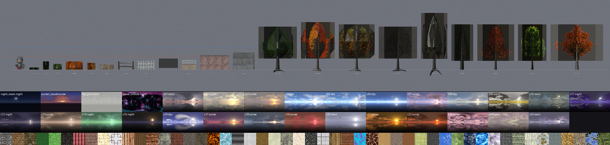

# itch.io PSX environment packs: textures, skies, trees, fences (converted)

Group `psx-env`: 8 itch.io archives converted for EFSUN ONLINE. **525 tileable textures + 157 model textures, 29 skies, 260 GLBs** (models 7.2 MB, textures 9.7 MB, skies 1.6 MB). All models are static (no armatures, no animation clips). Credits and licences: `docs/assets/credits-itch.md` (**PSX Skyboxes Free is CC BY 4.0, attribution required**; everything else is CC0). Preview contact sheet: `docs/assets/previews/itch-psx-env.png`.

> Contact sheet: true-scale line-up next to the 2.4 m KayKit Knight (red line = 2.4 m, blue = 4 m), then every sky, then a sample of the tileable textures. Blender Workbench ignores glTF alpha MASK, so foliage and chain-link are drawn with **dark boxes behind them in the line-up only**; the embedded PNGs have hard 1-bit alpha and the materials are `alphaMode: MASK`, so in three.js the holes are cut out (checked in the GLB JSON).

| Pack | Author | Public folder | Files | Scale applied | Licence |
|---|---|---|---:|---|---|
| **Tiny Texture Pack 1** (128 px) | Screaming Brain Studios | `/assets/textures/itch/tiny-texture-pack-1/` | 125 | none (128 px tileables) | CC0 |
| **Tiny Texture Pack 2** (128 px) | Screaming Brain Studios | `/assets/textures/itch/tiny-texture-pack-2/` | 160 | none | CC0 |
| **Tiny Texture Pack 3** (Small) | Screaming Brain Studios | `/assets/textures/itch/tiny-texture-pack-3/` | 240 | none | CC0 |
| **PSX Skyboxes Free** | heyheythere | `/assets/sky/itch/psx-skyboxes-free/` | 4 panoramas + 24 cube faces | none (as is) | **CC BY 4.0** |
| **Cloudy Skyboxes Panorama** | Screaming Brain Studios | `/assets/sky/itch/cloudy-skyboxes-panorama/` | 25 | 2048×1024 → 1024×512 JPG | CC0 |
| **Retro PSX tree pack** (tree_pack_1.1) | not stated in the archive | `/assets/models/itch/retro-psx-tree-pack/{trees,bushes}/` | 44 | trees → 6–10 m (×0.64, clamped), bushes → 1.2 m | CC0 |
| **Retro PSX Nature Pack** | Elegant Crow | `/assets/models/itch/retro-psx-nature-pack/{trees,bushes,grass}/` | 137 | trees ×2.0 (≤10 m), bushes ×1.5, grass ×0.8 | CC0 |
| **PSX style walls & fences** | valsekamerplant | `/assets/models/itch/psx-walls-fences/<family>/` | 79 | ×1.25 (same module scale as PSX Going Medieval) | CC0 |

## 0. Conventions (read first)

* **Scale contract** (ARCHITECTURE rule 7): 1 unit = 1 m, +Y up, KayKit hero ≈ 2.4 m, dungeon tile 4 × 4. Sizes below are game units after conversion; `W × H × D` is the AABB with **H = top height above y = 0**.
* **PSX materials:** every texture is a 256-colour palette PNG (≤ 256 px, hard 1-bit alpha), samplers are NEAREST, `metallic 0 / roughness 1`, no extensions. Alpha is **MASK** (cutoff 0.5) where the texture has holes (foliage, chain-link, bars), all materials are `doubleSided`. `Assets.onModelLoaded` still applies the usual PSX patch on load.
* **One mesh + one material per file** (walls keep one primitive per source material: brick + concrete cap, stucco + roof tile, …). Files of one pack share their texture images, so you can swap in one shared material (textures in `/assets/textures/itch/<pack>/`, section 2) and `InstancedMesh` them.
* **Seasons = separate files** in the nature pack: `<model>_<season>.glb` with `spring | summer | fall | winter` (bushes 2–6 additionally have `spring1 … spring6` flower-colour variants). Winter files use the pack's bare-branch mesh where one exists (110 vs 360 tris on `tree01`), otherwise the summer mesh with the snowy texture.
* **Trees: pivot = trunk base at y = 0.** The source meshes bury a short trunk stub below the ground plane (0.1–0.5 m in the source, up to 1 m after scaling on `tree07`); sink them into the terrain, do not shift them up. Foliage is crossed cut-out planes, so keep `side: DoubleSide` and alphaTest 0.5.
* **Walls and fences:** pieces lie along **X**, front = +Z, origin at the **bottom centre** unless the pivot column says otherwise. Gate leaves have their origin on the hinge edge at ground level (set `rotation.y` to swing). The source origins were not consistent (some pieces ran from 0 to +X, others from −X to 0), so everything was re-centred; adjacent segments tile at their own width (the author overlaps posts slightly).
* **Skies** are equirectangular, **horizon at the vertical middle**. The cloudy panoramas mirror the sky into a dark reflection below the horizon (use them above the horizon only, or hide the lower half behind terrain/fog). three.js: `tex.mapping = THREE.EquirectangularReflectionMapping; tex.colorSpace = THREE.SRGBColorSpace; tex.magFilter = THREE.NearestFilter` for the crunchy PSX look, then `scene.background = tex`. `fog` / `light` in section 1 are the author's horizon fog colour and sky light colour, ready for `scene.fog`.

## 1. Skies: `/assets/sky/itch/` (index: `/assets/sky/itch/index.json`)

Moods: **day** (blue sky), **sunset** (low sun, warm/pink), **night**, **overcast** (grey / fog / storm). Classified by eye from the contact sheet. `fog` = average colour of the 14 pixel rows just above the horizon (cloudy skies) or the author's fog colour (PSX skies); `zenith` = top rows.

| URL | KB | size | mood | fog | zenith / light | note |
|---|---:|---|---|---|---|---|
| `/assets/sky/itch/psx-skyboxes-free/night-moon.png` | 19 | 1024x512 | night | #212c46 | light #5a83ff ×0.22 | full moon, dithered night sky; cube faces `/assets/sky/itch/psx-skyboxes-free/cubemap/night-moon/{px,nx,py,ny,pz,nz}.png` (256 px) |
| `/assets/sky/itch/psx-skyboxes-free/sunset-clouds.png` | 38 | 1024x512 | sunset | #895c61 | light #d0a8ff ×0.68 | warm sunset with clouds; cube faces `/assets/sky/itch/psx-skyboxes-free/cubemap/sunset-clouds/{px,nx,py,ny,pz,nz}.png` (256 px) |
| `/assets/sky/itch/psx-skyboxes-free/fog-grey.png` | 45 | 1024x512 | overcast | #b7b7b3 | light #fdfffd ×1.3 | flat grey fog / overcast; cube faces `/assets/sky/itch/psx-skyboxes-free/cubemap/fog-grey/{px,nx,py,ny,pz,nz}.png` (256 px) |
| `/assets/sky/itch/psx-skyboxes-free/space-nebula.png` | 103 | 1024x512 | night | #130d1b | light #e079ff ×0.25 | purple nebula (space / void, no horizon); cube faces `/assets/sky/itch/psx-skyboxes-free/cubemap/space-nebula/{px,nx,py,ny,pz,nz}.png` (256 px) |
| `/assets/sky/itch/cloudy-skyboxes-panorama/cloudy-sky-01.jpg` | 46 | 1024x512 | overcast | #ae8b86 | zenith #54545e | stormy grey, low pale sun |
| `/assets/sky/itch/cloudy-skyboxes-panorama/cloudy-sky-02.jpg` | 71 | 1024x512 | sunset | #cbba9e | zenith #9e9b96 | hazy golden sun behind clouds |
| `/assets/sky/itch/cloudy-skyboxes-panorama/cloudy-sky-03.jpg` | 55 | 1024x512 | sunset | #b1968d | zenith #807c7e | dusty orange sun on the horizon |
| `/assets/sky/itch/cloudy-skyboxes-panorama/cloudy-sky-04.jpg` | 65 | 1024x512 | day | #daf4fe | zenith #5273a8 | clear blue, bright sun and cumulus |
| `/assets/sky/itch/cloudy-skyboxes-panorama/cloudy-sky-05.jpg` | 69 | 1024x512 | day | #cfeafa | zenith #5576ab | clear blue, wispy clouds |
| `/assets/sky/itch/cloudy-skyboxes-panorama/cloudy-sky-06.jpg` | 35 | 1024x512 | day | #c9e9fd | zenith #435a8d | deep blue, very few clouds, glaring sun |
| `/assets/sky/itch/cloudy-skyboxes-panorama/cloudy-sky-07.jpg` | 60 | 1024x512 | sunset | #d1beda | zenith #68698e | pastel pink and lilac clouds |
| `/assets/sky/itch/cloudy-skyboxes-panorama/cloudy-sky-08.jpg` | 40 | 1024x512 | day | #cdcfc9 | zenith #788396 | pale blue, hazy overcast |
| `/assets/sky/itch/cloudy-skyboxes-panorama/cloudy-sky-09.jpg` | 65 | 1024x512 | overcast | #b8a754 | zenith #a09c98 | storm front, yellow horizon band |
| `/assets/sky/itch/cloudy-skyboxes-panorama/cloudy-sky-10.jpg` | 38 | 1024x512 | overcast | #6e7571 | zenith #4d5859 | grey-green murk |
| `/assets/sky/itch/cloudy-skyboxes-panorama/cloudy-sky-11.jpg` | 53 | 1024x512 | night | #604ca0 | zenith #3b3650 | violet twilight, clouds lit from the sun |
| `/assets/sky/itch/cloudy-skyboxes-panorama/cloudy-sky-12.jpg` | 29 | 1024x512 | night | #675e70 | zenith #2d2a3e | dark purple dusk, small moon |
| `/assets/sky/itch/cloudy-skyboxes-panorama/cloudy-sky-13.jpg` | 41 | 1024x512 | sunset | #c7ab96 | zenith #605247 | sepia dust haze |
| `/assets/sky/itch/cloudy-skyboxes-panorama/cloudy-sky-14.jpg` | 38 | 1024x512 | night | #91d29c | zenith #486855 | green aurora, fantasy |
| `/assets/sky/itch/cloudy-skyboxes-panorama/cloudy-sky-15.jpg` | 23 | 1024x512 | night | #3c384a | zenith #211b19 | near black, tiny orange sun |
| `/assets/sky/itch/cloudy-skyboxes-panorama/cloudy-sky-16.jpg` | 51 | 1024x512 | day | #abaddf | zenith #474b7c | periwinkle blue, big white cloud |
| `/assets/sky/itch/cloudy-skyboxes-panorama/cloudy-sky-17.jpg` | 31 | 1024x512 | sunset | #ac6c6b | zenith #4f3d53 | magenta dusk, yellow sun |
| `/assets/sky/itch/cloudy-skyboxes-panorama/cloudy-sky-18.jpg` | 39 | 1024x512 | sunset | #9f9e9f | zenith #4d535e | cool slate blue, bright low sun |
| `/assets/sky/itch/cloudy-skyboxes-panorama/cloudy-sky-19.jpg` | 28 | 1024x512 | sunset | #b15b56 | zenith #6b4136 | blood red sky, crimson clouds |
| `/assets/sky/itch/cloudy-skyboxes-panorama/cloudy-sky-20.jpg` | 23 | 1024x512 | overcast | #9799b2 | zenith #84879a | white-grey fog, bright sun disc |
| `/assets/sky/itch/cloudy-skyboxes-panorama/cloudy-sky-21.jpg` | 60 | 1024x512 | sunset | #ae6029 | zenith #573e1a | golden orange sunset |
| `/assets/sky/itch/cloudy-skyboxes-panorama/cloudy-sky-22.jpg` | 48 | 1024x512 | sunset | #b25535 | zenith #583a2c | dark orange sunset |
| `/assets/sky/itch/cloudy-skyboxes-panorama/cloudy-sky-23.jpg` | 90 | 1024x512 | sunset | #c096a1 | zenith #7e5965 | pink cloud mass, pastel |
| `/assets/sky/itch/cloudy-skyboxes-panorama/cloudy-sky-24.jpg` | 61 | 1024x512 | overcast | #a19791 | zenith #98868b | pale beige haze |
| `/assets/sky/itch/cloudy-skyboxes-panorama/cloudy-sky-25.jpg` | 40 | 1024x512 | overcast | #a49db1 | zenith #5b596a | grey-lilac dusk haze |

PSX Skyboxes Free: 32 colours, ordered-dither, kept byte for byte (renamed to kebab-case). `CREDITS.txt` sits next to the files. Only the 1024 × 512 panoramas and the 256 px cubemaps were kept (the 512/128 px half-resolution copies are not needed).

## 2. Loose textures: `/assets/textures/itch/<pack>/` (indexed in `/assets/textures/itch/index.json`)

`index.json` entries: `{name, path, category, tags, pack, size}` (merged with the existing dungeon / medieval / weapons entries). Tags always start with `psx, tileable` for the Tiny Texture Packs, followed by material tags and an average-colour tag (`green`, `brown`, `grey`, … plus `dark` / `light`).

### 2.1 Tiny Texture Packs (128 × 128 tileable, 256-colour PNG)

File name = `tt<pack>-<source category>-<nn>.png` (kebab-case of the source `Category_NN-128x128.png`). Category = index `category` field.

| pack | folder | category | files | names | look |
|---|---|---|---:|---|---|
| 1 | `/assets/textures/itch/tiny-texture-pack-1/` | brick | 25 | `tt1-bricks-01` … `tt1-bricks-25` | brown 14, grey 6, orange 2, red 1 |
| 1 | `/assets/textures/itch/tiny-texture-pack-1/` | grass | 25 | `tt1-grass-01` … `tt1-grass-25` | green 21, yellow 3, black 1 |
| 1 | `/assets/textures/itch/tiny-texture-pack-1/` | roof | 25 | `tt1-roofs-01` … `tt1-roofs-25` | brown 9, red 6, orange 3, grey 3 |
| 1 | `/assets/textures/itch/tiny-texture-pack-1/` | tile | 25 | `tt1-tile-01` … `tt1-tile-25` | grey 9, beige 7, white 3, brown 2 |
| 1 | `/assets/textures/itch/tiny-texture-pack-1/` | wood | 25 | `tt1-wood-01` … `tt1-wood-25` | brown 9, orange 8, yellow 4, red 2 |
| 2 | `/assets/textures/itch/tiny-texture-pack-2/` | brick | 20 | `tt2-brick-01` … `tt2-brick-20` | grey 10, red 2, beige 2, yellow 2 |
| 2 | `/assets/textures/itch/tiny-texture-pack-2/` | dirt | 20 | `tt2-dirt-01` … `tt2-dirt-20` | brown 10, beige 6, grey 2, yellow 2 |
| 2 | `/assets/textures/itch/tiny-texture-pack-2/` | elements | 20 | `tt2-elements-01` … `tt2-elements-20` | cyan 6, brown 4, white 4, orange 2 |
| 2 | `/assets/textures/itch/tiny-texture-pack-2/` | metal | 20 | `tt2-metal-01` … `tt2-metal-20` | grey 8, white 4, brown 4, beige 2 |
| 2 | `/assets/textures/itch/tiny-texture-pack-2/` | plaster | 20 | `tt2-plaster-01` … `tt2-plaster-20` | green 6, beige 6, orange 4, brown 2 |
| 2 | `/assets/textures/itch/tiny-texture-pack-2/` | stone | 20 | `tt2-stone-01` … `tt2-stone-20` | grey 6, brown 4, beige 3, red 2 |
| 2 | `/assets/textures/itch/tiny-texture-pack-2/` | tile | 20 | `tt2-tile-01` … `tt2-tile-20` | grey 12, brown 2, green 2, orange 2 |
| 2 | `/assets/textures/itch/tiny-texture-pack-2/` | wood | 20 | `tt2-wood-01` … `tt2-wood-20` | orange 7, brown 7, yellow 4, grey 2 |
| 3 | `/assets/textures/itch/tiny-texture-pack-3/` | animal | 24 | `tt3-animal-01` … `tt3-animal-24` | brown 11, beige 2, blue 2, cyan 2 |
| 3 | `/assets/textures/itch/tiny-texture-pack-3/` | box | 24 | `tt3-box-01` … `tt3-box-24` | orange 10, brown 8, white 4, grey 1 |
| 3 | `/assets/textures/itch/tiny-texture-pack-3/` | cloth | 24 | `tt3-cloth-01` … `tt3-cloth-24` | blue 5, red 5, beige 3, grey 3 |
| 3 | `/assets/textures/itch/tiny-texture-pack-3/` | elements | 24 | `tt3-elements-01` … `tt3-elements-24` | blue 7, orange 4, purple 4, cyan 2 |
| 3 | `/assets/textures/itch/tiny-texture-pack-3/` | gem | 24 | `tt3-gem-01` … `tt3-gem-24` | blue 7, purple 6, cyan 3, grey 3 |
| 3 | `/assets/textures/itch/tiny-texture-pack-3/` | grating | 24 | `tt3-grating-01` … `tt3-grating-24` | grey 10, brown 6, green 4, beige 2 |
| 3 | `/assets/textures/itch/tiny-texture-pack-3/` | metal | 24 | `tt3-metal-01` … `tt3-metal-24` | grey 8, beige 4, brown 3, yellow 3 |
| 3 | `/assets/textures/itch/tiny-texture-pack-3/` | stone | 24 | `tt3-stone-01` … `tt3-stone-24` | orange 10, grey 6, brown 4, white 2 |
| 3 | `/assets/textures/itch/tiny-texture-pack-3/` | terrain | 24 | `tt3-terrain-01` … `tt3-terrain-24` | green 10, brown 6, yellow 6, blue 2 |
| 3 | `/assets/textures/itch/tiny-texture-pack-3/` | weave | 24 | `tt3-weave-01` … `tt3-weave-24` | orange 9, yellow 7, brown 4, green 3 |

Typical use: `brick / stone / plaster / tile / wood / metal / grating` for walls, floors and props; `grass / dirt / terrain` for the ground splat; `roof` for roofs; `elements` (lava, ice, water, sky, magic) for hazards and FX planes; `gem` for crystals and loot; `cloth / weave / animal / box` for tents, banners, rugs, hides and crates. Nearest filtering and `RepeatWrapping`.

### 2.2 Textures embedded in the tree / nature / wall GLBs (same pixels as inside the GLBs)

Published for shared materials / instancing. Foliage entries have alpha (use `alphaTest: 0.5`).

| path | size | category | tags |
|---|---|---|---|
| `/assets/textures/itch/retro-psx-tree-pack/rtp-bush01.png` | 128x128 | foliage | psx, atlas, foliage, bush, alpha |
| `/assets/textures/itch/retro-psx-tree-pack/rtp-bush02.png` | 128x128 | foliage | psx, atlas, foliage, bush, alpha |
| `/assets/textures/itch/retro-psx-tree-pack/rtp-bush03.png` | 128x128 | foliage | psx, atlas, foliage, bush, alpha |
| `/assets/textures/itch/retro-psx-tree-pack/rtp-bush04.png` | 128x128 | foliage | psx, atlas, foliage, bush, alpha |
| `/assets/textures/itch/retro-psx-tree-pack/rtp-bush05.png` | 128x128 | foliage | psx, atlas, foliage, bush, alpha |
| `/assets/textures/itch/retro-psx-tree-pack/rtp-bush06.png` | 128x128 | foliage | psx, atlas, foliage, bush, alpha |
| `/assets/textures/itch/retro-psx-tree-pack/rtp-bush07.png` | 128x128 | foliage | psx, atlas, foliage, bush, alpha |
| `/assets/textures/itch/retro-psx-tree-pack/rtp-bush08.png` | 128x128 | foliage | psx, atlas, foliage, bush, alpha |
| `/assets/textures/itch/retro-psx-tree-pack/rtp-tree01.png` | 128x128 | foliage | psx, atlas, foliage, tree, alpha |
| `/assets/textures/itch/retro-psx-tree-pack/rtp-tree02.png` | 128x128 | foliage | psx, atlas, foliage, tree, alpha |
| `/assets/textures/itch/retro-psx-tree-pack/rtp-tree03.png` | 128x128 | foliage | psx, atlas, foliage, tree, alpha |
| `/assets/textures/itch/retro-psx-tree-pack/rtp-tree04.png` | 128x128 | foliage | psx, atlas, foliage, tree, alpha |
| `/assets/textures/itch/retro-psx-tree-pack/rtp-tree05.png` | 128x128 | foliage | psx, atlas, foliage, tree, alpha |
| `/assets/textures/itch/retro-psx-tree-pack/rtp-tree06.png` | 128x128 | foliage | psx, atlas, foliage, tree, alpha |
| `/assets/textures/itch/retro-psx-tree-pack/rtp-tree07.png` | 128x128 | foliage | psx, atlas, foliage, tree, alpha |
| `/assets/textures/itch/retro-psx-tree-pack/rtp-tree08.png` | 128x128 | foliage | psx, atlas, foliage, tree, alpha |
| `/assets/textures/itch/retro-psx-tree-pack/rtp-tree09.png` | 128x128 | foliage | psx, atlas, foliage, tree, alpha |
| `/assets/textures/itch/retro-psx-tree-pack/rtp-tree10.png` | 128x128 | foliage | psx, atlas, foliage, tree, alpha |
| `/assets/textures/itch/retro-psx-tree-pack/rtp-tree11.png` | 128x128 | foliage | psx, atlas, foliage, tree, alpha |
| `/assets/textures/itch/retro-psx-tree-pack/rtp-tree12.png` | 128x128 | foliage | psx, atlas, foliage, tree, alpha |
| `/assets/textures/itch/retro-psx-tree-pack/rtp-tree13.png` | 128x128 | foliage | psx, atlas, foliage, tree, alpha |
| `/assets/textures/itch/retro-psx-tree-pack/rtp-tree14.png` | 128x128 | foliage | psx, atlas, foliage, tree, alpha |
| `/assets/textures/itch/retro-psx-tree-pack/rtp-tree15.png` | 128x128 | foliage | psx, atlas, foliage, tree, alpha |
| `/assets/textures/itch/retro-psx-tree-pack/rtp-tree16.png` | 128x128 | foliage | psx, atlas, foliage, tree, alpha |
| `/assets/textures/itch/retro-psx-tree-pack/rtp-tree17.png` | 128x128 | foliage | psx, atlas, foliage, tree, alpha |
| `/assets/textures/itch/retro-psx-tree-pack/rtp-tree18.png` | 128x128 | foliage | psx, atlas, foliage, tree, alpha |
| `/assets/textures/itch/retro-psx-tree-pack/rtp-tree19.png` | 128x128 | foliage | psx, atlas, foliage, tree, alpha |
| `/assets/textures/itch/retro-psx-tree-pack/rtp-tree20.png` | 128x128 | foliage | psx, atlas, foliage, tree, alpha |
| `/assets/textures/itch/retro-psx-tree-pack/rtp-tree21.png` | 128x128 | foliage | psx, atlas, foliage, tree, alpha |
| `/assets/textures/itch/retro-psx-tree-pack/rtp-tree22.png` | 128x128 | foliage | psx, atlas, foliage, tree, alpha |
| `/assets/textures/itch/retro-psx-tree-pack/rtp-tree23.png` | 128x128 | foliage | psx, atlas, foliage, tree, alpha |
| `/assets/textures/itch/retro-psx-tree-pack/rtp-tree24.png` | 128x128 | foliage | psx, atlas, foliage, tree, alpha |
| `/assets/textures/itch/retro-psx-tree-pack/rtp-tree25.png` | 128x128 | foliage | psx, atlas, foliage, tree, alpha |
| `/assets/textures/itch/retro-psx-tree-pack/rtp-tree26.png` | 128x128 | foliage | psx, atlas, foliage, tree, alpha |
| `/assets/textures/itch/retro-psx-tree-pack/rtp-tree27.png` | 128x128 | foliage | psx, atlas, foliage, tree, alpha |
| `/assets/textures/itch/retro-psx-tree-pack/rtp-tree28.png` | 128x128 | foliage | psx, atlas, foliage, tree, alpha |
| `/assets/textures/itch/retro-psx-tree-pack/rtp-tree29.png` | 128x128 | foliage | psx, atlas, foliage, tree, alpha |
| `/assets/textures/itch/retro-psx-tree-pack/rtp-tree30.png` | 128x128 | foliage | psx, atlas, foliage, tree, alpha |
| `/assets/textures/itch/retro-psx-tree-pack/rtp-tree31.png` | 128x128 | foliage | psx, atlas, foliage, tree, alpha |
| `/assets/textures/itch/retro-psx-tree-pack/rtp-tree32.png` | 128x128 | foliage | psx, atlas, foliage, tree, alpha |
| `/assets/textures/itch/retro-psx-tree-pack/rtp-tree33.png` | 128x128 | foliage | psx, atlas, foliage, tree, alpha |
| `/assets/textures/itch/retro-psx-tree-pack/rtp-tree34.png` | 128x128 | foliage | psx, atlas, foliage, tree, alpha |
| `/assets/textures/itch/retro-psx-tree-pack/rtp-tree35.png` | 128x128 | foliage | psx, atlas, foliage, tree, alpha |
| `/assets/textures/itch/retro-psx-tree-pack/rtp-tree36.png` | 128x128 | foliage | psx, atlas, foliage, tree, alpha |
| `/assets/textures/itch/retro-psx-nature-pack/rnp-bush1-fall.png` | 128x128 | foliage | psx, atlas, foliage, bush, fall, alpha |
| `/assets/textures/itch/retro-psx-nature-pack/rnp-bush1-spring.png` | 128x128 | foliage | psx, atlas, foliage, bush, spring, alpha |
| `/assets/textures/itch/retro-psx-nature-pack/rnp-bush1-summer.png` | 128x128 | foliage | psx, atlas, foliage, bush, summer, alpha |
| `/assets/textures/itch/retro-psx-nature-pack/rnp-bush1-winter.png` | 128x128 | foliage | psx, atlas, foliage, bush, winter, alpha |
| `/assets/textures/itch/retro-psx-nature-pack/rnp-bush2-fall.png` | 128x128 | foliage | psx, atlas, foliage, bush, fall, alpha |
| `/assets/textures/itch/retro-psx-nature-pack/rnp-bush2-spring1.png` | 128x128 | foliage | psx, atlas, foliage, bush, spring, alpha |
| `/assets/textures/itch/retro-psx-nature-pack/rnp-bush2-spring2.png` | 128x128 | foliage | psx, atlas, foliage, bush, spring, alpha |
| `/assets/textures/itch/retro-psx-nature-pack/rnp-bush2-spring3.png` | 128x128 | foliage | psx, atlas, foliage, bush, spring, alpha |
| `/assets/textures/itch/retro-psx-nature-pack/rnp-bush2-spring4.png` | 128x128 | foliage | psx, atlas, foliage, bush, spring, alpha |
| `/assets/textures/itch/retro-psx-nature-pack/rnp-bush2-spring5.png` | 128x128 | foliage | psx, atlas, foliage, bush, spring, alpha |
| `/assets/textures/itch/retro-psx-nature-pack/rnp-bush2-spring6.png` | 128x128 | foliage | psx, atlas, foliage, bush, spring, alpha |
| `/assets/textures/itch/retro-psx-nature-pack/rnp-bush2-summer.png` | 128x128 | foliage | psx, atlas, foliage, bush, summer, alpha |
| `/assets/textures/itch/retro-psx-nature-pack/rnp-bush2-winter.png` | 128x128 | foliage | psx, atlas, foliage, bush, winter, alpha |
| `/assets/textures/itch/retro-psx-nature-pack/rnp-bush3-fall.png` | 128x128 | foliage | psx, atlas, foliage, bush, fall, alpha |
| `/assets/textures/itch/retro-psx-nature-pack/rnp-bush3-spring1.png` | 128x128 | foliage | psx, atlas, foliage, bush, spring, alpha |
| `/assets/textures/itch/retro-psx-nature-pack/rnp-bush3-spring2.png` | 128x128 | foliage | psx, atlas, foliage, bush, spring, alpha |
| `/assets/textures/itch/retro-psx-nature-pack/rnp-bush3-spring3.png` | 128x128 | foliage | psx, atlas, foliage, bush, spring, alpha |
| `/assets/textures/itch/retro-psx-nature-pack/rnp-bush3-spring4.png` | 128x128 | foliage | psx, atlas, foliage, bush, spring, alpha |
| `/assets/textures/itch/retro-psx-nature-pack/rnp-bush3-spring5.png` | 128x128 | foliage | psx, atlas, foliage, bush, spring, alpha |
| `/assets/textures/itch/retro-psx-nature-pack/rnp-bush3-spring6.png` | 128x128 | foliage | psx, atlas, foliage, bush, spring, alpha |
| `/assets/textures/itch/retro-psx-nature-pack/rnp-bush3-summer.png` | 128x128 | foliage | psx, atlas, foliage, bush, summer, alpha |
| `/assets/textures/itch/retro-psx-nature-pack/rnp-bush3-winter.png` | 128x128 | foliage | psx, atlas, foliage, bush, winter, alpha |
| `/assets/textures/itch/retro-psx-nature-pack/rnp-bush4-fall.png` | 128x128 | foliage | psx, atlas, foliage, bush, fall, alpha |
| `/assets/textures/itch/retro-psx-nature-pack/rnp-bush4-spring1.png` | 128x128 | foliage | psx, atlas, foliage, bush, spring, alpha |
| `/assets/textures/itch/retro-psx-nature-pack/rnp-bush4-spring2.png` | 128x128 | foliage | psx, atlas, foliage, bush, spring, alpha |
| `/assets/textures/itch/retro-psx-nature-pack/rnp-bush4-spring3.png` | 128x128 | foliage | psx, atlas, foliage, bush, spring, alpha |
| `/assets/textures/itch/retro-psx-nature-pack/rnp-bush4-spring4.png` | 128x128 | foliage | psx, atlas, foliage, bush, spring, alpha |
| `/assets/textures/itch/retro-psx-nature-pack/rnp-bush4-spring5.png` | 128x128 | foliage | psx, atlas, foliage, bush, spring, alpha |
| `/assets/textures/itch/retro-psx-nature-pack/rnp-bush4-spring6.png` | 128x128 | foliage | psx, atlas, foliage, bush, spring, alpha |
| `/assets/textures/itch/retro-psx-nature-pack/rnp-bush4-summer.png` | 128x128 | foliage | psx, atlas, foliage, bush, summer, alpha |
| `/assets/textures/itch/retro-psx-nature-pack/rnp-bush4-winter.png` | 128x128 | foliage | psx, atlas, foliage, bush, winter, alpha |
| `/assets/textures/itch/retro-psx-nature-pack/rnp-bush5-fall.png` | 128x128 | foliage | psx, atlas, foliage, bush, fall, alpha |
| `/assets/textures/itch/retro-psx-nature-pack/rnp-bush5-spring1.png` | 128x128 | foliage | psx, atlas, foliage, bush, spring, alpha |
| `/assets/textures/itch/retro-psx-nature-pack/rnp-bush5-spring2.png` | 128x128 | foliage | psx, atlas, foliage, bush, spring, alpha |
| `/assets/textures/itch/retro-psx-nature-pack/rnp-bush5-spring3.png` | 128x128 | foliage | psx, atlas, foliage, bush, spring, alpha |
| `/assets/textures/itch/retro-psx-nature-pack/rnp-bush5-spring4.png` | 128x128 | foliage | psx, atlas, foliage, bush, spring, alpha |
| `/assets/textures/itch/retro-psx-nature-pack/rnp-bush5-spring5.png` | 128x128 | foliage | psx, atlas, foliage, bush, spring, alpha |
| `/assets/textures/itch/retro-psx-nature-pack/rnp-bush5-spring6.png` | 128x128 | foliage | psx, atlas, foliage, bush, spring, alpha |
| `/assets/textures/itch/retro-psx-nature-pack/rnp-bush5-summer.png` | 128x128 | foliage | psx, atlas, foliage, bush, summer, alpha |
| `/assets/textures/itch/retro-psx-nature-pack/rnp-bush5-winter.png` | 128x128 | foliage | psx, atlas, foliage, bush, winter, alpha |
| `/assets/textures/itch/retro-psx-nature-pack/rnp-bush6-fall.png` | 128x128 | foliage | psx, atlas, foliage, bush, fall, alpha |
| `/assets/textures/itch/retro-psx-nature-pack/rnp-bush6-spring1.png` | 128x128 | foliage | psx, atlas, foliage, bush, spring, alpha |
| `/assets/textures/itch/retro-psx-nature-pack/rnp-bush6-spring2.png` | 128x128 | foliage | psx, atlas, foliage, bush, spring, alpha |
| `/assets/textures/itch/retro-psx-nature-pack/rnp-bush6-spring3.png` | 128x128 | foliage | psx, atlas, foliage, bush, spring, alpha |
| `/assets/textures/itch/retro-psx-nature-pack/rnp-bush6-spring4.png` | 128x128 | foliage | psx, atlas, foliage, bush, spring, alpha |
| `/assets/textures/itch/retro-psx-nature-pack/rnp-bush6-spring5.png` | 128x128 | foliage | psx, atlas, foliage, bush, spring, alpha |
| `/assets/textures/itch/retro-psx-nature-pack/rnp-bush6-spring6.png` | 128x128 | foliage | psx, atlas, foliage, bush, spring, alpha |
| `/assets/textures/itch/retro-psx-nature-pack/rnp-bush6-summer.png` | 128x128 | foliage | psx, atlas, foliage, bush, summer, alpha |
| `/assets/textures/itch/retro-psx-nature-pack/rnp-bush6-winter.png` | 128x128 | foliage | psx, atlas, foliage, bush, winter, alpha |
| `/assets/textures/itch/retro-psx-nature-pack/rnp-bush7-fall.png` | 128x128 | foliage | psx, atlas, foliage, bush, fall, alpha |
| `/assets/textures/itch/retro-psx-nature-pack/rnp-bush7-spring.png` | 128x128 | foliage | psx, atlas, foliage, bush, spring, alpha |
| `/assets/textures/itch/retro-psx-nature-pack/rnp-bush7-summer.png` | 128x128 | foliage | psx, atlas, foliage, bush, summer, alpha |
| `/assets/textures/itch/retro-psx-nature-pack/rnp-bush7-winter.png` | 128x128 | foliage | psx, atlas, foliage, bush, winter, alpha |
| `/assets/textures/itch/retro-psx-nature-pack/rnp-bush8-fall.png` | 128x128 | foliage | psx, atlas, foliage, bush, fall, alpha |
| `/assets/textures/itch/retro-psx-nature-pack/rnp-bush8-spring.png` | 128x128 | foliage | psx, atlas, foliage, bush, spring, alpha |
| `/assets/textures/itch/retro-psx-nature-pack/rnp-bush8-summer.png` | 128x128 | foliage | psx, atlas, foliage, bush, summer, alpha |
| `/assets/textures/itch/retro-psx-nature-pack/rnp-bush8-winter.png` | 128x128 | foliage | psx, atlas, foliage, bush, winter, alpha |
| `/assets/textures/itch/retro-psx-nature-pack/rnp-grass-bush-fall.png` | 128x128 | foliage | psx, atlas, foliage, grass, fall, alpha |
| `/assets/textures/itch/retro-psx-nature-pack/rnp-grass-bush-spring.png` | 128x128 | foliage | psx, atlas, foliage, grass, spring, alpha |
| `/assets/textures/itch/retro-psx-nature-pack/rnp-grass-bush-summer.png` | 128x128 | foliage | psx, atlas, foliage, grass, summer, alpha |
| `/assets/textures/itch/retro-psx-nature-pack/rnp-grass-bush-winter.png` | 128x128 | foliage | psx, atlas, foliage, grass, winter, alpha |
| `/assets/textures/itch/retro-psx-nature-pack/rnp-grass-fall.png` | 128x128 | foliage | psx, atlas, foliage, grass, fall, alpha |
| `/assets/textures/itch/retro-psx-nature-pack/rnp-grass-patch-fall.png` | 128x128 | foliage | psx, atlas, foliage, grass, fall, alpha |
| `/assets/textures/itch/retro-psx-nature-pack/rnp-grass-patch-spring.png` | 128x128 | foliage | psx, atlas, foliage, grass, spring, alpha |
| `/assets/textures/itch/retro-psx-nature-pack/rnp-grass-patch-summer.png` | 128x128 | foliage | psx, atlas, foliage, grass, summer, alpha |
| `/assets/textures/itch/retro-psx-nature-pack/rnp-grass-patch-winter.png` | 128x128 | foliage | psx, atlas, foliage, grass, winter, alpha |
| `/assets/textures/itch/retro-psx-nature-pack/rnp-grass-spring.png` | 128x128 | foliage | psx, atlas, foliage, grass, spring, alpha |
| `/assets/textures/itch/retro-psx-nature-pack/rnp-grass-summer.png` | 128x128 | foliage | psx, atlas, foliage, grass, summer, alpha |
| `/assets/textures/itch/retro-psx-nature-pack/rnp-grass-winter.png` | 128x128 | foliage | psx, atlas, foliage, grass, winter, alpha |
| `/assets/textures/itch/retro-psx-nature-pack/rnp-tree01-fall.png` | 256x256 | foliage | psx, atlas, foliage, tree, fall, alpha |
| `/assets/textures/itch/retro-psx-nature-pack/rnp-tree01-spring.png` | 256x256 | foliage | psx, atlas, foliage, tree, spring, alpha |
| `/assets/textures/itch/retro-psx-nature-pack/rnp-tree01-summer.png` | 256x256 | foliage | psx, atlas, foliage, tree, summer, alpha |
| `/assets/textures/itch/retro-psx-nature-pack/rnp-tree01-winter.png` | 256x256 | foliage | psx, atlas, foliage, tree, winter, alpha |
| `/assets/textures/itch/retro-psx-nature-pack/rnp-tree02-fall.png` | 256x256 | foliage | psx, atlas, foliage, tree, fall, alpha |
| `/assets/textures/itch/retro-psx-nature-pack/rnp-tree02-spring.png` | 256x256 | foliage | psx, atlas, foliage, tree, spring, alpha |
| `/assets/textures/itch/retro-psx-nature-pack/rnp-tree02-summer.png` | 256x256 | foliage | psx, atlas, foliage, tree, summer, alpha |
| `/assets/textures/itch/retro-psx-nature-pack/rnp-tree02-winter.png` | 256x256 | foliage | psx, atlas, foliage, tree, winter, alpha |
| `/assets/textures/itch/retro-psx-nature-pack/rnp-tree03-fall.png` | 256x256 | foliage | psx, atlas, foliage, tree, fall, alpha |
| `/assets/textures/itch/retro-psx-nature-pack/rnp-tree03-spring.png` | 256x256 | foliage | psx, atlas, foliage, tree, spring, alpha |
| `/assets/textures/itch/retro-psx-nature-pack/rnp-tree03-summer.png` | 256x256 | foliage | psx, atlas, foliage, tree, summer, alpha |
| `/assets/textures/itch/retro-psx-nature-pack/rnp-tree03-winter.png` | 256x256 | foliage | psx, atlas, foliage, tree, winter, alpha |
| `/assets/textures/itch/retro-psx-nature-pack/rnp-tree04-fall.png` | 256x256 | foliage | psx, atlas, foliage, tree, fall, alpha |
| `/assets/textures/itch/retro-psx-nature-pack/rnp-tree04-spring.png` | 256x256 | foliage | psx, atlas, foliage, tree, spring, alpha |
| `/assets/textures/itch/retro-psx-nature-pack/rnp-tree04-summer.png` | 256x256 | foliage | psx, atlas, foliage, tree, summer, alpha |
| `/assets/textures/itch/retro-psx-nature-pack/rnp-tree04-winter.png` | 256x256 | foliage | psx, atlas, foliage, tree, winter, alpha |
| `/assets/textures/itch/retro-psx-nature-pack/rnp-tree05-fall.png` | 256x256 | foliage | psx, atlas, foliage, tree, fall, alpha |
| `/assets/textures/itch/retro-psx-nature-pack/rnp-tree05-spring.png` | 256x256 | foliage | psx, atlas, foliage, tree, spring, alpha |
| `/assets/textures/itch/retro-psx-nature-pack/rnp-tree05-summer.png` | 256x256 | foliage | psx, atlas, foliage, tree, summer, alpha |
| `/assets/textures/itch/retro-psx-nature-pack/rnp-tree05-winter.png` | 256x256 | foliage | psx, atlas, foliage, tree, winter, alpha |
| `/assets/textures/itch/retro-psx-nature-pack/rnp-tree06-fall.png` | 256x256 | foliage | psx, atlas, foliage, tree, fall, alpha |
| `/assets/textures/itch/retro-psx-nature-pack/rnp-tree06-spring.png` | 256x256 | foliage | psx, atlas, foliage, tree, spring, alpha |
| `/assets/textures/itch/retro-psx-nature-pack/rnp-tree06-summer.png` | 256x256 | foliage | psx, atlas, foliage, tree, summer, alpha |
| `/assets/textures/itch/retro-psx-nature-pack/rnp-tree06-winter.png` | 256x256 | foliage | psx, atlas, foliage, tree, winter, alpha |
| `/assets/textures/itch/retro-psx-nature-pack/rnp-tree07-fall.png` | 256x256 | foliage | psx, atlas, foliage, tree, fall, alpha |
| `/assets/textures/itch/retro-psx-nature-pack/rnp-tree07-spring.png` | 256x256 | foliage | psx, atlas, foliage, tree, spring, alpha |
| `/assets/textures/itch/retro-psx-nature-pack/rnp-tree07-summer.png` | 256x256 | foliage | psx, atlas, foliage, tree, summer, alpha |
| `/assets/textures/itch/retro-psx-nature-pack/rnp-tree07-winter.png` | 256x256 | foliage | psx, atlas, foliage, tree, winter, alpha |
| `/assets/textures/itch/retro-psx-nature-pack/rnp-tree08-fall.png` | 256x256 | foliage | psx, atlas, foliage, tree, fall, alpha |
| `/assets/textures/itch/retro-psx-nature-pack/rnp-tree08-spring.png` | 256x256 | foliage | psx, atlas, foliage, tree, spring, alpha |
| `/assets/textures/itch/retro-psx-nature-pack/rnp-tree08-summer.png` | 256x256 | foliage | psx, atlas, foliage, tree, summer, alpha |
| `/assets/textures/itch/retro-psx-nature-pack/rnp-tree08-winter.png` | 256x256 | foliage | psx, atlas, foliage, tree, winter, alpha |
| `/assets/textures/itch/psx-walls-fences/wf-brick-wall.png` | 256x256 | brick | psx, model-texture, brick, wall |
| `/assets/textures/itch/psx-walls-fences/wf-concrete-bare.png` | 256x92 | stone | psx, model-texture, concrete, cap |
| `/assets/textures/itch/psx-walls-fences/wf-fence-mesh.png` | 243x256 | grating | psx, model-texture, chain-link, mesh, alpha |
| `/assets/textures/itch/psx-walls-fences/wf-low-wooden-wall.png` | 128x128 | wood | psx, model-texture, wood, fence |
| `/assets/textures/itch/psx-walls-fences/wf-metal-bare.png` | 256x256 | metal | psx, model-texture, metal, bare |
| `/assets/textures/itch/psx-walls-fences/wf-plackard-wall.png` | 168x256 | wood | psx, model-texture, wood, planks, wall |
| `/assets/textures/itch/psx-walls-fences/wf-plastic-gate.png` | 207x79 | grating | psx, model-texture, gate, bars, alpha |
| `/assets/textures/itch/psx-walls-fences/wf-roof-tiles.png` | 128x128 | roof | psx, model-texture, roof, tiles |
| `/assets/textures/itch/psx-walls-fences/wf-rusted-pipe.png` | 256x66 | metal | psx, model-texture, metal, rust, pipe |
| `/assets/textures/itch/psx-walls-fences/wf-stone-wall.png` | 128x128 | stone | psx, model-texture, stone, drystone, wall |
| `/assets/textures/itch/psx-walls-fences/wf-stucco.png` | 128x128 | plaster | psx, model-texture, plaster, stucco, wall |
| `/assets/textures/itch/psx-walls-fences/wf-white-picket-fence.png` | 166x256 | wood | psx, model-texture, wood, white, picket |

## 3. Retro PSX tree pack (tree_pack_1.1): `/assets/models/itch/retro-psx-tree-pack/`

44 FBX in centimetres (object scale 0.01; trees 12.5 m × 6 m, bushes 7.5 m after import, which is not usable at 1 unit = 1 m). The FBX have no texture links, so each model got `textures/<name>.png` (128 px: trunk strip on the left, canopy on the right). Scaled so **trees are 6–10 m (×0.64 of the source height, clamped; almost all end at 8.00 m) and bushes exactly 1.2 m**; widths follow the source (canopy 3.8–9.2 m). Pivot = trunk base at y = 0 (centre of the trunk). 52 tris per tree, 16 per bush. The description column is read from the texture, not from the author.

| URL | KB | tris | W × H × D (m) | description / use |
|---|---:|---:|---|---|
| `/assets/models/itch/retro-psx-tree-pack/bushes/bush01.glb` | 8 | 16 | 1.34 × 1.20 × 1.34 | bush, brown-gold low bush; undergrowth, hedges |
| `/assets/models/itch/retro-psx-tree-pack/bushes/bush02.glb` | 7 | 16 | 1.92 × 1.20 × 1.92 | bush, dark green; undergrowth, hedges |
| `/assets/models/itch/retro-psx-tree-pack/bushes/bush03.glb` | 9 | 16 | 1.15 × 1.20 × 1.15 | bush, yellow flowering; undergrowth, hedges |
| `/assets/models/itch/retro-psx-tree-pack/bushes/bush04.glb` | 8 | 16 | 1.44 × 1.20 × 1.44 | bush, green; undergrowth, hedges |
| `/assets/models/itch/retro-psx-tree-pack/bushes/bush05.glb` | 9 | 16 | 1.54 × 1.20 × 1.54 | bush, orange autumn; undergrowth, hedges |
| `/assets/models/itch/retro-psx-tree-pack/bushes/bush06.glb` | 8 | 16 | 1.34 × 1.20 × 1.34 | bush, dark green; undergrowth, hedges |
| `/assets/models/itch/retro-psx-tree-pack/bushes/bush07.glb` | 8 | 16 | 1.75 × 1.20 × 1.75 | bush, red autumn; undergrowth, hedges |
| `/assets/models/itch/retro-psx-tree-pack/bushes/bush08.glb` | 7 | 16 | 1.40 × 1.20 × 1.40 | bush, very dark teal; undergrowth, hedges |
| `/assets/models/itch/retro-psx-tree-pack/trees/tree01.glb` | 10 | 52 | 3.84 × 8.00 × 3.84 | conifer, dark olive spruce; forest filler / landmark tree |
| `/assets/models/itch/retro-psx-tree-pack/trees/tree02.glb` | 12 | 52 | 3.84 × 8.00 × 3.84 | deciduous, broadleaf, deep green, pale bark; forest filler / landmark tree |
| `/assets/models/itch/retro-psx-tree-pack/trees/tree03.glb` | 10 | 52 | 3.84 × 8.00 × 3.84 | conifer, dark spruce; forest filler / landmark tree |
| `/assets/models/itch/retro-psx-tree-pack/trees/tree04.glb` | 10 | 52 | 3.84 × 8.00 × 3.84 | conifer, olive pine; forest filler / landmark tree |
| `/assets/models/itch/retro-psx-tree-pack/trees/tree05.glb` | 9 | 52 | 3.84 × 8.00 × 3.84 | conifer, dark fir; forest filler / landmark tree |
| `/assets/models/itch/retro-psx-tree-pack/trees/tree06.glb` | 11 | 52 | 3.84 × 8.00 × 3.84 | conifer, frosted fir (white-green); forest filler / landmark tree |
| `/assets/models/itch/retro-psx-tree-pack/trees/tree07.glb` | 10 | 52 | 3.84 × 8.00 × 3.84 | conifer, green fir; forest filler / landmark tree |
| `/assets/models/itch/retro-psx-tree-pack/trees/tree08.glb` | 9 | 52 | 4.61 × 8.00 × 4.61 | conifer, dark broad fir; forest filler / landmark tree |
| `/assets/models/itch/retro-psx-tree-pack/trees/tree09.glb` | 10 | 52 | 3.84 × 8.00 × 3.84 | conifer, mid-green fir; forest filler / landmark tree |
| `/assets/models/itch/retro-psx-tree-pack/trees/tree10.glb` | 10 | 52 | 3.84 × 8.00 × 3.84 | conifer, bright fir, light needles; forest filler / landmark tree |
| `/assets/models/itch/retro-psx-tree-pack/trees/tree11.glb` | 10 | 52 | 4.61 × 8.00 × 4.61 | conifer, olive fir; forest filler / landmark tree |
| `/assets/models/itch/retro-psx-tree-pack/trees/tree12.glb` | 10 | 52 | 3.84 × 8.00 × 3.84 | conifer, very dark fir; forest filler / landmark tree |
| `/assets/models/itch/retro-psx-tree-pack/trees/tree13.glb` | 11 | 52 | 3.84 × 8.00 × 3.84 | deciduous, yellow-green broadleaf; forest filler / landmark tree |
| `/assets/models/itch/retro-psx-tree-pack/trees/tree14.glb` | 10 | 52 | 7.68 × 8.00 × 7.68 | conifer, wide dark teal pine, drooping; forest filler / landmark tree |
| `/assets/models/itch/retro-psx-tree-pack/trees/tree15.glb` | 11 | 52 | 4.99 × 8.00 × 4.99 | deciduous, bright green round broadleaf; forest filler / landmark tree |
| `/assets/models/itch/retro-psx-tree-pack/trees/tree16.glb` | 13 | 52 | 6.49 × 8.00 × 6.49 | deciduous, lime broadleaf, pale trunk; forest filler / landmark tree |
| `/assets/models/itch/retro-psx-tree-pack/trees/tree17.glb` | 11 | 52 | 7.68 × 8.00 × 7.68 | deciduous, dark green broadleaf; forest filler / landmark tree |
| `/assets/models/itch/retro-psx-tree-pack/trees/tree18.glb` | 10 | 52 | 5.75 × 8.00 × 5.75 | deciduous, olive broadleaf; forest filler / landmark tree |
| `/assets/models/itch/retro-psx-tree-pack/trees/tree19.glb` | 11 | 52 | 7.68 × 8.00 × 7.68 | deciduous, light olive broadleaf; forest filler / landmark tree |
| `/assets/models/itch/retro-psx-tree-pack/trees/tree20.glb` | 12 | 52 | 6.97 × 8.32 × 6.97 | deciduous, yellow-green broadleaf; forest filler / landmark tree |
| `/assets/models/itch/retro-psx-tree-pack/trees/tree21.glb` | 9 | 52 | 7.68 × 8.00 × 7.68 | deciduous, very dark green broadleaf; forest filler / landmark tree |
| `/assets/models/itch/retro-psx-tree-pack/trees/tree22.glb` | 10 | 52 | 9.22 × 8.00 × 9.22 | deciduous, wide olive broadleaf; forest filler / landmark tree |
| `/assets/models/itch/retro-psx-tree-pack/trees/tree23.glb` | 11 | 52 | 8.45 × 8.00 × 8.45 | deciduous, lime broadleaf; forest filler / landmark tree |
| `/assets/models/itch/retro-psx-tree-pack/trees/tree24.glb` | 11 | 52 | 8.45 × 8.00 × 8.45 | deciduous, green broadleaf; forest filler / landmark tree |
| `/assets/models/itch/retro-psx-tree-pack/trees/tree25.glb` | 11 | 52 | 5.75 × 8.00 × 5.75 | deciduous, pale green round broadleaf; forest filler / landmark tree |
| `/assets/models/itch/retro-psx-tree-pack/trees/tree26.glb` | 10 | 52 | 4.99 × 8.90 × 4.99 | deciduous, dark scraggly broadleaf (tall source); forest filler / landmark tree |
| `/assets/models/itch/retro-psx-tree-pack/trees/tree27.glb` | 10 | 52 | 5.20 × 6.00 × 5.20 | deciduous, small dark scraggly broadleaf (shortest source); forest filler / landmark tree |
| `/assets/models/itch/retro-psx-tree-pack/trees/tree28.glb` | 10 | 52 | 6.45 × 8.00 × 6.45 | deciduous, autumn maple, red-orange; forest filler / landmark tree |
| `/assets/models/itch/retro-psx-tree-pack/trees/tree29.glb` | 11 | 52 | 6.53 × 8.00 × 6.53 | deciduous, late autumn, dry tan leaves; forest filler / landmark tree |
| `/assets/models/itch/retro-psx-tree-pack/trees/tree30.glb` | 11 | 52 | 5.76 × 8.00 × 5.76 | deciduous, orange maple, pale trunk; forest filler / landmark tree |
| `/assets/models/itch/retro-psx-tree-pack/trees/tree31.glb` | 12 | 52 | 5.76 × 8.00 × 5.76 | deciduous, bright orange maple, pale trunk; forest filler / landmark tree |
| `/assets/models/itch/retro-psx-tree-pack/trees/tree32.glb` | 12 | 52 | 5.76 × 8.00 × 5.76 | deciduous, amber autumn; forest filler / landmark tree |
| `/assets/models/itch/retro-psx-tree-pack/trees/tree33.glb` | 11 | 52 | 5.76 × 8.00 × 5.76 | deciduous, dead brown leaves; forest filler / landmark tree |
| `/assets/models/itch/retro-psx-tree-pack/trees/tree34.glb` | 12 | 52 | 9.22 × 8.00 × 9.22 | deciduous, wide round orange autumn; forest filler / landmark tree |
| `/assets/models/itch/retro-psx-tree-pack/trees/tree35.glb` | 11 | 52 | 6.53 × 8.00 × 6.53 | deciduous, slim yellow birch; forest filler / landmark tree |
| `/assets/models/itch/retro-psx-tree-pack/trees/tree36.glb` | 10 | 52 | 6.53 × 8.00 × 6.53 | deciduous, sparse orange birch; forest filler / landmark tree |

## 4. Retro PSX Nature Pack (Elegant Crow): `/assets/models/itch/retro-psx-nature-pack/`

Source = the pack's glTF geometry (no materials) + 101 per-season PNGs (128 / 256 px); materials rebuilt here. **Seasons are separate files** (`<model>_<season>.glb`). Scales: **trees ×2.0 (tree07 ×1.92 so it does not pass 10 m) = 7.4–10 m above ground, bushes ×1.5 = 1.05–1.5 m high, grass ×0.8 = 0.2–0.4 m**. Source quirk: `trees/tree02_winter.glb` is a broken 132-byte file, so `tree02_winter` uses the summer mesh with the winter texture; `tree07`/`tree08`/`bush07`/`bush08` have no winter mesh either (same fallback).

| URL | KB | tris | W × H × D (m) | pivot | use |
|---|---:|---:|---|---|---|
| `/assets/models/itch/retro-psx-nature-pack/trees/tree01_spring.glb` | 66 | 360 | 6.72 × 7.60 × 6.72 | ground contact at y=0 (trunk centre); trunk stub 0.47 m below y=0 | round broadleaf (oak-like) - spring |
| `/assets/models/itch/retro-psx-nature-pack/trees/tree01_summer.glb` | 61 | 360 | 6.72 × 7.60 × 6.72 | ground contact at y=0 (trunk centre); trunk stub 0.47 m below y=0 | round broadleaf (oak-like) - summer |
| `/assets/models/itch/retro-psx-nature-pack/trees/tree01_fall.glb` | 66 | 360 | 6.72 × 7.60 × 6.72 | ground contact at y=0 (trunk centre); trunk stub 0.47 m below y=0 | round broadleaf (oak-like) - fall |
| `/assets/models/itch/retro-psx-nature-pack/trees/tree01_winter.glb` | 32 | 110 | 6.72 × 7.60 × 6.72 | ground contact at y=0 (trunk centre); trunk stub 0.47 m below y=0 | round broadleaf (oak-like) - winter |
| `/assets/models/itch/retro-psx-nature-pack/trees/tree02_spring.glb` | 64 | 350 | 4.80 × 7.40 × 4.80 | ground contact at y=0 (trunk centre); trunk stub 0.35 m below y=0 | broadleaf with pale bark - spring |
| `/assets/models/itch/retro-psx-nature-pack/trees/tree02_summer.glb` | 62 | 350 | 4.80 × 7.40 × 4.80 | ground contact at y=0 (trunk centre); trunk stub 0.35 m below y=0 | broadleaf with pale bark - summer |
| `/assets/models/itch/retro-psx-nature-pack/trees/tree02_fall.glb` | 66 | 350 | 4.80 × 7.40 × 4.80 | ground contact at y=0 (trunk centre); trunk stub 0.35 m below y=0 | broadleaf with pale bark - fall |
| `/assets/models/itch/retro-psx-nature-pack/trees/tree02_winter.glb` | 62 | 350 | 4.80 × 7.40 × 4.80 | ground contact at y=0 (trunk centre); trunk stub 0.35 m below y=0 | broadleaf with pale bark - winter |
| `/assets/models/itch/retro-psx-nature-pack/trees/tree03_spring.glb` | 59 | 366 | 6.72 × 7.60 × 6.72 | ground contact at y=0 (trunk centre); trunk stub 0.27 m below y=0 | dense broadleaf - spring |
| `/assets/models/itch/retro-psx-nature-pack/trees/tree03_summer.glb` | 58 | 366 | 6.72 × 7.60 × 6.72 | ground contact at y=0 (trunk centre); trunk stub 0.27 m below y=0 | dense broadleaf - summer |
| `/assets/models/itch/retro-psx-nature-pack/trees/tree03_fall.glb` | 64 | 366 | 6.72 × 7.60 × 6.72 | ground contact at y=0 (trunk centre); trunk stub 0.27 m below y=0 | dense broadleaf - fall |
| `/assets/models/itch/retro-psx-nature-pack/trees/tree03_winter.glb` | 32 | 110 | 6.72 × 7.60 × 6.72 | ground contact at y=0 (trunk centre); trunk stub 0.27 m below y=0 | dense broadleaf - winter |
| `/assets/models/itch/retro-psx-nature-pack/trees/tree04_spring.glb` | 60 | 368 | 5.92 × 8.40 × 5.92 | ground contact at y=0 (trunk centre); trunk stub 0.24 m below y=0 | broadleaf - spring |
| `/assets/models/itch/retro-psx-nature-pack/trees/tree04_summer.glb` | 57 | 368 | 5.92 × 8.40 × 5.92 | ground contact at y=0 (trunk centre); trunk stub 0.24 m below y=0 | broadleaf - summer |
| `/assets/models/itch/retro-psx-nature-pack/trees/tree04_fall.glb` | 63 | 368 | 5.92 × 8.40 × 5.92 | ground contact at y=0 (trunk centre); trunk stub 0.24 m below y=0 | broadleaf - fall |
| `/assets/models/itch/retro-psx-nature-pack/trees/tree04_winter.glb` | 30 | 110 | 5.92 × 8.40 × 5.92 | ground contact at y=0 (trunk centre); trunk stub 0.24 m below y=0 | broadleaf - winter |
| `/assets/models/itch/retro-psx-nature-pack/trees/tree05_spring.glb` | 61 | 374 | 6.72 × 8.00 × 6.72 | ground contact at y=0 (trunk centre); trunk stub 0.39 m below y=0 | light broadleaf - spring |
| `/assets/models/itch/retro-psx-nature-pack/trees/tree05_summer.glb` | 61 | 374 | 6.72 × 8.00 × 6.72 | ground contact at y=0 (trunk centre); trunk stub 0.39 m below y=0 | light broadleaf - summer |
| `/assets/models/itch/retro-psx-nature-pack/trees/tree05_fall.glb` | 65 | 374 | 6.72 × 8.00 × 6.72 | ground contact at y=0 (trunk centre); trunk stub 0.39 m below y=0 | light broadleaf - fall |
| `/assets/models/itch/retro-psx-nature-pack/trees/tree05_winter.glb` | 31 | 110 | 6.72 × 8.00 × 6.72 | ground contact at y=0 (trunk centre); trunk stub 0.39 m below y=0 | light broadleaf - winter |
| `/assets/models/itch/retro-psx-nature-pack/trees/tree06_spring.glb` | 66 | 354 | 6.32 × 8.00 × 6.32 | ground contact at y=0 (trunk centre); trunk stub 0.27 m below y=0 | round bushy tree - spring |
| `/assets/models/itch/retro-psx-nature-pack/trees/tree06_summer.glb` | 62 | 354 | 6.32 × 8.00 × 6.32 | ground contact at y=0 (trunk centre); trunk stub 0.27 m below y=0 | round bushy tree - summer |
| `/assets/models/itch/retro-psx-nature-pack/trees/tree06_fall.glb` | 66 | 354 | 6.32 × 8.00 × 6.32 | ground contact at y=0 (trunk centre); trunk stub 0.27 m below y=0 | round bushy tree - fall |
| `/assets/models/itch/retro-psx-nature-pack/trees/tree06_winter.glb` | 35 | 110 | 6.32 × 8.00 × 6.32 | ground contact at y=0 (trunk centre); trunk stub 0.27 m below y=0 | round bushy tree - winter |
| `/assets/models/itch/retro-psx-nature-pack/trees/tree07_spring.glb` | 51 | 334 | 4.60 × 10.00 × 4.60 | ground contact at y=0 (trunk centre); trunk stub 1.01 m below y=0 | tall fir (conifer), muted green - spring |
| `/assets/models/itch/retro-psx-nature-pack/trees/tree07_summer.glb` | 51 | 334 | 4.60 × 10.00 × 4.60 | ground contact at y=0 (trunk centre); trunk stub 1.01 m below y=0 | tall fir (conifer), muted green - summer |
| `/assets/models/itch/retro-psx-nature-pack/trees/tree07_fall.glb` | 51 | 334 | 4.60 × 10.00 × 4.60 | ground contact at y=0 (trunk centre); trunk stub 1.01 m below y=0 | tall fir (conifer), muted green - fall |
| `/assets/models/itch/retro-psx-nature-pack/trees/tree07_winter.glb` | 52 | 334 | 4.60 × 10.00 × 4.60 | ground contact at y=0 (trunk centre); trunk stub 1.01 m below y=0 | tall fir (conifer), muted green - winter |
| `/assets/models/itch/retro-psx-nature-pack/trees/tree08_spring.glb` | 42 | 272 | 4.20 × 9.41 × 4.20 | ground contact at y=0 (trunk centre); trunk stub 0.77 m below y=0 | narrow dark spruce - spring |
| `/assets/models/itch/retro-psx-nature-pack/trees/tree08_summer.glb` | 41 | 272 | 4.20 × 9.41 × 4.20 | ground contact at y=0 (trunk centre); trunk stub 0.77 m below y=0 | narrow dark spruce - summer |
| `/assets/models/itch/retro-psx-nature-pack/trees/tree08_fall.glb` | 43 | 272 | 4.20 × 9.41 × 4.20 | ground contact at y=0 (trunk centre); trunk stub 0.77 m below y=0 | narrow dark spruce - fall |
| `/assets/models/itch/retro-psx-nature-pack/trees/tree08_winter.glb` | 44 | 272 | 4.20 × 9.41 × 4.20 | ground contact at y=0 (trunk centre); trunk stub 0.77 m below y=0 | narrow dark spruce - winter |
| `/assets/models/itch/retro-psx-nature-pack/bushes/bush01_spring.glb` | 21 | 160 | 1.05 × 1.50 × 1.05 | bottom centre | small round bush - spring |
| `/assets/models/itch/retro-psx-nature-pack/bushes/bush01_summer.glb` | 21 | 160 | 1.05 × 1.50 × 1.05 | bottom centre | small round bush - summer |
| `/assets/models/itch/retro-psx-nature-pack/bushes/bush01_fall.glb` | 21 | 160 | 1.05 × 1.50 × 1.05 | bottom centre | small round bush - fall |
| `/assets/models/itch/retro-psx-nature-pack/bushes/bush01_winter.glb` | 6 | 32 | 1.05 × 1.50 × 1.05 | bottom centre | small round bush - winter |
| `/assets/models/itch/retro-psx-nature-pack/bushes/bush02_spring1.glb` | 31 | 246 | 1.53 × 1.05 × 1.53 | bottom centre | low wide bush - spring1 |
| `/assets/models/itch/retro-psx-nature-pack/bushes/bush02_spring2.glb` | 31 | 246 | 1.53 × 1.05 × 1.53 | bottom centre | low wide bush - spring2 |
| `/assets/models/itch/retro-psx-nature-pack/bushes/bush02_spring3.glb` | 31 | 246 | 1.53 × 1.05 × 1.53 | bottom centre | low wide bush - spring3 |
| `/assets/models/itch/retro-psx-nature-pack/bushes/bush02_spring4.glb` | 31 | 246 | 1.53 × 1.05 × 1.53 | bottom centre | low wide bush - spring4 |
| `/assets/models/itch/retro-psx-nature-pack/bushes/bush02_spring5.glb` | 31 | 246 | 1.53 × 1.05 × 1.53 | bottom centre | low wide bush - spring5 |
| `/assets/models/itch/retro-psx-nature-pack/bushes/bush02_spring6.glb` | 31 | 246 | 1.53 × 1.05 × 1.53 | bottom centre | low wide bush - spring6 |
| `/assets/models/itch/retro-psx-nature-pack/bushes/bush02_summer.glb` | 31 | 246 | 1.53 × 1.05 × 1.53 | bottom centre | low wide bush - summer |
| `/assets/models/itch/retro-psx-nature-pack/bushes/bush02_fall.glb` | 31 | 246 | 1.53 × 1.05 × 1.53 | bottom centre | low wide bush - fall |
| `/assets/models/itch/retro-psx-nature-pack/bushes/bush02_winter.glb` | 6 | 20 | 1.50 × 1.05 × 1.50 | bottom centre | low wide bush - winter |
| `/assets/models/itch/retro-psx-nature-pack/bushes/bush03_spring1.glb` | 25 | 291 | 1.53 × 1.50 × 1.53 | bottom centre | medium bush - spring1 |
| `/assets/models/itch/retro-psx-nature-pack/bushes/bush03_spring2.glb` | 26 | 291 | 1.53 × 1.50 × 1.53 | bottom centre | medium bush - spring2 |
| `/assets/models/itch/retro-psx-nature-pack/bushes/bush03_spring3.glb` | 25 | 291 | 1.53 × 1.50 × 1.53 | bottom centre | medium bush - spring3 |
| `/assets/models/itch/retro-psx-nature-pack/bushes/bush03_spring4.glb` | 25 | 291 | 1.53 × 1.50 × 1.53 | bottom centre | medium bush - spring4 |
| `/assets/models/itch/retro-psx-nature-pack/bushes/bush03_spring5.glb` | 25 | 291 | 1.53 × 1.50 × 1.53 | bottom centre | medium bush - spring5 |
| `/assets/models/itch/retro-psx-nature-pack/bushes/bush03_spring6.glb` | 25 | 291 | 1.53 × 1.50 × 1.53 | bottom centre | medium bush - spring6 |
| `/assets/models/itch/retro-psx-nature-pack/bushes/bush03_summer.glb` | 25 | 291 | 1.53 × 1.50 × 1.53 | bottom centre | medium bush - summer |
| `/assets/models/itch/retro-psx-nature-pack/bushes/bush03_fall.glb` | 26 | 291 | 1.53 × 1.50 × 1.53 | bottom centre | medium bush - fall |
| `/assets/models/itch/retro-psx-nature-pack/bushes/bush03_winter.glb` | 4 | 16 | 1.50 × 1.50 × 1.50 | bottom centre | medium bush - winter |
| `/assets/models/itch/retro-psx-nature-pack/bushes/bush04_spring1.glb` | 30 | 244 | 0.90 × 1.50 × 0.90 | bottom centre | tree-like shrub (visible stem) - spring1 |
| `/assets/models/itch/retro-psx-nature-pack/bushes/bush04_spring2.glb` | 30 | 244 | 0.90 × 1.50 × 0.90 | bottom centre | tree-like shrub (visible stem) - spring2 |
| `/assets/models/itch/retro-psx-nature-pack/bushes/bush04_spring3.glb` | 30 | 244 | 0.90 × 1.50 × 0.90 | bottom centre | tree-like shrub (visible stem) - spring3 |
| `/assets/models/itch/retro-psx-nature-pack/bushes/bush04_spring4.glb` | 30 | 244 | 0.90 × 1.50 × 0.90 | bottom centre | tree-like shrub (visible stem) - spring4 |
| `/assets/models/itch/retro-psx-nature-pack/bushes/bush04_spring5.glb` | 30 | 244 | 0.90 × 1.50 × 0.90 | bottom centre | tree-like shrub (visible stem) - spring5 |
| `/assets/models/itch/retro-psx-nature-pack/bushes/bush04_spring6.glb` | 30 | 244 | 0.90 × 1.50 × 0.90 | bottom centre | tree-like shrub (visible stem) - spring6 |
| `/assets/models/itch/retro-psx-nature-pack/bushes/bush04_summer.glb` | 29 | 244 | 0.90 × 1.50 × 0.90 | bottom centre | tree-like shrub (visible stem) - summer |
| `/assets/models/itch/retro-psx-nature-pack/bushes/bush04_fall.glb` | 30 | 244 | 0.90 × 1.50 × 0.90 | bottom centre | tree-like shrub (visible stem) - fall |
| `/assets/models/itch/retro-psx-nature-pack/bushes/bush04_winter.glb` | 5 | 16 | 0.90 × 1.50 × 0.90 | bottom centre | tree-like shrub (visible stem) - winter |
| `/assets/models/itch/retro-psx-nature-pack/bushes/bush05_spring1.glb` | 31 | 256 | 0.66 × 1.50 × 0.66 | bottom centre | tall thin shrub - spring1 |
| `/assets/models/itch/retro-psx-nature-pack/bushes/bush05_spring2.glb` | 31 | 256 | 0.66 × 1.50 × 0.66 | bottom centre | tall thin shrub - spring2 |
| `/assets/models/itch/retro-psx-nature-pack/bushes/bush05_spring3.glb` | 31 | 256 | 0.66 × 1.50 × 0.66 | bottom centre | tall thin shrub - spring3 |
| `/assets/models/itch/retro-psx-nature-pack/bushes/bush05_spring4.glb` | 31 | 256 | 0.66 × 1.50 × 0.66 | bottom centre | tall thin shrub - spring4 |
| `/assets/models/itch/retro-psx-nature-pack/bushes/bush05_spring5.glb` | 31 | 256 | 0.66 × 1.50 × 0.66 | bottom centre | tall thin shrub - spring5 |
| `/assets/models/itch/retro-psx-nature-pack/bushes/bush05_spring6.glb` | 31 | 256 | 0.66 × 1.50 × 0.66 | bottom centre | tall thin shrub - spring6 |
| `/assets/models/itch/retro-psx-nature-pack/bushes/bush05_summer.glb` | 31 | 256 | 0.66 × 1.50 × 0.66 | bottom centre | tall thin shrub - summer |
| `/assets/models/itch/retro-psx-nature-pack/bushes/bush05_fall.glb` | 31 | 256 | 0.66 × 1.50 × 0.66 | bottom centre | tall thin shrub - fall |
| `/assets/models/itch/retro-psx-nature-pack/bushes/bush05_winter.glb` | 7 | 32 | 0.66 × 1.50 × 0.66 | bottom centre | tall thin shrub - winter |
| `/assets/models/itch/retro-psx-nature-pack/bushes/bush06_spring1.glb` | 35 | 264 | 3.00 × 1.50 × 3.00 | bottom centre | wide hedge-like bush (3 m) - spring1 |
| `/assets/models/itch/retro-psx-nature-pack/bushes/bush06_spring2.glb` | 36 | 264 | 3.00 × 1.50 × 3.00 | bottom centre | wide hedge-like bush (3 m) - spring2 |
| `/assets/models/itch/retro-psx-nature-pack/bushes/bush06_spring3.glb` | 36 | 264 | 3.00 × 1.50 × 3.00 | bottom centre | wide hedge-like bush (3 m) - spring3 |
| `/assets/models/itch/retro-psx-nature-pack/bushes/bush06_spring4.glb` | 36 | 264 | 3.00 × 1.50 × 3.00 | bottom centre | wide hedge-like bush (3 m) - spring4 |
| `/assets/models/itch/retro-psx-nature-pack/bushes/bush06_spring5.glb` | 36 | 264 | 3.00 × 1.50 × 3.00 | bottom centre | wide hedge-like bush (3 m) - spring5 |
| `/assets/models/itch/retro-psx-nature-pack/bushes/bush06_spring6.glb` | 36 | 264 | 3.00 × 1.50 × 3.00 | bottom centre | wide hedge-like bush (3 m) - spring6 |
| `/assets/models/itch/retro-psx-nature-pack/bushes/bush06_summer.glb` | 34 | 264 | 3.00 × 1.50 × 3.00 | bottom centre | wide hedge-like bush (3 m) - summer |
| `/assets/models/itch/retro-psx-nature-pack/bushes/bush06_fall.glb` | 36 | 264 | 3.00 × 1.50 × 3.00 | bottom centre | wide hedge-like bush (3 m) - fall |
| `/assets/models/itch/retro-psx-nature-pack/bushes/bush06_winter.glb` | 5 | 16 | 3.00 × 1.50 × 3.00 | bottom centre | wide hedge-like bush (3 m) - winter |
| `/assets/models/itch/retro-psx-nature-pack/bushes/bush07_spring.glb` | 29 | 256 | 1.05 × 1.50 × 1.05 | bottom centre | grey-green shrub - spring |
| `/assets/models/itch/retro-psx-nature-pack/bushes/bush07_summer.glb` | 29 | 256 | 1.05 × 1.50 × 1.05 | bottom centre | grey-green shrub - summer |
| `/assets/models/itch/retro-psx-nature-pack/bushes/bush07_fall.glb` | 30 | 256 | 1.05 × 1.50 × 1.05 | bottom centre | grey-green shrub - fall |
| `/assets/models/itch/retro-psx-nature-pack/bushes/bush07_winter.glb` | 30 | 256 | 1.05 × 1.50 × 1.05 | bottom centre | grey-green shrub - winter |
| `/assets/models/itch/retro-psx-nature-pack/bushes/bush08_spring.glb` | 32 | 280 | 1.20 × 1.50 × 1.20 | bottom centre | dark spiky shrub - spring |
| `/assets/models/itch/retro-psx-nature-pack/bushes/bush08_summer.glb` | 31 | 280 | 1.20 × 1.50 × 1.20 | bottom centre | dark spiky shrub - summer |
| `/assets/models/itch/retro-psx-nature-pack/bushes/bush08_fall.glb` | 32 | 280 | 1.20 × 1.50 × 1.20 | bottom centre | dark spiky shrub - fall |
| `/assets/models/itch/retro-psx-nature-pack/bushes/bush08_winter.glb` | 31 | 280 | 1.20 × 1.50 × 1.20 | bottom centre | dark spiky shrub - winter |
| `/assets/models/itch/retro-psx-nature-pack/grass/grass01_spring.glb` | 4 | 8 | 0.32 × 0.40 × 0.32 | bottom centre | grass tuft (8 tris, two crossed quads) - spring |
| `/assets/models/itch/retro-psx-nature-pack/grass/grass01_summer.glb` | 4 | 8 | 0.32 × 0.40 × 0.32 | bottom centre | grass tuft (8 tris, two crossed quads) - summer |
| `/assets/models/itch/retro-psx-nature-pack/grass/grass01_fall.glb` | 5 | 8 | 0.32 × 0.40 × 0.32 | bottom centre | grass tuft (8 tris, two crossed quads) - fall |
| `/assets/models/itch/retro-psx-nature-pack/grass/grass01_winter.glb` | 5 | 8 | 0.32 × 0.40 × 0.32 | bottom centre | grass tuft (8 tris, two crossed quads) - winter |
| `/assets/models/itch/retro-psx-nature-pack/grass/grass02_spring.glb` | 5 | 8 | 0.40 × 0.20 × 0.40 | bottom centre | grass tuft (8 tris, two crossed quads) - spring |
| `/assets/models/itch/retro-psx-nature-pack/grass/grass02_summer.glb` | 4 | 8 | 0.40 × 0.20 × 0.40 | bottom centre | grass tuft (8 tris, two crossed quads) - summer |
| `/assets/models/itch/retro-psx-nature-pack/grass/grass02_fall.glb` | 5 | 8 | 0.40 × 0.20 × 0.40 | bottom centre | grass tuft (8 tris, two crossed quads) - fall |
| `/assets/models/itch/retro-psx-nature-pack/grass/grass02_winter.glb` | 5 | 8 | 0.40 × 0.20 × 0.40 | bottom centre | grass tuft (8 tris, two crossed quads) - winter |
| `/assets/models/itch/retro-psx-nature-pack/grass/grass03_spring.glb` | 5 | 8 | 0.27 × 0.34 × 0.27 | bottom centre | grass tuft (8 tris, two crossed quads) - spring |
| `/assets/models/itch/retro-psx-nature-pack/grass/grass03_summer.glb` | 5 | 8 | 0.27 × 0.34 × 0.27 | bottom centre | grass tuft (8 tris, two crossed quads) - summer |
| `/assets/models/itch/retro-psx-nature-pack/grass/grass03_fall.glb` | 5 | 8 | 0.27 × 0.34 × 0.27 | bottom centre | grass tuft (8 tris, two crossed quads) - fall |
| `/assets/models/itch/retro-psx-nature-pack/grass/grass03_winter.glb` | 5 | 8 | 0.27 × 0.34 × 0.27 | bottom centre | grass tuft (8 tris, two crossed quads) - winter |
| `/assets/models/itch/retro-psx-nature-pack/grass/grass04_spring.glb` | 5 | 8 | 0.40 × 0.34 × 0.40 | bottom centre | grass tuft (8 tris, two crossed quads) - spring |
| `/assets/models/itch/retro-psx-nature-pack/grass/grass04_summer.glb` | 4 | 8 | 0.40 × 0.34 × 0.40 | bottom centre | grass tuft (8 tris, two crossed quads) - summer |
| `/assets/models/itch/retro-psx-nature-pack/grass/grass04_fall.glb` | 5 | 8 | 0.40 × 0.34 × 0.40 | bottom centre | grass tuft (8 tris, two crossed quads) - fall |
| `/assets/models/itch/retro-psx-nature-pack/grass/grass04_winter.glb` | 5 | 8 | 0.40 × 0.34 × 0.40 | bottom centre | grass tuft (8 tris, two crossed quads) - winter |
| `/assets/models/itch/retro-psx-nature-pack/grass/grass05_spring.glb` | 5 | 8 | 0.40 × 0.40 × 0.40 | bottom centre | grass tuft (8 tris, two crossed quads) - spring |
| `/assets/models/itch/retro-psx-nature-pack/grass/grass05_summer.glb` | 4 | 8 | 0.40 × 0.40 × 0.40 | bottom centre | grass tuft (8 tris, two crossed quads) - summer |
| `/assets/models/itch/retro-psx-nature-pack/grass/grass05_fall.glb` | 5 | 8 | 0.40 × 0.40 × 0.40 | bottom centre | grass tuft (8 tris, two crossed quads) - fall |
| `/assets/models/itch/retro-psx-nature-pack/grass/grass05_winter.glb` | 5 | 8 | 0.40 × 0.40 × 0.40 | bottom centre | grass tuft (8 tris, two crossed quads) - winter |
| `/assets/models/itch/retro-psx-nature-pack/grass/grass06_spring.glb` | 5 | 8 | 0.40 × 0.40 × 0.40 | bottom centre | grass tuft (8 tris, two crossed quads) - spring |
| `/assets/models/itch/retro-psx-nature-pack/grass/grass06_summer.glb` | 5 | 8 | 0.40 × 0.40 × 0.40 | bottom centre | grass tuft (8 tris, two crossed quads) - summer |
| `/assets/models/itch/retro-psx-nature-pack/grass/grass06_fall.glb` | 5 | 8 | 0.40 × 0.40 × 0.40 | bottom centre | grass tuft (8 tris, two crossed quads) - fall |
| `/assets/models/itch/retro-psx-nature-pack/grass/grass06_winter.glb` | 5 | 8 | 0.40 × 0.40 × 0.40 | bottom centre | grass tuft (8 tris, two crossed quads) - winter |
| `/assets/models/itch/retro-psx-nature-pack/grass/grass07_spring.glb` | 5 | 8 | 0.40 × 0.40 × 0.40 | bottom centre | grass tuft (8 tris, two crossed quads) - spring |
| `/assets/models/itch/retro-psx-nature-pack/grass/grass07_summer.glb` | 4 | 8 | 0.40 × 0.40 × 0.40 | bottom centre | grass tuft (8 tris, two crossed quads) - summer |
| `/assets/models/itch/retro-psx-nature-pack/grass/grass07_fall.glb` | 5 | 8 | 0.40 × 0.40 × 0.40 | bottom centre | grass tuft (8 tris, two crossed quads) - fall |
| `/assets/models/itch/retro-psx-nature-pack/grass/grass07_winter.glb` | 5 | 8 | 0.40 × 0.40 × 0.40 | bottom centre | grass tuft (8 tris, two crossed quads) - winter |
| `/assets/models/itch/retro-psx-nature-pack/grass/grass08_spring.glb` | 5 | 8 | 0.40 × 0.40 × 0.40 | bottom centre | grass tuft (8 tris, two crossed quads) - spring |
| `/assets/models/itch/retro-psx-nature-pack/grass/grass08_summer.glb` | 4 | 8 | 0.40 × 0.40 × 0.40 | bottom centre | grass tuft (8 tris, two crossed quads) - summer |
| `/assets/models/itch/retro-psx-nature-pack/grass/grass08_fall.glb` | 5 | 8 | 0.40 × 0.40 × 0.40 | bottom centre | grass tuft (8 tris, two crossed quads) - fall |
| `/assets/models/itch/retro-psx-nature-pack/grass/grass08_winter.glb` | 5 | 8 | 0.40 × 0.40 × 0.40 | bottom centre | grass tuft (8 tris, two crossed quads) - winter |
| `/assets/models/itch/retro-psx-nature-pack/grass/grass09_spring.glb` | 4 | 8 | 0.40 × 0.40 × 0.40 | bottom centre | grass tuft (8 tris, two crossed quads) - spring |
| `/assets/models/itch/retro-psx-nature-pack/grass/grass09_summer.glb` | 4 | 8 | 0.40 × 0.40 × 0.40 | bottom centre | grass tuft (8 tris, two crossed quads) - summer |
| `/assets/models/itch/retro-psx-nature-pack/grass/grass09_fall.glb` | 5 | 8 | 0.40 × 0.40 × 0.40 | bottom centre | grass tuft (8 tris, two crossed quads) - fall |
| `/assets/models/itch/retro-psx-nature-pack/grass/grass09_winter.glb` | 5 | 8 | 0.40 × 0.40 × 0.40 | bottom centre | grass tuft (8 tris, two crossed quads) - winter |
| `/assets/models/itch/retro-psx-nature-pack/grass/grass_bush_spring.glb` | 8 | 48 | 0.80 × 0.40 × 0.80 | bottom centre | grass clump 0.8 m (48 tris) - spring |
| `/assets/models/itch/retro-psx-nature-pack/grass/grass_bush_summer.glb` | 8 | 48 | 0.80 × 0.40 × 0.80 | bottom centre | grass clump 0.8 m (48 tris) - summer |
| `/assets/models/itch/retro-psx-nature-pack/grass/grass_bush_fall.glb` | 8 | 48 | 0.80 × 0.40 × 0.80 | bottom centre | grass clump 0.8 m (48 tris) - fall |
| `/assets/models/itch/retro-psx-nature-pack/grass/grass_bush_winter.glb` | 8 | 48 | 0.80 × 0.40 × 0.80 | bottom centre | grass clump 0.8 m (48 tris) - winter |
| `/assets/models/itch/retro-psx-nature-pack/grass/grass_patch_spring.glb` | 32 | 280 | 1.68 × 0.40 × 1.68 | bottom centre | ground patch 1.7 × 1.7 m of tall grass (rim blades) - spring |
| `/assets/models/itch/retro-psx-nature-pack/grass/grass_patch_summer.glb` | 32 | 280 | 1.68 × 0.40 × 1.68 | bottom centre | ground patch 1.7 × 1.7 m of tall grass (rim blades) - summer |
| `/assets/models/itch/retro-psx-nature-pack/grass/grass_patch_fall.glb` | 33 | 280 | 1.68 × 0.40 × 1.68 | bottom centre | ground patch 1.7 × 1.7 m of tall grass (rim blades) - fall |
| `/assets/models/itch/retro-psx-nature-pack/grass/grass_patch_winter.glb` | 32 | 280 | 1.68 × 0.40 × 1.68 | bottom centre | ground patch 1.7 × 1.7 m of tall grass (rim blades) - winter |
| `/assets/models/itch/retro-psx-nature-pack/grass/grass_patch_corner_spring.glb` | 33 | 286 | 1.64 × 0.40 × 1.64 | bottom centre | patch with a cut corner: tiles with grass_patch around edges - spring |
| `/assets/models/itch/retro-psx-nature-pack/grass/grass_patch_corner_summer.glb` | 33 | 286 | 1.64 × 0.40 × 1.64 | bottom centre | patch with a cut corner: tiles with grass_patch around edges - summer |
| `/assets/models/itch/retro-psx-nature-pack/grass/grass_patch_corner_fall.glb` | 34 | 286 | 1.64 × 0.40 × 1.64 | bottom centre | patch with a cut corner: tiles with grass_patch around edges - fall |
| `/assets/models/itch/retro-psx-nature-pack/grass/grass_patch_corner_winter.glb` | 33 | 286 | 1.64 × 0.40 × 1.64 | bottom centre | patch with a cut corner: tiles with grass_patch around edges - winter |

Per-model notes: `tree01` round broadleaf (oak-like); fall yellow; `tree02` broadleaf with pale bark; fall orange, winter snow-covered; `tree03` dense broadleaf; summer carries orange fruit, fall red-orange; `tree04` broadleaf; fall bright orange (maple); `tree05` light broadleaf; fall yellow; `tree06` round bushy tree; spring blossoms, fall yellow; `tree07` tall fir (conifer), muted green; winter frosted; `tree08` narrow dark spruce; winter frosted; `bush01` small round bush; fall orange; `bush02` low wide bush; spring1-6 = flower colours (pink, red, none…); `bush03` medium bush; fall yellow, spring flowers; `bush04` tree-like shrub (visible stem); fall gold, spring flowers; `bush05` tall thin shrub; fall bright yellow; `bush06` wide hedge-like bush (3 m); fall orange, spring flowers; `bush07` grey-green shrub; winter frosted; `bush08` dark spiky shrub.

## 5. PSX style walls & fences (valsekamerplant): `/assets/models/itch/psx-walls-fences/<family>/`

79 GLB in 7 families, geometry kept, textures re-built (embedded images extracted, reduced to ≤ 256 px palette PNGs, material names `wf_*`), **scaled ×1.25** (the same module scale as the author's PSX Going Medieval pack, so the 4 m brick wall becomes a 5 m module; widths 1.25–5 m). Fixed source typos: `wooden_fence_oen_crossed → wooden_fence_open_crossed`, `plackard_slab_boken → plackard_slab_broken`, `brick_Wall_corner → brick_wall_corner`. Source vertex colours (picket fence only, mean white) were dropped. Use descriptions come from the author's file names and the geometry; `open`/`closed` etc. are the author's words.

### 5.1 brick-fence (`/assets/models/itch/psx-walls-fences/brick-fence/`, 7 files)

| URL | KB | tris | W × H × D (m) | pivot | use |
|---|---:|---:|---|---|---|
| `/assets/models/itch/psx-walls-fences/brick-fence/brick_wall_corner.glb` | 78 | 56 | 1.44 × 2.60 × 1.44 | corner post centre, base; arms run to +X and -Z | 90° corner: post + two 1.25 m arms |
| `/assets/models/itch/psx-walls-fences/brick-fence/brick_wall.glb` | 77 | 44 | 5.00 × 2.60 × 0.38 | centre, base | straight brick wall, 5 m module, concrete coping |
| `/assets/models/itch/psx-walls-fences/brick-fence/brick_wall_gate.glb` | 54 | 324 | 1.98 × 2.05 × 0.10 | hinge post edge (x=0), base; leaf extends + X | iron gate leaf 2 m (hinge at the post). Re-based to y = 0; in the source it hung 0.31 m above ground |
| `/assets/models/itch/psx-walls-fences/brick-fence/brick_wall_one_overhang.glb` | 77 | 52 | 5.06 × 2.60 × 0.38 | centre, base | brick wall whose one end overhangs past the post |
| `/assets/models/itch/psx-walls-fences/brick-fence/brick_wall_one_overhang_small.glb` | 78 | 52 | 2.56 × 2.60 × 0.38 | centre, base | same, short (2.5 m) |
| `/assets/models/itch/psx-walls-fences/brick-fence/brick_wall_pole.glb` | 77 | 36 | 0.60 × 2.75 × 0.60 | centre, base | brick pillar 0.6 × 2.75 m (joint / gate post) |
| `/assets/models/itch/psx-walls-fences/brick-fence/brick_wall_small.glb` | 77 | 44 | 2.50 × 2.60 × 0.38 | centre, base | half-length brick wall (2.5 m) |

### 5.2 drystone-wall (`/assets/models/itch/psx-walls-fences/drystone-wall/`, 9 files)

| URL | KB | tris | W × H × D (m) | pivot | use |
|---|---:|---:|---|---|---|
| `/assets/models/itch/psx-walls-fences/drystone-wall/drystone_column.glb` | 20 | 28 | 0.71 × 1.12 × 0.69 | centre, base | dry-stone post 1.1 m |
| `/assets/models/itch/psx-walls-fences/drystone-wall/drystone_column_capped.glb` | 44 | 44 | 0.75 × 1.19 × 0.75 | centre, base | dry-stone post with concrete cap |
| `/assets/models/itch/psx-walls-fences/drystone-wall/drystone_column_tiles.glb` | 39 | 44 | 0.71 × 1.22 × 0.71 | centre, base | dry-stone post with roof-tile cap |
| `/assets/models/itch/psx-walls-fences/drystone-wall/drystone_wall.glb` | 24 | 104 | 2.50 × 1.06 × 0.72 | centre, base | 2.5 m dry-stone field wall |
| `/assets/models/itch/psx-walls-fences/drystone-wall/drystone_wall_capped.glb` | 48 | 116 | 2.52 × 1.04 × 0.72 | centre, base | dry-stone wall with concrete cap |
| `/assets/models/itch/psx-walls-fences/drystone-wall/drystone_wall_half.glb` | 22 | 64 | 1.25 × 1.02 × 0.64 | centre, base | 1.25 m dry-stone wall |
| `/assets/models/itch/psx-walls-fences/drystone-wall/drystone_wall_half_capped.glb` | 46 | 76 | 1.27 × 1.04 × 0.64 | centre, base | 1.25 m, concrete cap |
| `/assets/models/itch/psx-walls-fences/drystone-wall/drystone_wall_half_tiles.glb` | 43 | 108 | 1.25 × 1.18 × 0.60 | centre, base | 1.25 m, roof-tile coping |
| `/assets/models/itch/psx-walls-fences/drystone-wall/drystone_wall_tiles.glb` | 46 | 172 | 2.51 × 1.18 × 0.64 | centre, base | dry-stone wall with roof-tile coping |

### 5.3 low-wooden-fence (`/assets/models/itch/psx-walls-fences/low-wooden-fence/`, 16 files)

| URL | KB | tris | W × H × D (m) | pivot | use |
|---|---:|---:|---|---|---|
| `/assets/models/itch/psx-walls-fences/low-wooden-fence/wooden_fence_beam.glb` | 20 | 36 | 2.50 × 0.22 × 0.16 | centre, base | loose rail lying on the ground (debris) |
| `/assets/models/itch/psx-walls-fences/low-wooden-fence/wooden_fence_beam_alt.glb` | 20 | 36 | 2.53 × 0.23 × 0.15 | centre, base | loose rail, variant |
| `/assets/models/itch/psx-walls-fences/low-wooden-fence/wooden_fence_beam_alt_2.glb` | 20 | 36 | 2.52 × 0.19 × 0.16 | centre, base | loose rail, variant 2 |
| `/assets/models/itch/psx-walls-fences/low-wooden-fence/wooden_fence_broken.glb` | 25 | 108 | 2.63 × 1.59 × 0.37 | centre, base | damaged fence segment |
| `/assets/models/itch/psx-walls-fences/low-wooden-fence/wooden_fence_broken_alt.glb` | 26 | 112 | 2.67 × 1.50 × 0.24 | centre, base | damaged fence segment, variant |
| `/assets/models/itch/psx-walls-fences/low-wooden-fence/wooden_fence_broken_alt2.glb` | 31 | 200 | 2.59 × 1.29 × 1.04 | centre, base | collapsed fence segment (leaning, 1 m deep) |
| `/assets/models/itch/psx-walls-fences/low-wooden-fence/wooden_fence_closed.glb` | 28 | 144 | 2.77 × 1.50 × 0.25 | centre, base | fence segment "closed" (rails + boards, 144 tris) |
| `/assets/models/itch/psx-walls-fences/low-wooden-fence/wooden_fence_open_crossed.glb` | 26 | 108 | 2.65 × 1.50 × 0.30 | centre, base | fence segment "open", crossed rails (source name `oen_crossed`) |
| `/assets/models/itch/psx-walls-fences/low-wooden-fence/wooden_fence_open.glb` | 25 | 108 | 2.65 × 1.50 × 0.24 | centre, base | fence segment "open" (two rails) |
| `/assets/models/itch/psx-walls-fences/low-wooden-fence/wooden_fence_open_alt.glb` | 25 | 108 | 2.74 × 1.50 × 0.33 | centre, base | fence segment "open", variant |
| `/assets/models/itch/psx-walls-fences/low-wooden-fence/wooden_fence_pile.glb` | 23 | 76 | 2.58 × 0.34 × 1.04 | centre, base | pile of loose planks (debris) |
| `/assets/models/itch/psx-walls-fences/low-wooden-fence/wooden_fence_pole.glb` | 21 | 36 | 0.30 × 1.50 × 0.31 | centre, base | fence post 1.5 m |
| `/assets/models/itch/psx-walls-fences/low-wooden-fence/wooden_fence_pole_alt.glb` | 20 | 36 | 0.24 × 1.50 × 0.23 | centre, base | fence post, variant |
| `/assets/models/itch/psx-walls-fences/low-wooden-fence/wooden_fence_pole_alt_2.glb` | 20 | 36 | 0.33 × 1.50 × 0.32 | centre, base | fence post, variant 2 |
| `/assets/models/itch/psx-walls-fences/low-wooden-fence/wooden_fence_pole_broken_large.glb` | 23 | 78 | 0.33 × 1.21 × 0.32 | centre, base | broken post (1.2 m) |
| `/assets/models/itch/psx-walls-fences/low-wooden-fence/wooden_fence_pole_broken_small.glb` | 21 | 46 | 0.27 × 0.57 × 0.26 | centre, base | broken post stub (0.57 m) |

### 5.4 metal-fence (`/assets/models/itch/psx-walls-fences/metal-fence/`, 7 files)

| URL | KB | tris | W × H × D (m) | pivot | use |
|---|---:|---:|---|---|---|
| `/assets/models/itch/psx-walls-fences/metal-fence/gate.glb` | 36 | 114 | 1.29 × 1.56 × 0.06 | hinge post edge (x=0), base; leaf extends + X | metal gate leaf alone (1.29 m, hinge at the post) |
| `/assets/models/itch/psx-walls-fences/metal-fence/metal_fence_gate_with_gate.glb` | 22 | 56 | 1.49 × 2.08 × 0.05 | centre, base | gate frame with the closed leaf |
| `/assets/models/itch/psx-walls-fences/metal-fence/metalfence_both_sides_no_topbar.glb` | 30 | 34 | 3.37 × 2.08 × 0.05 | centre, base | chain-link panel, mesh on both sides, no top rail |
| `/assets/models/itch/psx-walls-fences/metal-fence/metalfence_both_sides_topbar.glb` | 31 | 46 | 3.37 × 2.08 × 0.05 | centre, base | chain-link panel, mesh on both sides, top rail |
| `/assets/models/itch/psx-walls-fences/metal-fence/metalfence_gate_only_sides.glb` | 22 | 56 | 1.49 × 2.08 × 0.05 | centre, base | gate frame: two posts, empty opening (1.49 m) |
| `/assets/models/itch/psx-walls-fences/metal-fence/metalfence_one_side_no_topbar.glb` | 29 | 18 | 3.36 × 2.08 × 0.05 | centre, base | chain-link panel, mesh on one side, no top rail |
| `/assets/models/itch/psx-walls-fences/metal-fence/metalfence_one_side_topbar.glb` | 30 | 34 | 3.37 × 2.08 × 0.05 | centre, base | chain-link panel, mesh on one side, top rail |

### 5.5 plackard-wall (`/assets/models/itch/psx-walls-fences/plackard-wall/`, 24 files)

| URL | KB | tris | W × H × D (m) | pivot | use |
|---|---:|---:|---|---|---|
| `/assets/models/itch/psx-walls-fences/plackard-wall/plackard_broken.glb` | 49 | 164 | 3.81 × 3.12 × 0.25 | centre, base | hoarding with missing boards |
| `/assets/models/itch/psx-walls-fences/plackard-wall/plackard_broken_alt.glb` | 47 | 128 | 3.81 × 3.12 × 0.25 | centre, base | broken hoarding, variant |
| `/assets/models/itch/psx-walls-fences/plackard-wall/plackard_broken_slanted.glb` | 48 | 172 | 3.95 × 3.13 × 0.25 | centre, base | broken hoarding, slanted / leaning |
| `/assets/models/itch/psx-walls-fences/plackard-wall/plackard_closed.glb` | 48 | 152 | 3.81 × 3.12 × 0.25 | centre, base | plank hoarding segment, solid boards |
| `/assets/models/itch/psx-walls-fences/plackard-wall/plackard_closed_full.glb` | 46 | 108 | 4.00 × 3.12 × 0.25 | centre, base | hoarding segment incl. both end posts (4 m) |
| `/assets/models/itch/psx-walls-fences/plackard-wall/plackard_corner.glb` | 45 | 96 | 3.81 × 3.12 × 0.25 | centre, base | hoarding segment ending in a corner post |
| `/assets/models/itch/psx-walls-fences/plackard-wall/plackard_corner_closed.glb` | 42 | 36 | 0.25 × 3.12 × 0.25 | centre, base | corner post only (closed) |
| `/assets/models/itch/psx-walls-fences/plackard-wall/plackard_corner_closed_alt.glb` | 42 | 36 | 0.25 × 3.12 × 0.25 | centre, base | corner post (closed, variant) |
| `/assets/models/itch/psx-walls-fences/plackard-wall/plackard_corner_open.glb` | 43 | 60 | 0.25 × 3.12 × 0.25 | centre, base | corner post (open) |
| `/assets/models/itch/psx-walls-fences/plackard-wall/plackard_corner_open_90.glb` | 43 | 60 | 0.25 × 3.12 × 0.25 | centre, base | corner post (open, 90° layout) |
| `/assets/models/itch/psx-walls-fences/plackard-wall/plackard_corner_open_90_alt.glb` | 43 | 60 | 0.25 × 3.12 × 0.25 | centre, base | corner post (open, 90°, variant) |
| `/assets/models/itch/psx-walls-fences/plackard-wall/plackard_corner_open_alt.glb` | 43 | 60 | 0.25 × 3.12 × 0.25 | centre, base | corner post (open, variant) |
| `/assets/models/itch/psx-walls-fences/plackard-wall/plackard_open.glb` | 49 | 176 | 3.81 × 3.12 × 0.25 | centre, base | hoarding segment with gaps |
| `/assets/models/itch/psx-walls-fences/plackard-wall/plackard_open_alt.glb` | 45 | 96 | 3.81 × 3.12 × 0.25 | centre, base | hoarding, gaps variant |
| `/assets/models/itch/psx-walls-fences/plackard-wall/plackard_open_alt2.glb` | 49 | 176 | 3.81 × 3.12 × 0.25 | centre, base | hoarding, gaps variant 2 |
| `/assets/models/itch/psx-walls-fences/plackard-wall/plackard_open_patched.glb` | 49 | 176 | 3.81 × 3.12 × 0.25 | centre, base | hoarding with gaps and patch boards |
| `/assets/models/itch/psx-walls-fences/plackard-wall/plackard_slab_broken.glb` | 43 | 68 | 3.63 × 1.00 × 0.12 | centre, base | board slab 1 m, broken (source name `boken`) |
| `/assets/models/itch/psx-walls-fences/plackard-wall/plackard_slab_broken_alt.glb` | 43 | 68 | 3.63 × 1.00 × 0.12 | centre, base | board slab 1 m, broken variant |
| `/assets/models/itch/psx-walls-fences/plackard-wall/plackard_slab_chipped.glb` | 42 | 44 | 3.62 × 1.00 × 0.12 | centre, base | board slab 1 m, chipped |
| `/assets/models/itch/psx-walls-fences/plackard-wall/plackard_slab_chipped_alt.glb` | 43 | 60 | 3.62 × 1.00 × 0.12 | centre, base | board slab 1 m, chipped variant |
| `/assets/models/itch/psx-walls-fences/plackard-wall/plackard_slab_full.glb` | 42 | 36 | 3.62 × 3.04 × 0.12 | centre, base | single board slab, full height 3 m |
| `/assets/models/itch/psx-walls-fences/plackard-wall/plackard_slab_half.glb` | 41 | 24 | 3.62 × 2.02 × 0.12 | centre, base | single board slab, 2 m |
| `/assets/models/itch/psx-walls-fences/plackard-wall/plackard_slab_single.glb` | 41 | 12 | 3.62 × 1.00 × 0.12 | centre, base | single board slab, 1 m |
| `/assets/models/itch/psx-walls-fences/plackard-wall/plackard_slab_wood_patched.glb` | 43 | 60 | 3.62 × 1.00 × 0.12 | centre, base | board slab 1 m, wood patch |

### 5.6 plaster-wall (`/assets/models/itch/psx-walls-fences/plaster-wall/`, 9 files)

| URL | KB | tris | W × H × D (m) | pivot | use |
|---|---:|---:|---|---|---|
| `/assets/models/itch/psx-walls-fences/plaster-wall/gate_handle.glb` | 8 | 56 | 0.14 × 0.02 × 0.11 | centre (tiny hardware piece) | gate handle hardware, 0.14 m |
| `/assets/models/itch/psx-walls-fences/plaster-wall/plaster_wall.glb` | 35 | 60 | 2.50 × 0.94 × 0.50 | centre, base | 2.5 m low stucco wall with roof-tile coping |
| `/assets/models/itch/psx-walls-fences/plaster-wall/plaster_wall_column.glb` | 38 | 36 | 0.66 × 2.68 × 0.66 | centre, base | stucco pillar 2.7 m |
| `/assets/models/itch/psx-walls-fences/plaster-wall/plaster_wall_column_fancy.glb` | 42 | 84 | 0.66 × 2.68 × 0.66 | centre, base | stucco pillar, ornamented cap |
| `/assets/models/itch/psx-walls-fences/plaster-wall/plaster_wall_fenced.glb` | 62 | 408 | 2.50 × 1.85 × 0.52 | centre, base | stucco wall with iron railing on top (1.85 m) |
| `/assets/models/itch/psx-walls-fences/plaster-wall/plaster_wall_half.glb` | 34 | 44 | 1.25 × 0.94 × 0.50 | centre, base | 1.25 m low stucco wall |
| `/assets/models/itch/psx-walls-fences/plaster-wall/plaster_wall_half_fenced.glb` | 51 | 252 | 1.26 × 1.85 × 0.54 | centre, base | 1.25 m stucco wall with railing |
| `/assets/models/itch/psx-walls-fences/plaster-wall/plastic_gate_left.glb` | 31 | 476 | 2.50 × 2.25 × 0.08 | hinge post edge (x=0), base; leaf extends - X | gate leaf 2.5 m, left (extends −X from the hinge) |
| `/assets/models/itch/psx-walls-fences/plaster-wall/plastic_gate_right.glb` | 34 | 528 | 2.53 × 2.25 × 0.08 | hinge post edge (x=0), base; leaf extends + X | gate leaf 2.5 m, right (extends +X from the hinge) |

### 5.7 white-picket-fence (`/assets/models/itch/psx-walls-fences/white-picket-fence/`, 7 files)

| URL | KB | tris | W × H × D (m) | pivot | use |
|---|---:|---:|---|---|---|
| `/assets/models/itch/psx-walls-fences/white-picket-fence/white_picket_fence_closed_left.glb` | 54 | 156 | 2.98 × 1.71 × 0.33 | centre, base | picket segment with end posts, "closed", left |
| `/assets/models/itch/psx-walls-fences/white-picket-fence/white_picket_fence_closed_right.glb` | 54 | 156 | 2.99 × 1.71 × 0.33 | centre, base | picket segment with end posts, "closed", right (mirror) |
| `/assets/models/itch/psx-walls-fences/white-picket-fence/white_picket_fence_gate.glb` | 51 | 112 | 1.35 × 1.58 × 0.08 | hinge post edge (x=0), base; leaf extends + X | picket gate leaf 1.35 m (hinge at the post) |
| `/assets/models/itch/psx-walls-fences/white-picket-fence/white_picket_fence_gate_poles.glb` | 48 | 72 | 1.93 × 1.71 × 0.33 | centre, base | two gate posts |
| `/assets/models/itch/psx-walls-fences/white-picket-fence/white_picket_fence_open_left.glb` | 51 | 120 | 2.71 × 1.58 × 0.08 | centre, base | picket panel only, no posts, left |
| `/assets/models/itch/psx-walls-fences/white-picket-fence/white_picket_fence_open_right.glb` | 51 | 120 | 2.71 × 1.58 × 0.08 | centre, base | picket panel only, no posts, right (mirror) |
| `/assets/models/itch/psx-walls-fences/white-picket-fence/white_picket_fence_pole.glb` | 46 | 36 | 0.32 × 1.71 × 0.33 | centre, base | single picket post |

## 6. Appendix: every Tiny Texture file

| path | KB | category | tags |
|---|---:|---|---|
| `/assets/textures/itch/tiny-texture-pack-1/tt1-bricks-01.png` | 17 | brick | brick, wall, grey |
| `/assets/textures/itch/tiny-texture-pack-1/tt1-bricks-02.png` | 16 | brick | brick, wall, brown |
| `/assets/textures/itch/tiny-texture-pack-1/tt1-bricks-03.png` | 16 | brick | brick, wall, brown |
| `/assets/textures/itch/tiny-texture-pack-1/tt1-bricks-04.png` | 16 | brick | brick, wall, brown |
| `/assets/textures/itch/tiny-texture-pack-1/tt1-bricks-05.png` | 13 | brick | brick, wall, orange |
| `/assets/textures/itch/tiny-texture-pack-1/tt1-bricks-06.png` | 12 | brick | brick, wall, orange |
| `/assets/textures/itch/tiny-texture-pack-1/tt1-bricks-07.png` | 14 | brick | brick, wall, brown |
| `/assets/textures/itch/tiny-texture-pack-1/tt1-bricks-08.png` | 15 | brick | brick, wall, brown |
| `/assets/textures/itch/tiny-texture-pack-1/tt1-bricks-09.png` | 16 | brick | brick, wall, brown |
| `/assets/textures/itch/tiny-texture-pack-1/tt1-bricks-10.png` | 16 | brick | brick, wall, brown |
| `/assets/textures/itch/tiny-texture-pack-1/tt1-bricks-11.png` | 17 | brick | brick, wall, brown |
| `/assets/textures/itch/tiny-texture-pack-1/tt1-bricks-12.png` | 17 | brick | brick, wall, red |
| `/assets/textures/itch/tiny-texture-pack-1/tt1-bricks-13.png` | 17 | brick | brick, wall, brown |
| `/assets/textures/itch/tiny-texture-pack-1/tt1-bricks-14.png` | 17 | brick | brick, wall, brown |
| `/assets/textures/itch/tiny-texture-pack-1/tt1-bricks-15.png` | 17 | brick | brick, wall, brown |
| `/assets/textures/itch/tiny-texture-pack-1/tt1-bricks-16.png` | 17 | brick | brick, wall, grey, dark |
| `/assets/textures/itch/tiny-texture-pack-1/tt1-bricks-17.png` | 16 | brick | brick, wall, grey |
| `/assets/textures/itch/tiny-texture-pack-1/tt1-bricks-18.png` | 17 | brick | brick, wall, brown, dark |
| `/assets/textures/itch/tiny-texture-pack-1/tt1-bricks-19.png` | 17 | brick | brick, wall, grey |
| `/assets/textures/itch/tiny-texture-pack-1/tt1-bricks-20.png` | 17 | brick | brick, wall, green |
| `/assets/textures/itch/tiny-texture-pack-1/tt1-bricks-21.png` | 17 | brick | brick, wall, yellow, dark |
| `/assets/textures/itch/tiny-texture-pack-1/tt1-bricks-22.png` | 16 | brick | brick, wall, brown |
| `/assets/textures/itch/tiny-texture-pack-1/tt1-bricks-23.png` | 15 | brick | brick, wall, grey |
| `/assets/textures/itch/tiny-texture-pack-1/tt1-bricks-24.png` | 15 | brick | brick, wall, grey |
| `/assets/textures/itch/tiny-texture-pack-1/tt1-bricks-25.png` | 16 | brick | brick, wall, brown |
| `/assets/textures/itch/tiny-texture-pack-1/tt1-grass-01.png` | 17 | grass | grass, ground, nature, green, dark |
| `/assets/textures/itch/tiny-texture-pack-1/tt1-grass-02.png` | 17 | grass | grass, ground, nature, green |
| `/assets/textures/itch/tiny-texture-pack-1/tt1-grass-03.png` | 17 | grass | grass, ground, nature, green, dark |
| `/assets/textures/itch/tiny-texture-pack-1/tt1-grass-04.png` | 17 | grass | grass, ground, nature, green, dark |
| `/assets/textures/itch/tiny-texture-pack-1/tt1-grass-05.png` | 17 | grass | grass, ground, nature, green |
| `/assets/textures/itch/tiny-texture-pack-1/tt1-grass-06.png` | 17 | grass | grass, ground, nature, green |
| `/assets/textures/itch/tiny-texture-pack-1/tt1-grass-07.png` | 17 | grass | grass, ground, nature, green, dark |
| `/assets/textures/itch/tiny-texture-pack-1/tt1-grass-08.png` | 17 | grass | grass, ground, nature, green |
| `/assets/textures/itch/tiny-texture-pack-1/tt1-grass-09.png` | 17 | grass | grass, ground, nature, green |
| `/assets/textures/itch/tiny-texture-pack-1/tt1-grass-10.png` | 17 | grass | grass, ground, nature, green |
| `/assets/textures/itch/tiny-texture-pack-1/tt1-grass-11.png` | 17 | grass | grass, ground, nature, yellow |
| `/assets/textures/itch/tiny-texture-pack-1/tt1-grass-12.png` | 17 | grass | grass, ground, nature, black |
| `/assets/textures/itch/tiny-texture-pack-1/tt1-grass-13.png` | 17 | grass | grass, ground, nature, yellow |
| `/assets/textures/itch/tiny-texture-pack-1/tt1-grass-14.png` | 17 | grass | grass, ground, nature, green |
| `/assets/textures/itch/tiny-texture-pack-1/tt1-grass-15.png` | 17 | grass | grass, ground, nature, green |
| `/assets/textures/itch/tiny-texture-pack-1/tt1-grass-16.png` | 17 | grass | grass, ground, nature, green |
| `/assets/textures/itch/tiny-texture-pack-1/tt1-grass-17.png` | 17 | grass | grass, ground, nature, green |
| `/assets/textures/itch/tiny-texture-pack-1/tt1-grass-18.png` | 17 | grass | grass, ground, nature, green |
| `/assets/textures/itch/tiny-texture-pack-1/tt1-grass-19.png` | 17 | grass | grass, ground, nature, green, dark |
| `/assets/textures/itch/tiny-texture-pack-1/tt1-grass-20.png` | 17 | grass | grass, ground, nature, green, dark |
| `/assets/textures/itch/tiny-texture-pack-1/tt1-grass-21.png` | 17 | grass | grass, ground, nature, green |
| `/assets/textures/itch/tiny-texture-pack-1/tt1-grass-22.png` | 17 | grass | grass, ground, nature, yellow |
| `/assets/textures/itch/tiny-texture-pack-1/tt1-grass-23.png` | 17 | grass | grass, ground, nature, green |
| `/assets/textures/itch/tiny-texture-pack-1/tt1-grass-24.png` | 17 | grass | grass, ground, nature, green |
| `/assets/textures/itch/tiny-texture-pack-1/tt1-grass-25.png` | 17 | grass | grass, ground, nature, green, dark |
| `/assets/textures/itch/tiny-texture-pack-1/tt1-roofs-01.png` | 16 | roof | roof, shingles, black |
| `/assets/textures/itch/tiny-texture-pack-1/tt1-roofs-02.png` | 17 | roof | roof, shingles, yellow |
| `/assets/textures/itch/tiny-texture-pack-1/tt1-roofs-03.png` | 17 | roof | roof, shingles, brown, dark |
| `/assets/textures/itch/tiny-texture-pack-1/tt1-roofs-04.png` | 15 | roof | roof, shingles, brown |
| `/assets/textures/itch/tiny-texture-pack-1/tt1-roofs-05.png` | 15 | roof | roof, shingles, orange, light |
| `/assets/textures/itch/tiny-texture-pack-1/tt1-roofs-06.png` | 17 | roof | roof, shingles, orange, light |
| `/assets/textures/itch/tiny-texture-pack-1/tt1-roofs-07.png` | 17 | roof | roof, shingles, orange, light |
| `/assets/textures/itch/tiny-texture-pack-1/tt1-roofs-08.png` | 16 | roof | roof, shingles, grey |
| `/assets/textures/itch/tiny-texture-pack-1/tt1-roofs-09.png` | 15 | roof | roof, shingles, brown |
| `/assets/textures/itch/tiny-texture-pack-1/tt1-roofs-10.png` | 15 | roof | roof, shingles, brown |
| `/assets/textures/itch/tiny-texture-pack-1/tt1-roofs-11.png` | 15 | roof | roof, shingles, red |
| `/assets/textures/itch/tiny-texture-pack-1/tt1-roofs-12.png` | 17 | roof | roof, shingles, brown, dark |
| `/assets/textures/itch/tiny-texture-pack-1/tt1-roofs-13.png` | 17 | roof | roof, shingles, yellow |
| `/assets/textures/itch/tiny-texture-pack-1/tt1-roofs-14.png` | 17 | roof | roof, shingles, red |
| `/assets/textures/itch/tiny-texture-pack-1/tt1-roofs-15.png` | 17 | roof | roof, shingles, brown |
| `/assets/textures/itch/tiny-texture-pack-1/tt1-roofs-16.png` | 17 | roof | roof, shingles, brown, dark |
| `/assets/textures/itch/tiny-texture-pack-1/tt1-roofs-17.png` | 17 | roof | roof, shingles, brown, dark |
| `/assets/textures/itch/tiny-texture-pack-1/tt1-roofs-18.png` | 16 | roof | roof, shingles, brown |
| `/assets/textures/itch/tiny-texture-pack-1/tt1-roofs-19.png` | 16 | roof | roof, shingles, grey |
| `/assets/textures/itch/tiny-texture-pack-1/tt1-roofs-20.png` | 15 | roof | roof, shingles, grey |
| `/assets/textures/itch/tiny-texture-pack-1/tt1-roofs-21.png` | 15 | roof | roof, shingles, red |
| `/assets/textures/itch/tiny-texture-pack-1/tt1-roofs-22.png` | 15 | roof | roof, shingles, red |
| `/assets/textures/itch/tiny-texture-pack-1/tt1-roofs-23.png` | 16 | roof | roof, shingles, red |
| `/assets/textures/itch/tiny-texture-pack-1/tt1-roofs-24.png` | 16 | roof | roof, shingles, red |
| `/assets/textures/itch/tiny-texture-pack-1/tt1-roofs-25.png` | 17 | roof | roof, shingles, beige |
| `/assets/textures/itch/tiny-texture-pack-1/tt1-tile-01.png` | 17 | tile | tile, floor, orange, light |
| `/assets/textures/itch/tiny-texture-pack-1/tt1-tile-02.png` | 17 | tile | tile, floor, brown |
| `/assets/textures/itch/tiny-texture-pack-1/tt1-tile-03.png` | 11 | tile | tile, floor, grey, light |
| `/assets/textures/itch/tiny-texture-pack-1/tt1-tile-04.png` | 9 | tile | tile, floor, grey, light |
| `/assets/textures/itch/tiny-texture-pack-1/tt1-tile-05.png` | 14 | tile | tile, floor, beige, light |
| `/assets/textures/itch/tiny-texture-pack-1/tt1-tile-06.png` | 14 | tile | tile, floor, beige, light |
| `/assets/textures/itch/tiny-texture-pack-1/tt1-tile-07.png` | 17 | tile | tile, floor, cyan |
| `/assets/textures/itch/tiny-texture-pack-1/tt1-tile-08.png` | 17 | tile | tile, floor, yellow, light |
| `/assets/textures/itch/tiny-texture-pack-1/tt1-tile-09.png` | 14 | tile | tile, floor, white |
| `/assets/textures/itch/tiny-texture-pack-1/tt1-tile-10.png` | 17 | tile | tile, floor, beige, light |
| `/assets/textures/itch/tiny-texture-pack-1/tt1-tile-11.png` | 13 | tile | tile, floor, grey |
| `/assets/textures/itch/tiny-texture-pack-1/tt1-tile-12.png` | 14 | tile | tile, floor, grey, light |
| `/assets/textures/itch/tiny-texture-pack-1/tt1-tile-13.png` | 10 | tile | tile, floor, grey |
| `/assets/textures/itch/tiny-texture-pack-1/tt1-tile-14.png` | 17 | tile | tile, floor, brown |
| `/assets/textures/itch/tiny-texture-pack-1/tt1-tile-15.png` | 16 | tile | tile, floor, grey, light |
| `/assets/textures/itch/tiny-texture-pack-1/tt1-tile-16.png` | 15 | tile | tile, floor, white |
| `/assets/textures/itch/tiny-texture-pack-1/tt1-tile-17.png` | 17 | tile | tile, floor, beige |
| `/assets/textures/itch/tiny-texture-pack-1/tt1-tile-18.png` | 17 | tile | tile, floor, yellow |
| `/assets/textures/itch/tiny-texture-pack-1/tt1-tile-19.png` | 15 | tile | tile, floor, grey, light |
| `/assets/textures/itch/tiny-texture-pack-1/tt1-tile-20.png` | 15 | tile | tile, floor, white |
| `/assets/textures/itch/tiny-texture-pack-1/tt1-tile-21.png` | 15 | tile | tile, floor, beige |
| `/assets/textures/itch/tiny-texture-pack-1/tt1-tile-22.png` | 14 | tile | tile, floor, beige, light |
| `/assets/textures/itch/tiny-texture-pack-1/tt1-tile-23.png` | 15 | tile | tile, floor, beige, light |
| `/assets/textures/itch/tiny-texture-pack-1/tt1-tile-24.png` | 16 | tile | tile, floor, grey |
| `/assets/textures/itch/tiny-texture-pack-1/tt1-tile-25.png` | 16 | tile | tile, floor, grey |
| `/assets/textures/itch/tiny-texture-pack-1/tt1-wood-01.png` | 17 | wood | wood, planks, orange |
| `/assets/textures/itch/tiny-texture-pack-1/tt1-wood-02.png` | 17 | wood | wood, planks, brown |
| `/assets/textures/itch/tiny-texture-pack-1/tt1-wood-03.png` | 17 | wood | wood, planks, orange, light |
| `/assets/textures/itch/tiny-texture-pack-1/tt1-wood-04.png` | 17 | wood | wood, planks, orange, light |
| `/assets/textures/itch/tiny-texture-pack-1/tt1-wood-05.png` | 15 | wood | wood, planks, yellow, light |
| `/assets/textures/itch/tiny-texture-pack-1/tt1-wood-06.png` | 17 | wood | wood, planks, brown, dark |
| `/assets/textures/itch/tiny-texture-pack-1/tt1-wood-07.png` | 17 | wood | wood, planks, yellow |
| `/assets/textures/itch/tiny-texture-pack-1/tt1-wood-08.png` | 17 | wood | wood, planks, red, dark |
| `/assets/textures/itch/tiny-texture-pack-1/tt1-wood-09.png` | 17 | wood | wood, planks, red, dark |
| `/assets/textures/itch/tiny-texture-pack-1/tt1-wood-10.png` | 17 | wood | wood, planks, brown |
| `/assets/textures/itch/tiny-texture-pack-1/tt1-wood-11.png` | 17 | wood | wood, planks, brown |
| `/assets/textures/itch/tiny-texture-pack-1/tt1-wood-12.png` | 17 | wood | wood, planks, orange |
| `/assets/textures/itch/tiny-texture-pack-1/tt1-wood-13.png` | 16 | wood | wood, planks, orange, light |
| `/assets/textures/itch/tiny-texture-pack-1/tt1-wood-14.png` | 17 | wood | wood, planks, orange, light |
| `/assets/textures/itch/tiny-texture-pack-1/tt1-wood-15.png` | 17 | wood | wood, planks, brown |
| `/assets/textures/itch/tiny-texture-pack-1/tt1-wood-16.png` | 17 | wood | wood, planks, beige |
| `/assets/textures/itch/tiny-texture-pack-1/tt1-wood-17.png` | 17 | wood | wood, planks, orange |
| `/assets/textures/itch/tiny-texture-pack-1/tt1-wood-18.png` | 17 | wood | wood, planks, orange |
| `/assets/textures/itch/tiny-texture-pack-1/tt1-wood-19.png` | 17 | wood | wood, planks, brown |
| `/assets/textures/itch/tiny-texture-pack-1/tt1-wood-20.png` | 17 | wood | wood, planks, brown |
| `/assets/textures/itch/tiny-texture-pack-1/tt1-wood-21.png` | 17 | wood | wood, planks, brown |
| `/assets/textures/itch/tiny-texture-pack-1/tt1-wood-22.png` | 17 | wood | wood, planks, black |
| `/assets/textures/itch/tiny-texture-pack-1/tt1-wood-23.png` | 16 | wood | wood, planks, yellow |
| `/assets/textures/itch/tiny-texture-pack-1/tt1-wood-24.png` | 17 | wood | wood, planks, yellow |
| `/assets/textures/itch/tiny-texture-pack-1/tt1-wood-25.png` | 17 | wood | wood, planks, brown |
| `/assets/textures/itch/tiny-texture-pack-2/tt2-brick-01.png` | 17 | brick | brick, wall, red |
| `/assets/textures/itch/tiny-texture-pack-2/tt2-brick-02.png` | 17 | brick | brick, wall, red |
| `/assets/textures/itch/tiny-texture-pack-2/tt2-brick-03.png` | 17 | brick | brick, wall, beige, light |
| `/assets/textures/itch/tiny-texture-pack-2/tt2-brick-04.png` | 17 | brick | brick, wall, beige, light |
| `/assets/textures/itch/tiny-texture-pack-2/tt2-brick-05.png` | 16 | brick | brick, wall, grey |
| `/assets/textures/itch/tiny-texture-pack-2/tt2-brick-06.png` | 17 | brick | brick, wall, grey |
| `/assets/textures/itch/tiny-texture-pack-2/tt2-brick-07.png` | 15 | brick | brick, wall, grey |
| `/assets/textures/itch/tiny-texture-pack-2/tt2-brick-08.png` | 15 | brick | brick, wall, grey |
| `/assets/textures/itch/tiny-texture-pack-2/tt2-brick-09.png` | 16 | brick | brick, wall, grey, dark |
| `/assets/textures/itch/tiny-texture-pack-2/tt2-brick-10.png` | 17 | brick | brick, wall, grey, dark |
| `/assets/textures/itch/tiny-texture-pack-2/tt2-brick-11.png` | 17 | brick | brick, wall, grey, dark |
| `/assets/textures/itch/tiny-texture-pack-2/tt2-brick-12.png` | 17 | brick | brick, wall, grey, dark |
| `/assets/textures/itch/tiny-texture-pack-2/tt2-brick-13.png` | 16 | brick | brick, wall, yellow |
| `/assets/textures/itch/tiny-texture-pack-2/tt2-brick-14.png` | 16 | brick | brick, wall, yellow |
| `/assets/textures/itch/tiny-texture-pack-2/tt2-brick-15.png` | 17 | brick | brick, wall, brown |
| `/assets/textures/itch/tiny-texture-pack-2/tt2-brick-16.png` | 17 | brick | brick, wall, brown |
| `/assets/textures/itch/tiny-texture-pack-2/tt2-brick-17.png` | 16 | brick | brick, wall, orange, light |
| `/assets/textures/itch/tiny-texture-pack-2/tt2-brick-18.png` | 17 | brick | brick, wall, orange, light |
| `/assets/textures/itch/tiny-texture-pack-2/tt2-brick-19.png` | 17 | brick | brick, wall, grey |
| `/assets/textures/itch/tiny-texture-pack-2/tt2-brick-20.png` | 17 | brick | brick, wall, grey |
| `/assets/textures/itch/tiny-texture-pack-2/tt2-dirt-01.png` | 15 | dirt | dirt, ground, earth, brown |
| `/assets/textures/itch/tiny-texture-pack-2/tt2-dirt-02.png` | 17 | dirt | dirt, ground, earth, brown |
| `/assets/textures/itch/tiny-texture-pack-2/tt2-dirt-03.png` | 15 | dirt | dirt, ground, earth, brown, dark |
| `/assets/textures/itch/tiny-texture-pack-2/tt2-dirt-04.png` | 17 | dirt | dirt, ground, earth, brown, dark |
| `/assets/textures/itch/tiny-texture-pack-2/tt2-dirt-05.png` | 16 | dirt | dirt, ground, earth, brown |
| `/assets/textures/itch/tiny-texture-pack-2/tt2-dirt-06.png` | 16 | dirt | dirt, ground, earth, brown |
| `/assets/textures/itch/tiny-texture-pack-2/tt2-dirt-07.png` | 17 | dirt | dirt, ground, earth, grey |
| `/assets/textures/itch/tiny-texture-pack-2/tt2-dirt-08.png` | 17 | dirt | dirt, ground, earth, grey |
| `/assets/textures/itch/tiny-texture-pack-2/tt2-dirt-09.png` | 17 | dirt | dirt, ground, earth, brown, dark |
| `/assets/textures/itch/tiny-texture-pack-2/tt2-dirt-10.png` | 17 | dirt | dirt, ground, earth, brown, dark |
| `/assets/textures/itch/tiny-texture-pack-2/tt2-dirt-11.png` | 17 | dirt | dirt, ground, earth, beige, light |
| `/assets/textures/itch/tiny-texture-pack-2/tt2-dirt-12.png` | 17 | dirt | dirt, ground, earth, beige, light |
| `/assets/textures/itch/tiny-texture-pack-2/tt2-dirt-13.png` | 17 | dirt | dirt, ground, earth, beige, light |
| `/assets/textures/itch/tiny-texture-pack-2/tt2-dirt-14.png` | 17 | dirt | dirt, ground, earth, beige, light |
| `/assets/textures/itch/tiny-texture-pack-2/tt2-dirt-15.png` | 17 | dirt | dirt, ground, earth, beige, dark |
| `/assets/textures/itch/tiny-texture-pack-2/tt2-dirt-16.png` | 16 | dirt | dirt, ground, earth, brown, dark |
| `/assets/textures/itch/tiny-texture-pack-2/tt2-dirt-17.png` | 17 | dirt | dirt, ground, earth, beige |
| `/assets/textures/itch/tiny-texture-pack-2/tt2-dirt-18.png` | 17 | dirt | dirt, ground, earth, brown |
| `/assets/textures/itch/tiny-texture-pack-2/tt2-dirt-19.png` | 17 | dirt | dirt, ground, earth, yellow |
| `/assets/textures/itch/tiny-texture-pack-2/tt2-dirt-20.png` | 17 | dirt | dirt, ground, earth, yellow |
| `/assets/textures/itch/tiny-texture-pack-2/tt2-elements-01.png` | 16 | elements | elemental, magic, fx, orange, light |
| `/assets/textures/itch/tiny-texture-pack-2/tt2-elements-02.png` | 16 | elements | elemental, magic, fx, orange |
| `/assets/textures/itch/tiny-texture-pack-2/tt2-elements-03.png` | 16 | elements | elemental, magic, fx, brown |
| `/assets/textures/itch/tiny-texture-pack-2/tt2-elements-04.png` | 16 | elements | elemental, magic, fx, brown |
| `/assets/textures/itch/tiny-texture-pack-2/tt2-elements-05.png` | 17 | elements | elemental, magic, fx, brown |
| `/assets/textures/itch/tiny-texture-pack-2/tt2-elements-06.png` | 17 | elements | elemental, magic, fx, brown |
| `/assets/textures/itch/tiny-texture-pack-2/tt2-elements-07.png` | 16 | elements | elemental, magic, fx, white |
| `/assets/textures/itch/tiny-texture-pack-2/tt2-elements-08.png` | 16 | elements | elemental, magic, fx, white |
| `/assets/textures/itch/tiny-texture-pack-2/tt2-elements-09.png` | 16 | elements | elemental, magic, fx, blue, light |
| `/assets/textures/itch/tiny-texture-pack-2/tt2-elements-10.png` | 16 | elements | elemental, magic, fx, blue, light |
| `/assets/textures/itch/tiny-texture-pack-2/tt2-elements-11.png` | 11 | elements | elemental, magic, fx, white |
| `/assets/textures/itch/tiny-texture-pack-2/tt2-elements-12.png` | 11 | elements | elemental, magic, fx, white |
| `/assets/textures/itch/tiny-texture-pack-2/tt2-elements-13.png` | 17 | elements | elemental, magic, fx, green |
| `/assets/textures/itch/tiny-texture-pack-2/tt2-elements-14.png` | 17 | elements | elemental, magic, fx, green |
| `/assets/textures/itch/tiny-texture-pack-2/tt2-elements-15.png` | 17 | elements | elemental, magic, fx, cyan, light |
| `/assets/textures/itch/tiny-texture-pack-2/tt2-elements-16.png` | 17 | elements | elemental, magic, fx, cyan, light |
| `/assets/textures/itch/tiny-texture-pack-2/tt2-elements-17.png` | 16 | elements | elemental, magic, fx, cyan, light |
| `/assets/textures/itch/tiny-texture-pack-2/tt2-elements-18.png` | 16 | elements | elemental, magic, fx, cyan, light |
| `/assets/textures/itch/tiny-texture-pack-2/tt2-elements-19.png` | 17 | elements | elemental, magic, fx, cyan, light |
| `/assets/textures/itch/tiny-texture-pack-2/tt2-elements-20.png` | 17 | elements | elemental, magic, fx, cyan, light |
| `/assets/textures/itch/tiny-texture-pack-2/tt2-metal-01.png` | 11 | metal | metal, plate, grey |
| `/assets/textures/itch/tiny-texture-pack-2/tt2-metal-02.png` | 11 | metal | metal, plate, grey |
| `/assets/textures/itch/tiny-texture-pack-2/tt2-metal-03.png` | 16 | metal | metal, plate, grey, dark |
| `/assets/textures/itch/tiny-texture-pack-2/tt2-metal-04.png` | 16 | metal | metal, plate, grey, dark |
| `/assets/textures/itch/tiny-texture-pack-2/tt2-metal-05.png` | 14 | metal | metal, plate, grey, dark |
| `/assets/textures/itch/tiny-texture-pack-2/tt2-metal-06.png` | 14 | metal | metal, plate, grey, dark |
| `/assets/textures/itch/tiny-texture-pack-2/tt2-metal-07.png` | 17 | metal | metal, plate, beige, dark |
| `/assets/textures/itch/tiny-texture-pack-2/tt2-metal-08.png` | 17 | metal | metal, plate, beige, dark |
| `/assets/textures/itch/tiny-texture-pack-2/tt2-metal-09.png` | 8 | metal | metal, plate, white |
| `/assets/textures/itch/tiny-texture-pack-2/tt2-metal-10.png` | 7 | metal | metal, plate, white |
| `/assets/textures/itch/tiny-texture-pack-2/tt2-metal-11.png` | 17 | metal | metal, plate, brown |
| `/assets/textures/itch/tiny-texture-pack-2/tt2-metal-12.png` | 17 | metal | metal, plate, brown |
| `/assets/textures/itch/tiny-texture-pack-2/tt2-metal-13.png` | 17 | metal | metal, plate, brown |
| `/assets/textures/itch/tiny-texture-pack-2/tt2-metal-14.png` | 17 | metal | metal, plate, brown |
| `/assets/textures/itch/tiny-texture-pack-2/tt2-metal-15.png` | 10 | metal | metal, plate, white |
| `/assets/textures/itch/tiny-texture-pack-2/tt2-metal-16.png` | 11 | metal | metal, plate, white |
| `/assets/textures/itch/tiny-texture-pack-2/tt2-metal-17.png` | 12 | metal | metal, plate, grey |
| `/assets/textures/itch/tiny-texture-pack-2/tt2-metal-18.png` | 12 | metal | metal, plate, grey |
| `/assets/textures/itch/tiny-texture-pack-2/tt2-metal-19.png` | 17 | metal | metal, plate, yellow |
| `/assets/textures/itch/tiny-texture-pack-2/tt2-metal-20.png` | 17 | metal | metal, plate, yellow |
| `/assets/textures/itch/tiny-texture-pack-2/tt2-plaster-01.png` | 16 | plaster | plaster, stucco, wall, orange |
| `/assets/textures/itch/tiny-texture-pack-2/tt2-plaster-02.png` | 16 | plaster | plaster, stucco, wall, orange |
| `/assets/textures/itch/tiny-texture-pack-2/tt2-plaster-03.png` | 17 | plaster | plaster, stucco, wall, green |
| `/assets/textures/itch/tiny-texture-pack-2/tt2-plaster-04.png` | 17 | plaster | plaster, stucco, wall, green |
| `/assets/textures/itch/tiny-texture-pack-2/tt2-plaster-05.png` | 17 | plaster | plaster, stucco, wall, brown |
| `/assets/textures/itch/tiny-texture-pack-2/tt2-plaster-06.png` | 17 | plaster | plaster, stucco, wall, brown |
| `/assets/textures/itch/tiny-texture-pack-2/tt2-plaster-07.png` | 17 | plaster | plaster, stucco, wall, orange, light |
| `/assets/textures/itch/tiny-texture-pack-2/tt2-plaster-08.png` | 17 | plaster | plaster, stucco, wall, orange, light |
| `/assets/textures/itch/tiny-texture-pack-2/tt2-plaster-09.png` | 17 | plaster | plaster, stucco, wall, beige, light |
| `/assets/textures/itch/tiny-texture-pack-2/tt2-plaster-10.png` | 17 | plaster | plaster, stucco, wall, beige, light |
| `/assets/textures/itch/tiny-texture-pack-2/tt2-plaster-11.png` | 17 | plaster | plaster, stucco, wall, green |
| `/assets/textures/itch/tiny-texture-pack-2/tt2-plaster-12.png` | 17 | plaster | plaster, stucco, wall, green |
| `/assets/textures/itch/tiny-texture-pack-2/tt2-plaster-13.png` | 17 | plaster | plaster, stucco, wall, green, light |
| `/assets/textures/itch/tiny-texture-pack-2/tt2-plaster-14.png` | 17 | plaster | plaster, stucco, wall, green, light |
| `/assets/textures/itch/tiny-texture-pack-2/tt2-plaster-15.png` | 15 | plaster | plaster, stucco, wall, beige, light |
| `/assets/textures/itch/tiny-texture-pack-2/tt2-plaster-16.png` | 15 | plaster | plaster, stucco, wall, beige, light |
| `/assets/textures/itch/tiny-texture-pack-2/tt2-plaster-17.png` | 17 | plaster | plaster, stucco, wall, beige, light |
| `/assets/textures/itch/tiny-texture-pack-2/tt2-plaster-18.png` | 17 | plaster | plaster, stucco, wall, beige, light |
| `/assets/textures/itch/tiny-texture-pack-2/tt2-plaster-19.png` | 17 | plaster | plaster, stucco, wall, grey, light |
| `/assets/textures/itch/tiny-texture-pack-2/tt2-plaster-20.png` | 17 | plaster | plaster, stucco, wall, grey, light |
| `/assets/textures/itch/tiny-texture-pack-2/tt2-stone-01.png` | 17 | stone | stone, rock, red |
| `/assets/textures/itch/tiny-texture-pack-2/tt2-stone-02.png` | 17 | stone | stone, rock, red |
| `/assets/textures/itch/tiny-texture-pack-2/tt2-stone-03.png` | 17 | stone | stone, rock, beige, light |
| `/assets/textures/itch/tiny-texture-pack-2/tt2-stone-04.png` | 17 | stone | stone, rock, beige, light |
| `/assets/textures/itch/tiny-texture-pack-2/tt2-stone-05.png` | 17 | stone | stone, rock, grey |
| `/assets/textures/itch/tiny-texture-pack-2/tt2-stone-06.png` | 17 | stone | stone, rock, grey |
| `/assets/textures/itch/tiny-texture-pack-2/tt2-stone-07.png` | 11 | stone | stone, rock, grey |
| `/assets/textures/itch/tiny-texture-pack-2/tt2-stone-08.png` | 11 | stone | stone, rock, grey |
| `/assets/textures/itch/tiny-texture-pack-2/tt2-stone-09.png` | 17 | stone | stone, rock, brown |
| `/assets/textures/itch/tiny-texture-pack-2/tt2-stone-10.png` | 17 | stone | stone, rock, brown |
| `/assets/textures/itch/tiny-texture-pack-2/tt2-stone-11.png` | 17 | stone | stone, rock, grey, dark |
| `/assets/textures/itch/tiny-texture-pack-2/tt2-stone-12.png` | 17 | stone | stone, rock, grey, dark |
| `/assets/textures/itch/tiny-texture-pack-2/tt2-stone-13.png` | 17 | stone | stone, rock, beige, dark |
| `/assets/textures/itch/tiny-texture-pack-2/tt2-stone-14.png` | 17 | stone | stone, rock, black |
| `/assets/textures/itch/tiny-texture-pack-2/tt2-stone-15.png` | 17 | stone | stone, rock, white |
| `/assets/textures/itch/tiny-texture-pack-2/tt2-stone-16.png` | 17 | stone | stone, rock, white |
| `/assets/textures/itch/tiny-texture-pack-2/tt2-stone-17.png` | 17 | stone | stone, rock, brown |
| `/assets/textures/itch/tiny-texture-pack-2/tt2-stone-18.png` | 17 | stone | stone, rock, brown |
| `/assets/textures/itch/tiny-texture-pack-2/tt2-stone-19.png` | 17 | stone | stone, rock, orange, light |
| `/assets/textures/itch/tiny-texture-pack-2/tt2-stone-20.png` | 17 | stone | stone, rock, orange, light |
| `/assets/textures/itch/tiny-texture-pack-2/tt2-tile-01.png` | 17 | tile | tile, floor, grey |
| `/assets/textures/itch/tiny-texture-pack-2/tt2-tile-02.png` | 17 | tile | tile, floor, grey |
| `/assets/textures/itch/tiny-texture-pack-2/tt2-tile-03.png` | 16 | tile | tile, floor, grey |
| `/assets/textures/itch/tiny-texture-pack-2/tt2-tile-04.png` | 16 | tile | tile, floor, grey |
| `/assets/textures/itch/tiny-texture-pack-2/tt2-tile-05.png` | 17 | tile | tile, floor, grey, dark |
| `/assets/textures/itch/tiny-texture-pack-2/tt2-tile-06.png` | 17 | tile | tile, floor, grey, dark |
| `/assets/textures/itch/tiny-texture-pack-2/tt2-tile-07.png` | 16 | tile | tile, floor, grey |
| `/assets/textures/itch/tiny-texture-pack-2/tt2-tile-08.png` | 16 | tile | tile, floor, grey |
| `/assets/textures/itch/tiny-texture-pack-2/tt2-tile-09.png` | 16 | tile | tile, floor, brown |
| `/assets/textures/itch/tiny-texture-pack-2/tt2-tile-10.png` | 16 | tile | tile, floor, brown |
| `/assets/textures/itch/tiny-texture-pack-2/tt2-tile-11.png` | 17 | tile | tile, floor, green, dark |
| `/assets/textures/itch/tiny-texture-pack-2/tt2-tile-12.png` | 17 | tile | tile, floor, green, dark |
| `/assets/textures/itch/tiny-texture-pack-2/tt2-tile-13.png` | 17 | tile | tile, floor, grey, light |
| `/assets/textures/itch/tiny-texture-pack-2/tt2-tile-14.png` | 17 | tile | tile, floor, grey, light |
| `/assets/textures/itch/tiny-texture-pack-2/tt2-tile-15.png` | 16 | tile | tile, floor, grey, light |
| `/assets/textures/itch/tiny-texture-pack-2/tt2-tile-16.png` | 15 | tile | tile, floor, grey, light |
| `/assets/textures/itch/tiny-texture-pack-2/tt2-tile-17.png` | 17 | tile | tile, floor, orange |
| `/assets/textures/itch/tiny-texture-pack-2/tt2-tile-18.png` | 17 | tile | tile, floor, orange |
| `/assets/textures/itch/tiny-texture-pack-2/tt2-tile-19.png` | 17 | tile | tile, floor, yellow |
| `/assets/textures/itch/tiny-texture-pack-2/tt2-tile-20.png` | 17 | tile | tile, floor, yellow |
| `/assets/textures/itch/tiny-texture-pack-2/tt2-wood-01.png` | 17 | wood | wood, planks, orange, light |
| `/assets/textures/itch/tiny-texture-pack-2/tt2-wood-02.png` | 17 | wood | wood, planks, orange, light |
| `/assets/textures/itch/tiny-texture-pack-2/tt2-wood-03.png` | 16 | wood | wood, planks, orange, light |
| `/assets/textures/itch/tiny-texture-pack-2/tt2-wood-04.png` | 16 | wood | wood, planks, orange, light |
| `/assets/textures/itch/tiny-texture-pack-2/tt2-wood-05.png` | 17 | wood | wood, planks, brown |
| `/assets/textures/itch/tiny-texture-pack-2/tt2-wood-06.png` | 17 | wood | wood, planks, brown |
| `/assets/textures/itch/tiny-texture-pack-2/tt2-wood-07.png` | 17 | wood | wood, planks, orange |
| `/assets/textures/itch/tiny-texture-pack-2/tt2-wood-08.png` | 17 | wood | wood, planks, brown |
| `/assets/textures/itch/tiny-texture-pack-2/tt2-wood-09.png` | 17 | wood | wood, planks, yellow, light |
| `/assets/textures/itch/tiny-texture-pack-2/tt2-wood-10.png` | 17 | wood | wood, planks, yellow, light |
| `/assets/textures/itch/tiny-texture-pack-2/tt2-wood-11.png` | 17 | wood | wood, planks, brown, dark |
| `/assets/textures/itch/tiny-texture-pack-2/tt2-wood-12.png` | 17 | wood | wood, planks, brown, dark |
| `/assets/textures/itch/tiny-texture-pack-2/tt2-wood-13.png` | 16 | wood | wood, planks, grey |
| `/assets/textures/itch/tiny-texture-pack-2/tt2-wood-14.png` | 16 | wood | wood, planks, grey |
| `/assets/textures/itch/tiny-texture-pack-2/tt2-wood-15.png` | 15 | wood | wood, planks, brown |
| `/assets/textures/itch/tiny-texture-pack-2/tt2-wood-16.png` | 15 | wood | wood, planks, brown |
| `/assets/textures/itch/tiny-texture-pack-2/tt2-wood-17.png` | 17 | wood | wood, planks, yellow |
| `/assets/textures/itch/tiny-texture-pack-2/tt2-wood-18.png` | 17 | wood | wood, planks, yellow |
| `/assets/textures/itch/tiny-texture-pack-2/tt2-wood-19.png` | 17 | wood | wood, planks, orange |
| `/assets/textures/itch/tiny-texture-pack-2/tt2-wood-20.png` | 17 | wood | wood, planks, orange |
| `/assets/textures/itch/tiny-texture-pack-3/tt3-animal-01.png` | 17 | animal | animal, hide, pattern, beige |
| `/assets/textures/itch/tiny-texture-pack-3/tt3-animal-02.png` | 17 | animal | animal, hide, pattern, beige |
| `/assets/textures/itch/tiny-texture-pack-3/tt3-animal-03.png` | 17 | animal | animal, hide, pattern, brown |
| `/assets/textures/itch/tiny-texture-pack-3/tt3-animal-04.png` | 17 | animal | animal, hide, pattern, brown |
| `/assets/textures/itch/tiny-texture-pack-3/tt3-animal-05.png` | 17 | animal | animal, hide, pattern, blue, light |
| `/assets/textures/itch/tiny-texture-pack-3/tt3-animal-06.png` | 17 | animal | animal, hide, pattern, blue, light |
| `/assets/textures/itch/tiny-texture-pack-3/tt3-animal-07.png` | 17 | animal | animal, hide, pattern, brown |
| `/assets/textures/itch/tiny-texture-pack-3/tt3-animal-08.png` | 17 | animal | animal, hide, pattern, brown |
| `/assets/textures/itch/tiny-texture-pack-3/tt3-animal-09.png` | 17 | animal | animal, hide, pattern, cyan |
| `/assets/textures/itch/tiny-texture-pack-3/tt3-animal-10.png` | 17 | animal | animal, hide, pattern, cyan |
| `/assets/textures/itch/tiny-texture-pack-3/tt3-animal-11.png` | 17 | animal | animal, hide, pattern, grey |
| `/assets/textures/itch/tiny-texture-pack-3/tt3-animal-12.png` | 17 | animal | animal, hide, pattern, grey |
| `/assets/textures/itch/tiny-texture-pack-3/tt3-animal-13.png` | 17 | animal | animal, hide, pattern, brown |
| `/assets/textures/itch/tiny-texture-pack-3/tt3-animal-14.png` | 17 | animal | animal, hide, pattern, brown |
| `/assets/textures/itch/tiny-texture-pack-3/tt3-animal-15.png` | 17 | animal | animal, hide, pattern, brown |
| `/assets/textures/itch/tiny-texture-pack-3/tt3-animal-16.png` | 17 | animal | animal, hide, pattern, brown |
| `/assets/textures/itch/tiny-texture-pack-3/tt3-animal-17.png` | 17 | animal | animal, hide, pattern, yellow |
| `/assets/textures/itch/tiny-texture-pack-3/tt3-animal-18.png` | 17 | animal | animal, hide, pattern, yellow |
| `/assets/textures/itch/tiny-texture-pack-3/tt3-animal-19.png` | 16 | animal | animal, hide, pattern, black |
| `/assets/textures/itch/tiny-texture-pack-3/tt3-animal-20.png` | 16 | animal | animal, hide, pattern, black |
| `/assets/textures/itch/tiny-texture-pack-3/tt3-animal-21.png` | 17 | animal | animal, hide, pattern, brown |
| `/assets/textures/itch/tiny-texture-pack-3/tt3-animal-22.png` | 17 | animal | animal, hide, pattern, brown |
| `/assets/textures/itch/tiny-texture-pack-3/tt3-animal-23.png` | 17 | animal | animal, hide, pattern, brown, dark |
| `/assets/textures/itch/tiny-texture-pack-3/tt3-animal-24.png` | 17 | animal | animal, hide, pattern, green, dark |
| `/assets/textures/itch/tiny-texture-pack-3/tt3-box-01.png` | 17 | box | box, crate, cardboard, orange |
| `/assets/textures/itch/tiny-texture-pack-3/tt3-box-02.png` | 17 | box | box, crate, cardboard, orange |
| `/assets/textures/itch/tiny-texture-pack-3/tt3-box-03.png` | 15 | box | box, crate, cardboard, orange |
| `/assets/textures/itch/tiny-texture-pack-3/tt3-box-04.png` | 17 | box | box, crate, cardboard, orange |
| `/assets/textures/itch/tiny-texture-pack-3/tt3-box-05.png` | 17 | box | box, crate, cardboard, white |
| `/assets/textures/itch/tiny-texture-pack-3/tt3-box-06.png` | 17 | box | box, crate, cardboard, white |
| `/assets/textures/itch/tiny-texture-pack-3/tt3-box-07.png` | 17 | box | box, crate, cardboard, white |
| `/assets/textures/itch/tiny-texture-pack-3/tt3-box-08.png` | 17 | box | box, crate, cardboard, white |
| `/assets/textures/itch/tiny-texture-pack-3/tt3-box-09.png` | 16 | box | box, crate, cardboard, brown |
| `/assets/textures/itch/tiny-texture-pack-3/tt3-box-10.png` | 16 | box | box, crate, cardboard, brown |
| `/assets/textures/itch/tiny-texture-pack-3/tt3-box-11.png` | 16 | box | box, crate, cardboard, brown |
| `/assets/textures/itch/tiny-texture-pack-3/tt3-box-12.png` | 15 | box | box, crate, cardboard, brown |
| `/assets/textures/itch/tiny-texture-pack-3/tt3-box-13.png` | 17 | box | box, crate, cardboard, orange, light |
| `/assets/textures/itch/tiny-texture-pack-3/tt3-box-14.png` | 17 | box | box, crate, cardboard, orange, light |
| `/assets/textures/itch/tiny-texture-pack-3/tt3-box-15.png` | 17 | box | box, crate, cardboard, orange, light |
| `/assets/textures/itch/tiny-texture-pack-3/tt3-box-16.png` | 17 | box | box, crate, cardboard, orange, light |
| `/assets/textures/itch/tiny-texture-pack-3/tt3-box-17.png` | 17 | box | box, crate, cardboard, orange |
| `/assets/textures/itch/tiny-texture-pack-3/tt3-box-18.png` | 17 | box | box, crate, cardboard, orange |
| `/assets/textures/itch/tiny-texture-pack-3/tt3-box-19.png` | 16 | box | box, crate, cardboard, grey |
| `/assets/textures/itch/tiny-texture-pack-3/tt3-box-20.png` | 17 | box | box, crate, cardboard, green |
| `/assets/textures/itch/tiny-texture-pack-3/tt3-box-21.png` | 16 | box | box, crate, cardboard, brown |
| `/assets/textures/itch/tiny-texture-pack-3/tt3-box-22.png` | 16 | box | box, crate, cardboard, brown |
| `/assets/textures/itch/tiny-texture-pack-3/tt3-box-23.png` | 17 | box | box, crate, cardboard, brown |
| `/assets/textures/itch/tiny-texture-pack-3/tt3-box-24.png` | 17 | box | box, crate, cardboard, brown |
| `/assets/textures/itch/tiny-texture-pack-3/tt3-cloth-01.png` | 9 | cloth | cloth, fabric, pattern, blue |
| `/assets/textures/itch/tiny-texture-pack-3/tt3-cloth-02.png` | 8 | cloth | cloth, fabric, pattern, red |
| `/assets/textures/itch/tiny-texture-pack-3/tt3-cloth-03.png` | 17 | cloth | cloth, fabric, pattern, beige, light |
| `/assets/textures/itch/tiny-texture-pack-3/tt3-cloth-04.png` | 17 | cloth | cloth, fabric, pattern, beige, light |
| `/assets/textures/itch/tiny-texture-pack-3/tt3-cloth-05.png` | 17 | cloth | cloth, fabric, pattern, green |
| `/assets/textures/itch/tiny-texture-pack-3/tt3-cloth-06.png` | 17 | cloth | cloth, fabric, pattern, orange |
| `/assets/textures/itch/tiny-texture-pack-3/tt3-cloth-07.png` | 17 | cloth | cloth, fabric, pattern, beige, light |
| `/assets/textures/itch/tiny-texture-pack-3/tt3-cloth-08.png` | 17 | cloth | cloth, fabric, pattern, green, light |
| `/assets/textures/itch/tiny-texture-pack-3/tt3-cloth-09.png` | 15 | cloth | cloth, fabric, pattern, brown |
| `/assets/textures/itch/tiny-texture-pack-3/tt3-cloth-10.png` | 16 | cloth | cloth, fabric, pattern, brown |
| `/assets/textures/itch/tiny-texture-pack-3/tt3-cloth-11.png` | 17 | cloth | cloth, fabric, pattern, grey, light |
| `/assets/textures/itch/tiny-texture-pack-3/tt3-cloth-12.png` | 17 | cloth | cloth, fabric, pattern, orange, light |
| `/assets/textures/itch/tiny-texture-pack-3/tt3-cloth-13.png` | 17 | cloth | cloth, fabric, pattern, blue |
| `/assets/textures/itch/tiny-texture-pack-3/tt3-cloth-14.png` | 17 | cloth | cloth, fabric, pattern, blue |
| `/assets/textures/itch/tiny-texture-pack-3/tt3-cloth-15.png` | 17 | cloth | cloth, fabric, pattern, blue |
| `/assets/textures/itch/tiny-texture-pack-3/tt3-cloth-16.png` | 17 | cloth | cloth, fabric, pattern, blue |
| `/assets/textures/itch/tiny-texture-pack-3/tt3-cloth-17.png` | 17 | cloth | cloth, fabric, pattern, grey, dark |
| `/assets/textures/itch/tiny-texture-pack-3/tt3-cloth-18.png` | 16 | cloth | cloth, fabric, pattern, grey, dark |
| `/assets/textures/itch/tiny-texture-pack-3/tt3-cloth-19.png` | 17 | cloth | cloth, fabric, pattern, yellow |
| `/assets/textures/itch/tiny-texture-pack-3/tt3-cloth-20.png` | 16 | cloth | cloth, fabric, pattern, yellow |
| `/assets/textures/itch/tiny-texture-pack-3/tt3-cloth-21.png` | 17 | cloth | cloth, fabric, pattern, red |
| `/assets/textures/itch/tiny-texture-pack-3/tt3-cloth-22.png` | 17 | cloth | cloth, fabric, pattern, red |
| `/assets/textures/itch/tiny-texture-pack-3/tt3-cloth-23.png` | 17 | cloth | cloth, fabric, pattern, red, light |
| `/assets/textures/itch/tiny-texture-pack-3/tt3-cloth-24.png` | 17 | cloth | cloth, fabric, pattern, red, light |
| `/assets/textures/itch/tiny-texture-pack-3/tt3-elements-01.png` | 14 | elements | elemental, magic, fx, blue, light |
| `/assets/textures/itch/tiny-texture-pack-3/tt3-elements-02.png` | 14 | elements | elemental, magic, fx, blue, light |
| `/assets/textures/itch/tiny-texture-pack-3/tt3-elements-03.png` | 15 | elements | elemental, magic, fx, blue, light |
| `/assets/textures/itch/tiny-texture-pack-3/tt3-elements-04.png` | 14 | elements | elemental, magic, fx, blue, light |
| `/assets/textures/itch/tiny-texture-pack-3/tt3-elements-05.png` | 11 | elements | elemental, magic, fx, cyan |
| `/assets/textures/itch/tiny-texture-pack-3/tt3-elements-06.png` | 10 | elements | elemental, magic, fx, cyan |
| `/assets/textures/itch/tiny-texture-pack-3/tt3-elements-07.png` | 15 | elements | elemental, magic, fx, grey |
| `/assets/textures/itch/tiny-texture-pack-3/tt3-elements-08.png` | 15 | elements | elemental, magic, fx, blue |
| `/assets/textures/itch/tiny-texture-pack-3/tt3-elements-09.png` | 16 | elements | elemental, magic, fx, orange, light |
| `/assets/textures/itch/tiny-texture-pack-3/tt3-elements-10.png` | 16 | elements | elemental, magic, fx, orange, light |
| `/assets/textures/itch/tiny-texture-pack-3/tt3-elements-11.png` | 15 | elements | elemental, magic, fx, orange, light |
| `/assets/textures/itch/tiny-texture-pack-3/tt3-elements-12.png` | 15 | elements | elemental, magic, fx, orange, light |
| `/assets/textures/itch/tiny-texture-pack-3/tt3-elements-13.png` | 15 | elements | elemental, magic, fx, green |
| `/assets/textures/itch/tiny-texture-pack-3/tt3-elements-14.png` | 15 | elements | elemental, magic, fx, green |
| `/assets/textures/itch/tiny-texture-pack-3/tt3-elements-15.png` | 13 | elements | elemental, magic, fx, white |
| `/assets/textures/itch/tiny-texture-pack-3/tt3-elements-16.png` | 14 | elements | elemental, magic, fx, white |
| `/assets/textures/itch/tiny-texture-pack-3/tt3-elements-17.png` | 14 | elements | elemental, magic, fx, purple |
| `/assets/textures/itch/tiny-texture-pack-3/tt3-elements-18.png` | 14 | elements | elemental, magic, fx, purple |
| `/assets/textures/itch/tiny-texture-pack-3/tt3-elements-19.png` | 15 | elements | elemental, magic, fx, purple |
| `/assets/textures/itch/tiny-texture-pack-3/tt3-elements-20.png` | 14 | elements | elemental, magic, fx, purple |
| `/assets/textures/itch/tiny-texture-pack-3/tt3-elements-21.png` | 15 | elements | elemental, magic, fx, grey |
| `/assets/textures/itch/tiny-texture-pack-3/tt3-elements-22.png` | 15 | elements | elemental, magic, fx, beige |
| `/assets/textures/itch/tiny-texture-pack-3/tt3-elements-23.png` | 16 | elements | elemental, magic, fx, blue |
| `/assets/textures/itch/tiny-texture-pack-3/tt3-elements-24.png` | 16 | elements | elemental, magic, fx, blue |
| `/assets/textures/itch/tiny-texture-pack-3/tt3-gem-01.png` | 16 | gem | gem, crystal, magic, purple, light |
| `/assets/textures/itch/tiny-texture-pack-3/tt3-gem-02.png` | 16 | gem | gem, crystal, magic, purple |
| `/assets/textures/itch/tiny-texture-pack-3/tt3-gem-03.png` | 12 | gem | gem, crystal, magic, red, light |
| `/assets/textures/itch/tiny-texture-pack-3/tt3-gem-04.png` | 13 | gem | gem, crystal, magic, red, light |
| `/assets/textures/itch/tiny-texture-pack-3/tt3-gem-05.png` | 16 | gem | gem, crystal, magic, cyan, light |
| `/assets/textures/itch/tiny-texture-pack-3/tt3-gem-06.png` | 17 | gem | gem, crystal, magic, cyan, light |
| `/assets/textures/itch/tiny-texture-pack-3/tt3-gem-07.png` | 13 | gem | gem, crystal, magic, blue, light |
| `/assets/textures/itch/tiny-texture-pack-3/tt3-gem-08.png` | 14 | gem | gem, crystal, magic, blue, light |
| `/assets/textures/itch/tiny-texture-pack-3/tt3-gem-09.png` | 14 | gem | gem, crystal, magic, blue, light |
| `/assets/textures/itch/tiny-texture-pack-3/tt3-gem-10.png` | 14 | gem | gem, crystal, magic, blue, light |
| `/assets/textures/itch/tiny-texture-pack-3/tt3-gem-11.png` | 15 | gem | gem, crystal, magic, purple |
| `/assets/textures/itch/tiny-texture-pack-3/tt3-gem-12.png` | 12 | gem | gem, crystal, magic, purple |
| `/assets/textures/itch/tiny-texture-pack-3/tt3-gem-13.png` | 17 | gem | gem, crystal, magic, grey, light |
| `/assets/textures/itch/tiny-texture-pack-3/tt3-gem-14.png` | 16 | gem | gem, crystal, magic, grey, light |
| `/assets/textures/itch/tiny-texture-pack-3/tt3-gem-15.png` | 16 | gem | gem, crystal, magic, purple, light |
| `/assets/textures/itch/tiny-texture-pack-3/tt3-gem-16.png` | 16 | gem | gem, crystal, magic, cyan |
| `/assets/textures/itch/tiny-texture-pack-3/tt3-gem-17.png` | 16 | gem | gem, crystal, magic, blue |
| `/assets/textures/itch/tiny-texture-pack-3/tt3-gem-18.png` | 16 | gem | gem, crystal, magic, purple |
| `/assets/textures/itch/tiny-texture-pack-3/tt3-gem-19.png` | 13 | gem | gem, crystal, magic, white |
| `/assets/textures/itch/tiny-texture-pack-3/tt3-gem-20.png` | 15 | gem | gem, crystal, magic, grey, light |
| `/assets/textures/itch/tiny-texture-pack-3/tt3-gem-21.png` | 12 | gem | gem, crystal, magic, blue, light |
| `/assets/textures/itch/tiny-texture-pack-3/tt3-gem-22.png` | 13 | gem | gem, crystal, magic, blue, light |
| `/assets/textures/itch/tiny-texture-pack-3/tt3-gem-23.png` | 17 | gem | gem, crystal, magic, green |
| `/assets/textures/itch/tiny-texture-pack-3/tt3-gem-24.png` | 17 | gem | gem, crystal, magic, green |
| `/assets/textures/itch/tiny-texture-pack-3/tt3-grating-01.png` | 17 | grating | grating, grate, mesh, metal, beige |
| `/assets/textures/itch/tiny-texture-pack-3/tt3-grating-02.png` | 17 | grating | grating, grate, mesh, metal, beige |
| `/assets/textures/itch/tiny-texture-pack-3/tt3-grating-03.png` | 16 | grating | grating, grate, mesh, metal, brown |
| `/assets/textures/itch/tiny-texture-pack-3/tt3-grating-04.png` | 16 | grating | grating, grate, mesh, metal, brown |
| `/assets/textures/itch/tiny-texture-pack-3/tt3-grating-05.png` | 17 | grating | grating, grate, mesh, metal, grey, dark |
| `/assets/textures/itch/tiny-texture-pack-3/tt3-grating-06.png` | 17 | grating | grating, grate, mesh, metal, grey, dark |
| `/assets/textures/itch/tiny-texture-pack-3/tt3-grating-07.png` | 17 | grating | grating, grate, mesh, metal, grey |
| `/assets/textures/itch/tiny-texture-pack-3/tt3-grating-08.png` | 17 | grating | grating, grate, mesh, metal, grey |
| `/assets/textures/itch/tiny-texture-pack-3/tt3-grating-09.png` | 16 | grating | grating, grate, mesh, metal, brown |
| `/assets/textures/itch/tiny-texture-pack-3/tt3-grating-10.png` | 17 | grating | grating, grate, mesh, metal, brown |
| `/assets/textures/itch/tiny-texture-pack-3/tt3-grating-11.png` | 15 | grating | grating, grate, mesh, metal, grey |
| `/assets/textures/itch/tiny-texture-pack-3/tt3-grating-12.png` | 16 | grating | grating, grate, mesh, metal, grey |
| `/assets/textures/itch/tiny-texture-pack-3/tt3-grating-13.png` | 15 | grating | grating, grate, mesh, metal, grey, dark |
| `/assets/textures/itch/tiny-texture-pack-3/tt3-grating-14.png` | 15 | grating | grating, grate, mesh, metal, grey |
| `/assets/textures/itch/tiny-texture-pack-3/tt3-grating-15.png` | 17 | grating | grating, grate, mesh, metal, green |
| `/assets/textures/itch/tiny-texture-pack-3/tt3-grating-16.png` | 17 | grating | grating, grate, mesh, metal, green |
| `/assets/textures/itch/tiny-texture-pack-3/tt3-grating-17.png` | 17 | grating | grating, grate, mesh, metal, green |
| `/assets/textures/itch/tiny-texture-pack-3/tt3-grating-18.png` | 17 | grating | grating, grate, mesh, metal, green |
| `/assets/textures/itch/tiny-texture-pack-3/tt3-grating-19.png` | 17 | grating | grating, grate, mesh, metal, yellow |
| `/assets/textures/itch/tiny-texture-pack-3/tt3-grating-20.png` | 16 | grating | grating, grate, mesh, metal, yellow |
| `/assets/textures/itch/tiny-texture-pack-3/tt3-grating-21.png` | 15 | grating | grating, grate, mesh, metal, grey |
| `/assets/textures/itch/tiny-texture-pack-3/tt3-grating-22.png` | 15 | grating | grating, grate, mesh, metal, grey |
| `/assets/textures/itch/tiny-texture-pack-3/tt3-grating-23.png` | 17 | grating | grating, grate, mesh, metal, brown |
| `/assets/textures/itch/tiny-texture-pack-3/tt3-grating-24.png` | 17 | grating | grating, grate, mesh, metal, brown |
| `/assets/textures/itch/tiny-texture-pack-3/tt3-metal-01.png` | 17 | metal | metal, plate, white |
| `/assets/textures/itch/tiny-texture-pack-3/tt3-metal-02.png` | 17 | metal | metal, plate, grey, light |
| `/assets/textures/itch/tiny-texture-pack-3/tt3-metal-03.png` | 17 | metal | metal, plate, beige |
| `/assets/textures/itch/tiny-texture-pack-3/tt3-metal-04.png` | 17 | metal | metal, plate, beige, light |
| `/assets/textures/itch/tiny-texture-pack-3/tt3-metal-05.png` | 17 | metal | metal, plate, brown |
| `/assets/textures/itch/tiny-texture-pack-3/tt3-metal-06.png` | 17 | metal | metal, plate, brown |
| `/assets/textures/itch/tiny-texture-pack-3/tt3-metal-07.png` | 17 | metal | metal, plate, yellow |
| `/assets/textures/itch/tiny-texture-pack-3/tt3-metal-08.png` | 17 | metal | metal, plate, beige |
| `/assets/textures/itch/tiny-texture-pack-3/tt3-metal-09.png` | 17 | metal | metal, plate, yellow, light |
| `/assets/textures/itch/tiny-texture-pack-3/tt3-metal-10.png` | 17 | metal | metal, plate, yellow, light |
| `/assets/textures/itch/tiny-texture-pack-3/tt3-metal-11.png` | 17 | metal | metal, plate, beige |
| `/assets/textures/itch/tiny-texture-pack-3/tt3-metal-12.png` | 17 | metal | metal, plate, grey |
| `/assets/textures/itch/tiny-texture-pack-3/tt3-metal-13.png` | 17 | metal | metal, plate, brown |
| `/assets/textures/itch/tiny-texture-pack-3/tt3-metal-14.png` | 17 | metal | metal, plate, orange |
| `/assets/textures/itch/tiny-texture-pack-3/tt3-metal-15.png` | 17 | metal | metal, plate, orange, light |
| `/assets/textures/itch/tiny-texture-pack-3/tt3-metal-16.png` | 17 | metal | metal, plate, orange, light |
| `/assets/textures/itch/tiny-texture-pack-3/tt3-metal-17.png` | 17 | metal | metal, plate, grey, light |
| `/assets/textures/itch/tiny-texture-pack-3/tt3-metal-18.png` | 17 | metal | metal, plate, grey, light |
| `/assets/textures/itch/tiny-texture-pack-3/tt3-metal-19.png` | 17 | metal | metal, plate, grey |
| `/assets/textures/itch/tiny-texture-pack-3/tt3-metal-20.png` | 17 | metal | metal, plate, grey |
| `/assets/textures/itch/tiny-texture-pack-3/tt3-metal-21.png` | 16 | metal | metal, plate, grey |
| `/assets/textures/itch/tiny-texture-pack-3/tt3-metal-22.png` | 16 | metal | metal, plate, grey |
| `/assets/textures/itch/tiny-texture-pack-3/tt3-metal-23.png` | 17 | metal | metal, plate, red |
| `/assets/textures/itch/tiny-texture-pack-3/tt3-metal-24.png` | 17 | metal | metal, plate, red |
| `/assets/textures/itch/tiny-texture-pack-3/tt3-stone-01.png` | 17 | stone | stone, rock, brown |
| `/assets/textures/itch/tiny-texture-pack-3/tt3-stone-02.png` | 17 | stone | stone, rock, brown |
| `/assets/textures/itch/tiny-texture-pack-3/tt3-stone-03.png` | 17 | stone | stone, rock, orange |
| `/assets/textures/itch/tiny-texture-pack-3/tt3-stone-04.png` | 17 | stone | stone, rock, orange |
| `/assets/textures/itch/tiny-texture-pack-3/tt3-stone-05.png` | 17 | stone | stone, rock, grey |
| `/assets/textures/itch/tiny-texture-pack-3/tt3-stone-06.png` | 17 | stone | stone, rock, grey |
| `/assets/textures/itch/tiny-texture-pack-3/tt3-stone-07.png` | 17 | stone | stone, rock, orange |
| `/assets/textures/itch/tiny-texture-pack-3/tt3-stone-08.png` | 17 | stone | stone, rock, orange |
| `/assets/textures/itch/tiny-texture-pack-3/tt3-stone-09.png` | 17 | stone | stone, rock, grey |
| `/assets/textures/itch/tiny-texture-pack-3/tt3-stone-10.png` | 17 | stone | stone, rock, grey |
| `/assets/textures/itch/tiny-texture-pack-3/tt3-stone-11.png` | 17 | stone | stone, rock, orange |
| `/assets/textures/itch/tiny-texture-pack-3/tt3-stone-12.png` | 17 | stone | stone, rock, orange |
| `/assets/textures/itch/tiny-texture-pack-3/tt3-stone-13.png` | 17 | stone | stone, rock, orange, light |
| `/assets/textures/itch/tiny-texture-pack-3/tt3-stone-14.png` | 17 | stone | stone, rock, orange, light |
| `/assets/textures/itch/tiny-texture-pack-3/tt3-stone-15.png` | 17 | stone | stone, rock, grey |
| `/assets/textures/itch/tiny-texture-pack-3/tt3-stone-16.png` | 17 | stone | stone, rock, grey |
| `/assets/textures/itch/tiny-texture-pack-3/tt3-stone-17.png` | 17 | stone | stone, rock, brown |
| `/assets/textures/itch/tiny-texture-pack-3/tt3-stone-18.png` | 17 | stone | stone, rock, brown |
| `/assets/textures/itch/tiny-texture-pack-3/tt3-stone-19.png` | 17 | stone | stone, rock, orange, light |
| `/assets/textures/itch/tiny-texture-pack-3/tt3-stone-20.png` | 17 | stone | stone, rock, orange, light |
| `/assets/textures/itch/tiny-texture-pack-3/tt3-stone-21.png` | 17 | stone | stone, rock, white |
| `/assets/textures/itch/tiny-texture-pack-3/tt3-stone-22.png` | 17 | stone | stone, rock, white |
| `/assets/textures/itch/tiny-texture-pack-3/tt3-stone-23.png` | 17 | stone | stone, rock, beige |
| `/assets/textures/itch/tiny-texture-pack-3/tt3-stone-24.png` | 17 | stone | stone, rock, beige |
| `/assets/textures/itch/tiny-texture-pack-3/tt3-terrain-01.png` | 17 | terrain | terrain, ground, camouflage, brown |
| `/assets/textures/itch/tiny-texture-pack-3/tt3-terrain-02.png` | 17 | terrain | terrain, ground, camouflage, brown |
| `/assets/textures/itch/tiny-texture-pack-3/tt3-terrain-03.png` | 16 | terrain | terrain, ground, camouflage, blue |
| `/assets/textures/itch/tiny-texture-pack-3/tt3-terrain-04.png` | 16 | terrain | terrain, ground, camouflage, blue |
| `/assets/textures/itch/tiny-texture-pack-3/tt3-terrain-05.png` | 17 | terrain | terrain, ground, camouflage, brown |
| `/assets/textures/itch/tiny-texture-pack-3/tt3-terrain-06.png` | 17 | terrain | terrain, ground, camouflage, brown |
| `/assets/textures/itch/tiny-texture-pack-3/tt3-terrain-07.png` | 17 | terrain | terrain, ground, camouflage, yellow, dark |
| `/assets/textures/itch/tiny-texture-pack-3/tt3-terrain-08.png` | 17 | terrain | terrain, ground, camouflage, yellow, dark |
| `/assets/textures/itch/tiny-texture-pack-3/tt3-terrain-09.png` | 17 | terrain | terrain, ground, camouflage, green |
| `/assets/textures/itch/tiny-texture-pack-3/tt3-terrain-10.png` | 17 | terrain | terrain, ground, camouflage, green |
| `/assets/textures/itch/tiny-texture-pack-3/tt3-terrain-11.png` | 17 | terrain | terrain, ground, camouflage, yellow |
| `/assets/textures/itch/tiny-texture-pack-3/tt3-terrain-12.png` | 17 | terrain | terrain, ground, camouflage, yellow, dark |
| `/assets/textures/itch/tiny-texture-pack-3/tt3-terrain-13.png` | 17 | terrain | terrain, ground, camouflage, green, dark |
| `/assets/textures/itch/tiny-texture-pack-3/tt3-terrain-14.png` | 17 | terrain | terrain, ground, camouflage, green |
| `/assets/textures/itch/tiny-texture-pack-3/tt3-terrain-15.png` | 17 | terrain | terrain, ground, camouflage, green, dark |
| `/assets/textures/itch/tiny-texture-pack-3/tt3-terrain-16.png` | 17 | terrain | terrain, ground, camouflage, green, dark |
| `/assets/textures/itch/tiny-texture-pack-3/tt3-terrain-17.png` | 17 | terrain | terrain, ground, camouflage, yellow, dark |
| `/assets/textures/itch/tiny-texture-pack-3/tt3-terrain-18.png` | 17 | terrain | terrain, ground, camouflage, yellow, dark |
| `/assets/textures/itch/tiny-texture-pack-3/tt3-terrain-19.png` | 17 | terrain | terrain, ground, camouflage, green, dark |
| `/assets/textures/itch/tiny-texture-pack-3/tt3-terrain-20.png` | 17 | terrain | terrain, ground, camouflage, green, dark |
| `/assets/textures/itch/tiny-texture-pack-3/tt3-terrain-21.png` | 17 | terrain | terrain, ground, camouflage, brown, dark |
| `/assets/textures/itch/tiny-texture-pack-3/tt3-terrain-22.png` | 17 | terrain | terrain, ground, camouflage, brown, dark |
| `/assets/textures/itch/tiny-texture-pack-3/tt3-terrain-23.png` | 17 | terrain | terrain, ground, camouflage, green, dark |
| `/assets/textures/itch/tiny-texture-pack-3/tt3-terrain-24.png` | 17 | terrain | terrain, ground, camouflage, green, dark |
| `/assets/textures/itch/tiny-texture-pack-3/tt3-weave-01.png` | 17 | weave | weave, wicker, pattern, orange |
| `/assets/textures/itch/tiny-texture-pack-3/tt3-weave-02.png` | 17 | weave | weave, wicker, pattern, orange |
| `/assets/textures/itch/tiny-texture-pack-3/tt3-weave-03.png` | 16 | weave | weave, wicker, pattern, brown |
| `/assets/textures/itch/tiny-texture-pack-3/tt3-weave-04.png` | 16 | weave | weave, wicker, pattern, brown |
| `/assets/textures/itch/tiny-texture-pack-3/tt3-weave-05.png` | 16 | weave | weave, wicker, pattern, orange |
| `/assets/textures/itch/tiny-texture-pack-3/tt3-weave-06.png` | 16 | weave | weave, wicker, pattern, orange |
| `/assets/textures/itch/tiny-texture-pack-3/tt3-weave-07.png` | 17 | weave | weave, wicker, pattern, yellow |
| `/assets/textures/itch/tiny-texture-pack-3/tt3-weave-08.png` | 17 | weave | weave, wicker, pattern, yellow |
| `/assets/textures/itch/tiny-texture-pack-3/tt3-weave-09.png` | 17 | weave | weave, wicker, pattern, brown |
| `/assets/textures/itch/tiny-texture-pack-3/tt3-weave-10.png` | 17 | weave | weave, wicker, pattern, brown |
| `/assets/textures/itch/tiny-texture-pack-3/tt3-weave-11.png` | 17 | weave | weave, wicker, pattern, yellow |
| `/assets/textures/itch/tiny-texture-pack-3/tt3-weave-12.png` | 17 | weave | weave, wicker, pattern, yellow |
| `/assets/textures/itch/tiny-texture-pack-3/tt3-weave-13.png` | 17 | weave | weave, wicker, pattern, yellow |
| `/assets/textures/itch/tiny-texture-pack-3/tt3-weave-14.png` | 17 | weave | weave, wicker, pattern, yellow |
| `/assets/textures/itch/tiny-texture-pack-3/tt3-weave-15.png` | 17 | weave | weave, wicker, pattern, green |
| `/assets/textures/itch/tiny-texture-pack-3/tt3-weave-16.png` | 17 | weave | weave, wicker, pattern, green |
| `/assets/textures/itch/tiny-texture-pack-3/tt3-weave-17.png` | 14 | weave | weave, wicker, pattern, yellow, light |
| `/assets/textures/itch/tiny-texture-pack-3/tt3-weave-18.png` | 12 | weave | weave, wicker, pattern, orange, light |
| `/assets/textures/itch/tiny-texture-pack-3/tt3-weave-19.png` | 6 | weave | weave, wicker, pattern, green |
| `/assets/textures/itch/tiny-texture-pack-3/tt3-weave-20.png` | 6 | weave | weave, wicker, pattern, purple |
| `/assets/textures/itch/tiny-texture-pack-3/tt3-weave-21.png` | 17 | weave | weave, wicker, pattern, orange |
| `/assets/textures/itch/tiny-texture-pack-3/tt3-weave-22.png` | 17 | weave | weave, wicker, pattern, orange |
| `/assets/textures/itch/tiny-texture-pack-3/tt3-weave-23.png` | 16 | weave | weave, wicker, pattern, orange |
| `/assets/textures/itch/tiny-texture-pack-3/tt3-weave-24.png` | 16 | weave | weave, wicker, pattern, orange, light |

## 7. Notes, quirks, rebuild

* **Archives:** all 8 were extracted under `.asset-cache/itch/psx-env/<pack>/x/` (never executed). The Cloudy Skyboxes archive is a RAR5: Git Bash's GNU `tar` cannot read it, **Windows `C:\Windows\System32\tar.exe` (bsdtar) can**.
* The PSX Skyboxes Free pack also contains Godot resources (`.tres`, `.gd`, shaders); only the panoramas, the 256 px cubemaps and the colour data from `skies.json` were used.
* The tree-pack and nature-pack archives carry no licence file (the nature pack has a donation `READ ME` only); CC0 is taken from the project brief and the itch.io pages. `LICENSE.txt` / `CREDITS.txt` files sit next to the converted files.
* Not done: no LODs, no collision shapes (use cylinders for trunks / boxes for fences), no wind animation (do it in the vertex shader on `position.y` of the foliage planes).
* Rebuild (scripts in `tools/blender/itch_env/`, system Python + Pillow, one headless Blender process): `python -I build_textures_skies.py <root>` → `blender --background --factory-startup --python convert_env.py -- <.asset-cache/itch/psx-env> <root>` → `python -I publish_model_textures.py <root>` → `python -I make_doc_env.py <root>`; contact sheet = `render_env_sheet.py` + `make_sheet.py`. Reports per pack: `tools/blender/itch_env/_reports/*.json`. Texture reduction and material helpers are shared with `tools/blender/itch_kits/` (`kitlib.py`, `tex_tool.py`).
